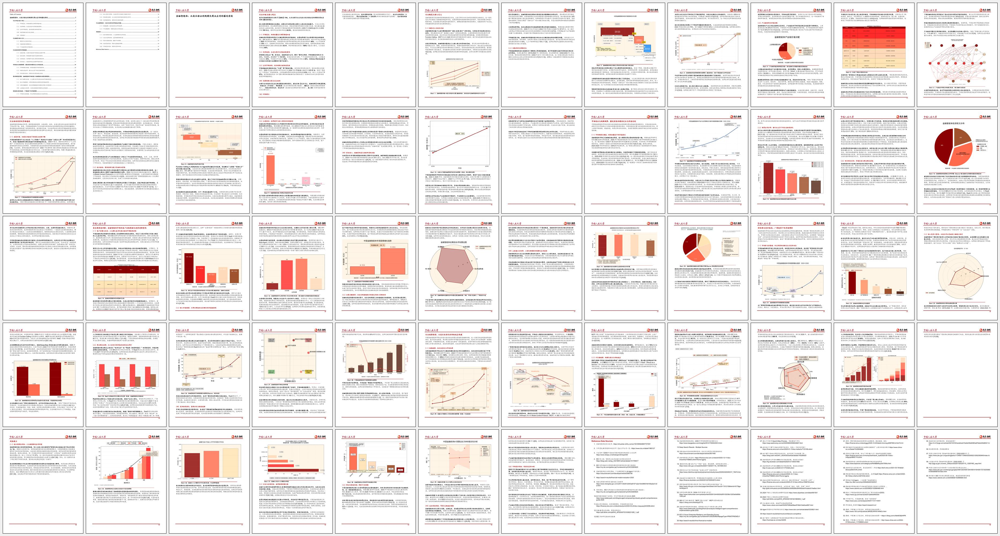

# Pharsight：基于 FinSight 的医药投研智能体

> [!IMPORTANT]
> **项目状态：V1 医药化主流程已实现，等待真实环境端到端验收。**Pharsight 是以 FinSight 提交 `8fc5bce28ac201c713219a47d30367c6a84342f4` 为基线、保留完整历史的独立 GPL-3.0 派生项目。当前已实现医药公司/行业双模式、Serper 联网发现与网页证据规范化、受控证据清单、医药提示词与报告大纲、截止日过滤及精确引用校验；尚未完成 Python 3.11 下的真实模型全流程、领域人工复核、官方数据连接器和图检索验收。

项目入口：[V1 最小闭环](docs/v1/README.md) · [项目管理](docs/PROJECT_MANAGEMENT.md) · [架构与证据规范](docs/ARCHITECTURE.md) · [上游 FinSight](https://github.com/RUC-NLPIR/FinSight)

## 项目目标与近期范围

Pharsight 面向两种中文研究模式：

- **A/H 股医药行业研究：**市场边界、政策支付、技术与管线、竞争格局、催化剂和风险。
- **A/H 股上市医药公司研究：**公司披露、财务、产品和适应症、临床及监管进度、竞争、估值假设和风险。

近期优先以最小改动跑通 FinSight 的 `DataCollector → DataAnalyzer → ReportGenerator` 主流程：DataCollector 默认用 Serper 发现公开网页并打开正文，成功抓取且满足截止时间的页面转成稳定 `WEB-*` 证据；也可叠加受控清单中的一手文件。随后完成医药分析和带精确来源编号的中文 Markdown 报告。首例仍应收窄为一家上市公司、一个核心药物和一个适应症。文档解析、Claim–Evidence 构图及 Graph/Hybrid 检索沿用同一证据契约继续演进。

每条重要结论必须区分来源事实、确定性计算、明确假设和模型判断，保留来源及日期、单位、口径和截止时间。Pharsight 仅辅助投资研究，不提供投资建议或医疗建议。

## 与 FinSight 的关系

FinSight 是面向通用金融深度研究的多智能体系统：采集结构化与网页数据、进行代码分析和图表生成、用视觉语言模型审查图表、最后生成报告。它采用共享变量内存及检查点，使长任务可恢复。Pharsight 将优先复用这条主干，隔离新增医药证据工具和生成规则，不修改同级只读的 `../FinSight` 检出。

| 上游部件 | 作用 | Pharsight V1 计划 |
| --- | --- | --- |
| Data Collector / Deep Search | 规划采集任务、调用结构化与网页工具 | 默认通过 Serper 联网发现并打开页面；搜索摘要不作为事实证据 |
| Memory 与检查点 | 存储工具结果、分析结果和执行状态 | 已增加双模式路由，并承载含来源编号的结构化证据 |
| Data Analyzer | 代码分析、文本结论、图表与 VLM 反馈 | 已增加医药分析提示词；无图模式不要求 VLM |
| Report Generator | 大纲、章节、排版及 DOCX/PDF | 已增加双模式中文大纲、Markdown 输出、精确引用和声明校验 |
| IndexBuilder / 原有引用处理 | 工具结果和报告来源的语义匹配 | 医药模式改走精确来源 ID；通用金融模式保留原兼容路径 |

上述能力已进入代码和自动化测试，但“实现”不等于“研究结论已验收”。真实模型、真实资料和 Python 3.11 环境仍须按项目管理文档完成端到端验证。上游源码及扩展说明见 [进阶使用指南](docs/ADVANCED_USAGE.md)。

## 当前路线图

| 阶段 | 重点 | 状态 |
| --- | --- | --- |
| M0 初始化 | 独立仓库、边界、架构和项目管理 | 已完成 |
| V1 医药化纵向切片 | 双模式、受控证据、三段式主流程、精确引用和 Markdown 报告 | 待审 |
| M1 可复现基线 | Python 3.11 环境、上游测试和无密钥冒烟路径 | 待办 |
| M2 医药证据工具 | 统一清单工具已实现；监管、试验、文献、医保/集采及披露连接器 | 进行中 |
| M3 双模式流程 | 行业与公司配置、提示词和模板已实现；受控案例待验收 | 进行中 |
| M4 领域分析 | 管线、竞争、财务估值、催化剂和风险 | 待办 |
| M5 评测演示 | 事实、引用、复现及 A/H/行业案例 | 待办 |

V1 横跨 M1～M3，以最小可验证切片优先，不代表这些完整里程碑已经完成。任务状态以 [项目管理文档](docs/PROJECT_MANAGEMENT.md) 为准。

## 运行 Pharsight V1

> [!WARNING]
> Python 3.11 是项目标准；当前改动只在本机 Python 3.12 上完成离线单元测试，尚未记录真实 Serper/模型端到端成功。真实调用会消耗 Serper 与模型额度。首次运行保持图表和 DOCX/PDF 关闭，只生成 Markdown，并确保网页及资料使用符合服务条款。

### 环境准备

- Python 3.11。
- Pandoc（可选）：仅在输出 DOCX/PDF 时需要；具体系统转换链可能另需本地软件。
- Node.js（可选）：仅在使用网页演示时需要。
- 主模型与 Serper 的合法访问凭据；联网抓取还需要 Crawl4AI 对应的浏览器运行环境。

在 `pharsight` 仓库根目录执行：

```bash
python -m venv .venv
python -m pip install -r requirements.txt
```

按照本机 Shell 激活 `.venv`。不要在同级只读 `FinSight` 下安装依赖或生成文件。Pandoc 的安装方法请参照其[官方文档](https://pandoc.org/installing.html)。

### 配置

将 `.env.example` 复制为被 Git 忽略的 `.env`，至少填写主 LLM 与 `SERPER_API_KEY`；不得提交真实凭据。当前联网 Markdown 路径不需要 VLM 或 Embedding。

```powershell
Copy-Item .env.example .env
```

将公司或行业示例复制到已被 Git 忽略的 `user_configs/`，再填写研究对象、截止时间、研究问题和证据清单路径：

```powershell
New-Item -ItemType Directory -Force user_configs
Copy-Item docs/example_configs/my_config_company.yaml user_configs/pharma_company.yaml
```

如需叠加本地一手资料，再复制并填写 `pharma_evidence_manifest.yaml`，把路径写入 `source_manifest`。

推荐的首次受控运行配置如下：

```yaml
target_name: "示例医药公司"
stock_code: "000001.SZ"
target_type: "pharma_company"  # 或 pharma_industry
as_of: "2026-09-21T23:59:59+08:00"
jurisdictions: ["中国"]
language: "zh"
source_manifest: null
live_web_search: true
search_provider: "serper"
live_web_search_in_analysis: false
live_web_search_in_report: false
enable_chart: false
output_formats: ["md"]
output_dir: "./outputs/pharma_company"
outline_template_path: "src/template/pharma_company_outline_zh.md"
```

Serper 只负责发现候选页面；必须实际打开并成功抓取正文后，页面才会生成稳定 `WEB-*` 来源编号。搜索结果摘要不能进入事实链。若使用本地清单，为每份资料分配 `S001` 类编号并填写完整元数据，规范见 [示例清单](docs/example_configs/pharma_evidence_manifest.yaml)。运行目录仍不得提交。

### 启动

从头执行医药化完整流程：

```bash
python run_report.py --config user_configs/pharma_company.yaml --no-resume
```

若中断后继续，可改用 `--resume`。医药模式会执行截止日过滤，并在报告落盘前检查 `[Source:S001]` 或 `[Source:WEB-…]` 引用；未知来源编号会使生成失败。默认只允许 DataCollector 联网，分析和报告阶段不能临时引入未经采集审计的网页。

上游网页演示（可选，分别启动）：

```bash
cd demo/backend
python app.py
```

```bash
cd demo/frontend
npm install
npm run dev
```

开发服务器地址通常为 `http://localhost:3000`。这些命令未构成 Pharsight 的已验证环境声明。

## 上游架构与功能参考

上游金融工具涵盖 A/H/美股的部分公司、行情和财报数据，国内外宏观指标、行业统计、搜索和页面抓取。功能覆盖和实时可用性取决于外部来源、服务条款和凭据，不应直接推断其适用于医药证据链。

```text
研究请求
  → Data Collector（工具与 Deep Search）
  → Memory（数据、任务映射、检查点）
  → Data Analyzer（分析与可选图表/VLM）
  → Report Generator（章节、引用、DOCX/PDF）
```

上游详细配置、提示词、报告大纲、图表、工具扩展和检查点说明已集中在 [进阶指南](docs/ADVANCED_USAGE.md)，避免 README 复制大量难以维护的代码片段。

## 上游演示与研究结果

上游 FinSight 的演示和报告样例供参考，**不是 Pharsight 医药成果**：

- [金融 AI 智能体行业报告样例](assets/examples/example_reports/Financial_Agent_Industry.pdf)
- [上游架构图](assets/examples/architecture.jpg)
- [演示视频](assets/examples/demo_compressed.mp4)
- [更多示例报告](assets/examples/example_reports/)



上游论文报告了与其他深度研究系统的对比结果；具体实验设置、数值及适用范围请阅读[原论文](https://arxiv.org/abs/2510.16844)。这些结果不代表 Pharsight 的医药事实准确率或引用质量。

## 贡献与许可

开发、测试、分支、文档和数据权限要求见 [贡献指南](CONTRIBUTING.md)。本派生项目保留上游历史、版权声明及 [GPL-3.0 许可证](LICENSE)。请勿依据上游 README 中可能不一致的许可证文字推断不同许可；以仓库 `LICENSE` 和实际版权通知为准。

引用上游研究成果时，可引用 FinSight 原论文：

```bibtex
@article{jin2025finsight,
  author  = {Jiajie Jin and Yuyao Zhang and Yimeng Xu and Hongjin Qian and Yutao Zhu and Zhicheng Dou},
  title   = {FinSight: Towards Real-World Financial Deep Research},
  journal = {CoRR},
  volume  = {abs/2510.16844},
  year    = {2025},
  url     = {https://doi.org/10.48550/arXiv.2510.16844}
}
```

感谢 FinSight 原作者与贡献者；Pharsight 的新增研究和实现应继续明确标注上游归属。
