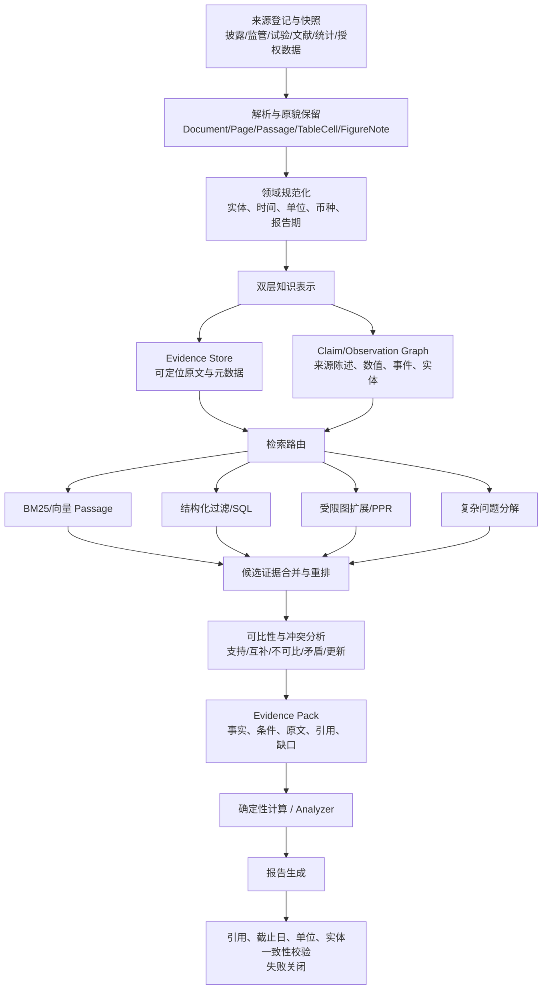

# 图增强 RAG 方法调研与 Pharsight 医药投研架构建议

> 调研日期：2026-10-07（Asia/Shanghai）  
> 文档状态：研究结论与拟议设计，不代表已实现或已通过验收  
> 研究模式：A/H 股医药行业研究、A/H 股上市医药公司研究  
> 输入边界：公开披露、监管与试验登记、同行评议文献、官方统计及获授权数据  
> 输出边界：可审计的检索结果、证据表、分析草稿和证券研究风格报告  
> 主要证据：论文、会议论文页与作者官方代码仓库；结果数字均按原论文口径转述  
> 责任角色建议：智能体与报告（架构）、数据与工具（证据管线）、领域研究（Schema 与标注）、质量与评测（Benchmark）  
> 依赖：稳定的页级 Passage 契约、精确引用校验、固定语料与问题集、实体别名库、人工证据金标准

## 1. 执行摘要

本文调研了 Youtu-GraphRAG、G-reasoner、HippoRAG、HippoRAG 2 和 ArbGraph，并结合 Pharsight 当前的 `DataCollector -> DataAnalyzer -> ReportGenerator` 主干、页级检索能力与 `meeting_02.md` 中的 Claim–Evidence 方案提出以下结论。

第一，五种方法解决的是不同环节的问题，不能用一个“谁最好”的单一排名替代架构选择：

| 方法 | 主要优化对象 | 最值得借鉴的能力 | 不宜直接照搬的部分 |
| --- | --- | --- | --- |
| Youtu-GraphRAG | 构图与检索协同 | Schema 约束、分层索引、查询分解、多路检索 | 自动扩展 Schema、社区摘要和智能体反思可能增加无依据语义及成本 |
| G-reasoner | 跨图结构的学习式检索/推理 | QuadGraph 统一接口、结构与文本联合节点预测 | 需要训练与部署 GFM；当前项目尚无足够领域标注证明收益 |
| HippoRAG | 单步多跳关联检索 | OpenIE 图、同义边、PPR 传播 | 无 Schema OpenIE 容易丢失条件；实体/关系方向在 PPR 中利用不足 |
| HippoRAG 2 | 关联检索兼顾上下文和简单事实 | Passage 节点、query-to-triple、LLM 识别过滤、PPR | 仍依赖 OpenIE 与大模型离线构图；“召回相关”不等于“证据可信” |
| ArbGraph | 长文生成前的证据冲突处理 | 原子主张、支持/矛盾图、先仲裁后生成 | 自动选“赢家”不适合直接取代医药证据分级、口径对齐和人工复核 |

第二，Pharsight 不应建设“纯 GraphRAG”，而应建设**以 Passage 为证据底座、Claim/Observation 为结构化索引、图用于发现关联、规则用于口径与截止日控制、生成前执行证据门控的混合 RAG**。图的职责是提高发现和组织能力，原文 Passage 才是引用与审计依据。

第三，`meeting_02.md` 的主方向是正确的：它已经识别出 Youtu 三元组压缩导致条件丢失、社区摘要新增语义、长 chunk 掩盖图贡献等关键问题，并提出 Document → Passage → Claim → Entity 的可追溯链路。需要修改的核心不是继续增加节点类型，而是：

1. 将“来源陈述”和“项目认可事实”分开，Claim 只表示某来源说了什么；
2. 将数值型结果提升为可校验的结构化 Observation/Measurement，而不是塞进自由文本字段；
3. 把“冲突”改为先判定可比性，再区分一致、互补、不可比、矛盾、更新/取代；
4. 把检索架构从单一 Graph Retrieval 改成查询路由后的 Chunk、结构化过滤、PPR/图扩展、冲突仲裁四条可组合路径；
5. 把“更好的图表示”与“更好的检索/回答”分别设立金标准、消融实验和发布门槛。

建议近期只实现不训练的 V1：BM25/向量 Passage 基线 + 类型化 Claim/Observation + 受限 1–2 跳图扩展 + 证据包组装 + 精确引用与冲突披露。HippoRAG 2 式 PPR、Youtu 式查询分解和 ArbGraph 式冲突图按评测结果逐项加入；G-reasoner 式 GFM 仅在积累足够训练数据并确认启发式检索成为瓶颈后再立项。

## 2. 调研口径与共同分析框架

### 2.1 名称与版本

- 用户所称 `youtu-graphRAG` 在本文统一写作 **Youtu-GraphRAG**。
- 用户所称 `G-reseoner` 按论文正式名称更正为 **G-reasoner**。
- HippoRAG 与 HippoRAG 2 分别指 NeurIPS 2024 论文和 ICML 2025 论文中的方法。
- ArbGraph 指 2026 年 4 月提交的 arXiv 预印本；截至本次调研，它不应被表述为已通过同行评议的会议论文。

### 2.2 评价维度

本文将每种方法拆成六个维度：

1. **知识单元**：Passage、实体三元组、属性、社区还是原子 Claim；
2. **构图方式**：开放抽取、Schema 约束、固定图接口或按查询临时构图；
3. **检索/推理方式**：向量、图遍历、PPR、GNN、智能体分解或证据仲裁；
4. **生成输入**：原文、三元组、节点预测、社区摘要或通过仲裁的 Claim；
5. **论文证据**：数据集、主要指标、消融和作者承认的限制；
6. **对医药投研的适配性**：是否保留来源、时间、适应症、剂量、终点、单位、统计口径和不确定性。

需要特别强调：通用多跳问答上的 EM/F1 或模型裁判准确率，不能直接外推为医药投研中的事实正确率、引用支持率或投资结论质量。

## 3. 五种方法的论文总结与归纳

### 3.1 Youtu-GraphRAG

#### 3.1.1 论文定位与问题

Youtu-GraphRAG 的出发点是：已有 GraphRAG 往往只优化构图或只优化检索，二者接口松散，在领域迁移时容易出现图里有但检索器不会用、检索器需要但图没有表达的问题。它使用同一份 Graph Schema 同时约束构图智能体和检索智能体，试图实现“纵向统一”。论文为 ICLR 2026 论文，arXiv 版本为 2508.19855。

#### 3.1.2 方法结构

**一是 Schema-bounded extraction。** Schema 包括实体类型、关系类型和属性类型。LLM 只抽取落在 Schema 约束空间内的实体—关系三元组与实体—属性记录，以减少开放抽取噪声。面对新领域时，智能体可以提出 Schema 增量，并用置信阈值控制是否接纳。

**二是双感知社区发现。** 方法把局部结构连接和语义相似度结合起来：先基于实体/三元组表示做初始聚类，再用拓扑关系重叠与子图语义相似的联合分数选择中心并迭代合并社区。随后用 LLM 为社区生成名称和描述。

**三是四层 Knowledge Tree。** 从细到粗依次组织为 Attribute、Entity–Relation Triple、Keyword、Community。叶层保留细粒度事实，上层承担主题过滤和全局摘要。

**四是 Schema-aware agentic retriever。** 检索器将复杂问题分成与 Schema 对齐的并行子问题，并在四类路径间选择：实体匹配、三元组匹配、社区过滤和最大深度受限的 DFS。智能体保留历史检索结果，执行迭代推理和反思。

**五是匿名化评测。** 论文设置 reject/open 两种生成模式，并构造 AnonyRAG/Anonymity Reversion 任务，以降低模型依靠参数知识而非检索证据答题造成的评测污染。

#### 3.1.3 实验结论

论文在 HotpotQA、2Wiki、MuSiQue、GraphRAG-Bench 与中英文匿名数据等六个集合上报告 top-20 准确率，并使用 DeepSeek-V3-0324 和 Qwen3-32B 两种生成骨干。在论文设置下，完整方法通常优于 Naive RAG、RAPTOR、GraphRAG、LightRAG、HippoRAG 1/2 等基线；例如 DeepSeek 骨干的 reject 模式下，HotpotQA、2Wiki、MuSiQue 分别报告 81.2、77.6、47.5。论文还报告最高 90.71% 的 token 节省和最高 16.62% 的准确率提升。

这些是作者在其数据、构图配置、模型裁判和 top-20 口径下的结果，不等同于 Pharsight 的领域效果。特别是，论文主要评估答案正确性和构图成本，没有证明自动抽取的每一条关系均忠实于原文，也没有把医药中的数值—条件绑定作为核心指标。

#### 3.1.4 优点、限制与项目启示

优点：

- Schema 同时服务抽取与查询分解，接口一致性强；
- 层次索引适合“行业全景—公司—产品—试验—结果”这种不同粒度问题；
- reject 模式和匿名数据提醒项目区分“模型会回答”与“检索真的找到证据”；
- 官方代码已可运行，便于作为实验基线。

限制与风险：

- 自动 Schema 扩展可能引入未经领域审批的关系；
- Community/Keyword/`member_of` 等组织边可能在小语料中占据大量图容量，却不直接提供可引用事实；
- 社区名称与摘要由 LLM 生成，可能把比较、共现误写成联合、隶属或因果；
- 属性文本仍可能压缩掉剂量、治疗时长、estimand、校正方式和推测性质；
- agentic decomposition 与迭代反思增加在线成本和不可复现性；
- 官方软件许可证限定为学术用途，禁止商业或生产用途；Pharsight 当前是高校研究项目可开展实验，但未来外部使用前必须重新审查许可。

对 Pharsight 的适用方式：保留其 **Schema 对齐的查询分解** 和 **多粒度索引** 思想，但把社区摘要降为候选导航信息，不允许直接作为事实证据；Schema 更新必须经过版本化评审；返回结果必须最终落回可定位 Passage。

### 3.2 G-reasoner

#### 3.2.1 论文定位与问题

G-reasoner 认为不同 GraphRAG 使用知识图、文档图、层次图等各自定制的结构与启发式检索器，难以跨图泛化。它提出统一图接口 QuadGraph，并训练一个 34M 参数的图基础模型（GFM）在多种图上预测与查询相关的节点，再将预测出的文档、实体等交给 LLM。论文已被 ICLR 2026 接收，arXiv 版本为 2509.24276v4。

#### 3.2.2 QuadGraph 与模型

QuadGraph 包含四层：

1. **Attribute layer**：节点的共同属性；
2. **Knowledge graph layer**：实体与关系三元组；
3. **Document layer**：文档和 Passage 等原始文本；
4. **Community layer**：按语义或结构连接形成的群组，提供全局信息。

这种统一接口不是规定一种唯一构图算法，而是把 HippoRAG 风格知识图、文档图和层次社区图映射到共同节点/边空间。

GFM 使用预训练文本编码器初始化节点与关系表示，以 query-dependent GNN 进行消息传递。查询相关节点被查询向量调制；多层传播后，针对不同节点类型使用类型专属预测头，输出实体相关性、文档相关性等“versatile predictions”。训练目标包含正节点监督和文本编码器伪标签分布的 KL 蒸馏，以弱监督缓解标注稀缺。工程上使用混合精度、分布式消息传递与多 GPU 扩展。

最终 LLM 不直接读取整个图，而是读取 GFM 预测出的支持文档、实体等结构化检索结果并生成答案。

#### 3.2.3 实验结论

论文在 HotpotQA、MuSiQue、2Wiki 和 GraphRAG-Bench 的 Novel、Medical、CS 子集上评估。在其主要表格中，G-reasoner 在多项 passage recall 和 QA 指标上优于对比方法；例如一组结果中，其三个通用多跳集合的检索/问答指标为 85.9/97.7、54.8/74.9、81.2/98.2，并在 Medical 子集报告 87.7/93.8。论文还展示同一个模型可作用于由 HippoRAG、LightRAG 等不同构造器形成的图。

应谨慎解读“Medical”：GraphRAG-Bench Medical 是领域问答基准，不等于 A/H 股医药投研，也不自动覆盖临床终点、监管时间、财务口径和证券引用审计。

#### 3.2.4 优点、限制与项目启示

优点：

- QuadGraph 给出了容纳 Passage、实体图、属性和社区的统一数据接口；
- 结构与文本联合打分比固定 PPR 更能学习“哪些边/节点对某类问题重要”；
- 节点类型专属预测头能同时服务实体召回和文档召回；
- 适合作为启发式检索达到瓶颈后的学习式 reranker。

作者明确列出的限制包括：仅处理文本图；GFM 与 LLM 仍是分离模块；主要聚焦 QA 而非规划等其他任务。对 Pharsight 还存在额外工程约束：

- 需要构造训练 query–graph–positive node 样本并部署 GNN；
- 模型学到的是基准相关性，不天然等于来源权威性、时间有效性或引用支持性；
- 图抽取错误会变成模型输入，GFM 不能替代证据忠实度校验；
- 官方模型页当前要求 Python 3.12 和 CUDA 12+，与 Pharsight 的 Python 3.11 标准不一致，不能未经隔离验证直接成为项目依赖；
- 当前项目数据规模、领域标注和 MLOps 基础不足以证明训练 34M GFM 的投入优于简单可审计检索。

对 Pharsight 的适用方式：近期只借鉴 QuadGraph 的**统一接口思想**，不要在 V1 引入 GFM。待形成至少数百个冻结问题、节点级相关性标注和稳定图快照后，再将 G-reasoner 作为 learned retriever/reranker 的实验分支，与 BM25、向量、PPR 和规则扩展在相同证据预算下比较。

### 3.3 HippoRAG

#### 3.3.1 论文定位与认知类比

HippoRAG 将 LLM 比作新皮层，将知识图与 Personalized PageRank（PPR）比作海马索引，将检索编码器比作连接二者的海马旁区域。目标是把新文档持续加入非参数记忆，并用一次图传播完成多跳关联召回。论文发表于 NeurIPS 2024，arXiv 版本为 2405.14831v3。

#### 3.3.2 离线索引

1. 对每个 Passage 用指令 LLM 做无 Schema 的 OpenIE；
2. 先识别命名实体，再抽取包含更多名词短语的三元组；
3. 将名词短语作为节点、OpenIE 关系作为边；
4. 用检索编码器计算节点相似度，高于阈值时添加同义边；
5. 保存短语节点与原 Passage 的出现矩阵，用于把节点得分聚合回文档。

#### 3.3.3 在线检索

1. 用 LLM 从查询中抽取命名实体；
2. 通过向量相似度把查询实体链接到图节点；
3. 以这些节点为 PPR restart seeds；
4. PPR 将概率传播到关联邻域；
5. 把节点概率按 Passage 聚合并排序，返回原始 Passage 给生成器。

因此，HippoRAG 的关键不是让 LLM“沿图逐步思考”，而是用 PPR 在一次检索中完成关联扩散，再把结果回收到文本证据。

#### 3.3.4 实验结论

论文在 MuSiQue、2WikiMultiHopQA 和 HotpotQA 的 1,000 问题开发集上评估。作者报告 HippoRAG 相比若干标准 RAG 在 MuSiQue 和 2Wiki 上分别有约 3 和 20 个点的提升；在线阶段相对 IRCoT 便宜 10–30 倍、快 6–13 倍。与 IRCoT 组合还能进一步提高多步检索召回。

论文也说明优势更明显地出现在 path-following 多跳问题；对需要发现未知路径的 path-finding 问题只是展示潜力，不应概括为已完全解决。

#### 3.3.5 优点、限制与项目启示

优点：

- 图搜索在线成本低、过程确定性较强；
- 同义边和 PPR 适合跨文档别名与关联发现；
- 最终返回 Passage，天然比只返回三元组更适合引用；
- 新文档可通过更新外部索引加入，不改模型参数。

作者指出主要错误来自 NER 和 OpenIE，其余错误来自图搜索；PPR 没有充分利用关系方向和语义。对医药投研的关键风险是：

- 无 Schema OpenIE 容易把适应症、剂量、组别、终点、时间点与数值拆散；
- 相似度同义边可能错误合并商品名、成分名、项目代号或相近适应症；
- PPR 的高连通节点会获得结构性优势，热门公司/药物可能挤压长尾证据；
- 召回相关 Passage 不代表辨别了一手/二手来源、截止日或冲突；
- 原始方法以查询实体为入口，对完整句意和条件敏感度不足。

对 Pharsight 的适用方式：PPR 可作为**候选发现器**，但种子应来自实体、Claim、Observation 和 Passage 的混合命中；边应分类型、设权重和时间/来源过滤；PPR 结果必须经过证据门控与 Passage 回溯。

### 3.4 HippoRAG 2

#### 3.4.1 相对 HippoRAG 的改进目标

HippoRAG 2 发现结构增强 RAG 虽擅长多跳关联，却常在简单事实检索和长文 sense-making 上退化。其目标是同时覆盖三类“记忆”：事实记忆、关联记忆与 sense-making。论文发表于 ICML 2025，正式题名为 *From RAG to Memory: Non-Parametric Continual Learning for Large Language Models*。

#### 3.4.2 三项关键改动

**Dense–Sparse Integration。** 除短语节点外，把每个原始 Passage 也作为图节点，并用 `contains` 边连接到从该 Passage 抽出的短语。这样原文上下文直接参与图传播，不再只在图搜索后做分数拼接。

**Deeper Contextualization。** 查询不再只做 NER-to-node；论文比较了 NER-to-node、query-to-node 和 query-to-triple，最终使用完整查询到三元组的语义匹配，使关系和上下文也参与确定图种子。

**Recognition Memory。** 用编码器先召回 top-k triples，再让在线 LLM 过滤与问题无关的三元组。通过的短语节点与所有 Passage 节点共同获得 PPR restart probability；若没有合格三元组，则回退为向量 Passage 检索。

这使 HippoRAG 2 成为“密集 Passage 检索 + 稀疏概念图传播”的混合系统，而不只是知识图检索器。

#### 3.4.3 实验与消融

论文覆盖 NQ、PopQA、MuSiQue、2Wiki、HotpotQA、LV-Eval 和 NarrativeQA。使用 Llama-3.3-70B 作为 QA reader 时，作者报告 HippoRAG 2 获得最高平均 F1；相对 NV-Embed-v2，在 2Wiki 上提高 9.5 F1，在 LV-Eval 上提高 3.1 F1。

消融对本项目很有启发：三个多跳集合的平均 Recall@5 为 87.1；改回 NER-to-node 降至 74.6，query-to-node 为 59.6，移除 Passage 节点降至 81.0，移除 LLM filter 降至 86.4。这表明在该实验中，query-to-triple 和 Passage 节点的贡献明显大于在线过滤器的平均贡献。

#### 3.4.4 优点、限制与项目启示

优点：

- 同时保留概念关联与完整上下文，直接回应 `meeting_02.md` 中“chunk 承担大量证据”的观察；
- query-to-triple 比只抽查询实体更能保留问题中的关系与条件；
- PPR 后仍返回 Passage，便于引用和二次阅读；
- 没有图种子时可回退向量检索，降低简单事实题退化。

限制与风险：

- 底层仍是无 Schema OpenIE，结构忠实度问题并未消失；
- 在线 LLM filter 引入成本和漏召回风险，论文消融显示其平均增益相对较小；
- PPR 传播没有原生表达医药口径可比性、来源等级和事件时间；
- 离线索引需要大量 LLM 抽取和大 embedding 模型，明显重于普通 RAG；
- 基准答案正确性不等于 Claim–Evidence 支持关系正确性。

对 Pharsight 的适用方式：这是五种方法中最适合作为**检索骨架参考**的方案，但要把 schemaless phrase graph 替换为领域受控的 Entity/Claim/Observation 图；保留 Passage 节点与向量回退；先用无训练 PPR 做可审计实验。

### 3.5 ArbGraph

#### 3.5.1 论文定位

ArbGraph 不主要解决“如何从全库找到更多材料”，而解决“检索后已有的材料彼此噪声、重复或矛盾时，如何在长文生成前形成可靠证据集”。它提出 **arbitrate first, generate later**：把冲突处理从生成过程剥离出来。论文为 2026 年 4 月 arXiv 预印本 2604.18362。

#### 3.5.2 方法流程

**原子化与规范化。** 对查询召回的文档用 LLM 拆成单一、可独立核验的 Claim；例如“成立于某年且总部位于某地”拆为两条。随后做语义对齐和近重复合并。

**Query-aware filtering。** 查询和 Claim 编码到同一空间，仅保留相似度高于阈值的 Claim，先控制节点数量。

**Evidence Graph。** Claim 是节点；边只有 Support 和 Contradiction。为避免所有 Claim 两两验证的二次复杂度，先用语义相似阈值挖候选对，再用 verifier 模型判定 Support/Contradiction/Neutral，并只保留高置信边；每个节点的支持边数设置上限。

**迭代可信度仲裁。** 节点有初始可信度。每轮优先处理“双方当前可信度都高且分差小”的高强度矛盾。LLM arbitrator 读取冲突对及两侧支持邻域，若证据足够则给出 winner/loser 并对双方 logit 对称增减；若不足则 gate 拒绝更新。最终只把超过接受阈值的 Claim 交给长文生成。

#### 3.5.3 实验结论

论文在 LongFact 与扩展到长文场景的 RAGChecker 上，用 Qwen3-4B-Instruct 和 Llama-3.1-8B 两个骨干评估。作者报告：Qwen3-4B 下 Fact Recall 从强基线 79.2 提高到 83.3，Information Density 从 177.2 提高到 187.6；RAGChecker 中 Qwen 骨干的 faithfulness 为 53.8、hallucination rate 为 33.3，相关与无关噪声敏感度分别为 4.2 和 4.9。消融中移除 Evidence Graph 后 Fact Recall 从 83.3 降至 66.1。

论文还对 200 个 Claim pair 和 50 个仲裁案例做人工小样本检查，并报告约 4% 的局部验证错误与 96% 的仲裁准确率。这些数字样本较小，且结果依赖其自动 Claim、verifier、初始可信度和通用网页语料设置。

#### 3.5.4 优点、限制与项目启示

优点：

- 将生成前证据治理变成显式阶段，符合证券研究“先核证、后落笔”；
- 原子 Claim 便于定位数值、日期等局部冲突；
- Support/Contradiction 邻域提供了比独立分数更好的多来源聚合；
- gating 比强制二选一更适合证据不足情形。

限制与风险：

- Claim 原子化、关系验证和仲裁均可由模型出错，且增加延迟；
- 语义相似不等于可比，两个临床数值相近也可能来自不同人群、时间点或 estimand；
- “支持边多”不一定更可信，大量二手转载可能只是同一原始来源的相关副本；
- 医药监管状态和公司指引常随时间更新，旧新记录可能是 supersession 而非 contradiction；
- 自动选 winner 可能掩盖真实不确定性；投研报告往往应并列展示来源差异，由分析师判断；
- 论文自己承认可靠性提升伴随额外的 claim extraction、verification 和 iterative arbitration 成本。

对 Pharsight 的适用方式：采纳**生成前证据图与 gate**，但将自动“胜负仲裁”改成分级策略：确定性口径规则可自动判定；来源优先级与时间更新可给出建议；重大冲突默认并列披露并进入人工复核队列。

### 3.6 横向归纳

| 维度 | Youtu | G-reasoner | HippoRAG | HippoRAG 2 | ArbGraph |
| --- | --- | --- | --- | --- | --- |
| 图是何时构建 | 离线全库 | 离线全库并训练 | 离线全库 | 离线全库 | 检索后按查询临时构建证据图 |
| 核心节点 | 实体、属性、关键词、社区 | 属性、实体、文档、社区 | 名词短语 | 名词短语、Passage | 原子 Claim |
| 核心检索 | agent + 多路图检索 | query-dependent GNN | PPR | dense seeds + PPR + LLM filter | 非全库检索；对已召回 Claim 仲裁 |
| 保留原文 | 返回 chunk，但图核心偏三元组 | Document layer | 最终回聚 Passage | Passage 是图节点 | Claim 来自检索文档，需自行保留定位 |
| 多跳关联 | 强 | 强，且可学习 | 强 | 强 | 不是主要目标 |
| 冲突处理 | 无专门机制 | 无专门机制 | 无 | 无 | 核心能力 |
| 可解释性 | 子查询与路径 | 节点预测/路径可分析 | PPR 节点传播 | seed、PPR、Passage | Claim 边与仲裁记录 |
| 本项目近期适用性 | 中：借查询分解 | 低：暂不训练 | 中：借 PPR | 高：借检索骨架 | 高：借证据门控 |

共同缺口是：五种方法都没有直接给出面向 A/H 股医药投研的完整来源治理、截止日、财务单位、临床可比性、监管状态更新和证券报告引用规范。这部分必须由 Pharsight 自己设计。

## 4. 面向医药行业投研的 RAG 设计

### 4.1 设计目标

系统需要同时支持两类任务：

- **行业模式**：政策/支付、市场规模、产业链、竞争格局、技术路线、交易与融资、催化剂和风险；
- **公司模式**：公司披露、财务质量、产品与管线、试验、监管/支付、商业化、同业比较、估值假设、催化剂和风险。

对每条材料，系统必须保存来源身份、发布日期、检索时间、报告期、单位/币种、转换说明和适用截止时间；对每条输出，必须区分来源事实、确定性计算、明确假设和模型判断。

架构的首要目标不是“多回答”，而是：

1. 必要证据能召回；
2. 数值与完整条件不被错配；
3. 引用可以回到页码、表格/图注或稳定记录；
4. 冲突和缺口不会被生成模型悄悄抹平；
5. 信息截止日之后的内容不会污染回测；
6. 图路径、计算和报告之间的 evidence ID 不丢失。

### 4.2 推荐总体架构



这是一套“Evidence-first Hybrid RAG”，不是把所有信息都压成知识图。Evidence Store 是事实审计底座；Claim/Observation Graph 是索引与关系投影；向量、图、SQL 都是可替换检索投影。

### 4.3 数据与证据分层

#### 4.3.1 Source 与 Document

建议明确区分：

- `SourceRecord`：发布主体、来源等级、URL/稳定 ID、许可、独立性组、获取方式；
- `Document`：某个具体版本的公告、年报、登记页、论文或统计表，含哈希与发布时间；
- `DocumentVersion`：同一登记页或网页在不同检索时间的快照，禁止覆盖历史。

`source_tier` 只能影响排序和审查策略，不能把权威来源自动变成正确结论。还需有 `origin_group_id` 标记转引关系，避免十篇转载被当成十个独立支持来源。

#### 4.3.2 Passage 与布局单元

保留当前稳定页级 Passage 边界，并增加可选的 `TableCell`、`TableRow`、`FigureCaption`、`Footnote`。正文、表格标题、单位、脚注必须能通过 `layout_context_ids` 联合返回；否则表格数值不应自动生成事实。

#### 4.3.3 Claim、Observation 与 Event

建议把 `meeting_02.md` 的通用 Claim 拆为三个互补单元：

| 单元 | 用途 | 示例 |
| --- | --- | --- |
| `Claim` | 来源表达的命题、预测或评价 | “公司预计该产品年底获批” |
| `Observation` | 带口径的测量/结果 | 某试验 15 mg、48 周、某 estimand 下减重约 18% |
| `Event` | 带事件时间的状态变化 | CDE 受理、试验达到主要终点、授权交易签署 |

每条记录都必须链接 `evidence_ids`。Observation 至少含：subject、metric、value、unit、population、intervention、comparator、dose/regimen、timepoint、estimand/analysis set、adjustment、region、as_of、uncertainty 和 raw expression。未说明字段保持空值，不从邻句自动复制。

Claim 的 `epistemic_status` 建议包含 `asserted/reported/estimated/forecast/opinion/hypothesis/unknown`，另设 `polarity` 和 `modality`，防止“预计”“可能”“未达到”在抽取中消失。

#### 4.3.4 Entity

实体至少覆盖 Company、Security、Drug、Program、Target、Modality、Indication、Trial、Endpoint、Regulator、Policy、MarketSegment、Geography。公司与证券分开，药物成分、商品名和研发项目分开，Trial 必须优先绑定登记号；无法消歧时使用临时 ID 并禁止跨文档自动合并。

#### 4.3.5 Derived Fact 与 Calculation

建议不要把项目计算结果伪装成来源 Claim。设置独立 `DerivedFact`/`Calculation`：保存输入 evidence IDs、公式版本、单位转换、币种/汇率、执行代码哈希和结果。市场规模、同比、毛利率、估值倍数、风险调整 NPV 等均通过该层进入报告。

### 4.4 图关系与可信度边界

关系分四类：

1. **来源确定性关系**：Document `contains` Passage，Passage `expresses` Claim/Observation；
2. **抽取关系**：Claim `has_subject` Entity，Observation `in_trial` Trial；带抽取器版本与审核状态；
3. **领域事实投影**：Drug `targets` Target、Company `develops` Program；必须能回到支持 Claim；
4. **分析关系**：`supports`、`contradicts`、`supersedes`、`comparable_with`；由可比性规则或审核流程产生。

不要让 community membership、同段共现或 embedding similarity 直接产生 `developed_by`、`sponsored_by`、`compares_with` 等事实关系。

图中每条非组织性边至少要有：`supporting_claim_ids`、`evidence_ids`、`valid_from/to`、`as_of`、`review_status`、`extractor/rule_version`。如果某图数据库不方便存复杂证据，图只保存 ID，权威记录仍保存在关系/文档存储中。

### 4.5 查询理解与检索路由

首先用确定性分类器/轻量 LLM 将问题标注为：

- 事实定位；
- 实体关系/多跳；
- 数值比较；
- 时间线/状态更新；
- 冲突与差异；
- 行业主题综述；
- 估值/计算；
- 证据不足或边界判断。

随后选择路径：

| 问题类型 | 主路径 | 辅助路径 |
| --- | --- | --- |
| 精确事实 | 结构化过滤 + BM25/向量 Passage | 实体别名扩展 |
| 多跳关系 | Entity/Claim seeds + 1–2 跳或 PPR | Passage rerank |
| 临床数值比较 | Observation 结构过滤 | 脚注/正文 Passage 补全 |
| 时间线 | Event 按 event_time 排序 | 文档版本与 supersedes |
| 冲突 | 同主题 Claim/Observation 聚合 | 可比性规则 + ArbGraph 式证据图 |
| 行业综述 | 主题/社区导航 | 多源 Passage，禁止只用社区摘要 |
| 估值/计算 | 取数后调用确定性计算 | 报告仅引用输入与公式 |

对复杂问题，可借鉴 Youtu 做 2–5 个 Schema 对齐子查询，但子查询计划、检索结果和停止条件必须写入 trace；简单问题不启动 agentic loop。

### 4.6 候选合并、重排与证据预算

建议将相关性与可信度分开：

```text
retrieval_score = lexical + dense + graph + structured_match
evidence_gate   = cutoff + provenance + location + review + comparability
presentation_rank = retrieval_score + source_priority + recency_fit + diversity - redundancy
```

来源优先级不能直接乘进“事实真值”，而应用于候选排序和冲突升级。证据包按问题预留 token 配额：结论级 Claim/Observation、必要原文、表格/脚注、冲突材料和反例各自有上限；同一原始来源的转载去重。

### 4.7 冲突、更新与仲裁

对任意两个候选先判断：

1. 实体是否相同；
2. 适应症、地区、人群、治疗方案、时间点、终点、分析集、单位/币种是否对齐；
3. 发布时间与事件时间是否表示新旧状态；
4. 是否来自同一原始研究/披露的转引。

再将关系标为：

- `equivalent`：同一事实的等价表达；
- `supports`：独立且一致的支持；
- `supplements`：不同字段互补；
- `incomparable`：口径不同，禁止直接比较；
- `contradicts`：可比口径下结论不一致；
- `supersedes`：新版本明确更新旧版本；
- `derived_from_same_origin`：非独立证据。

自动仲裁只允许在规则充分时执行，例如单位换算、文档版本更新、截止日过滤。临床、监管和财务重大冲突默认不选唯一赢家，而是生成差异表、来源等级和待复核原因。这里采纳 ArbGraph 的 evidence graph 与 gating，拒绝无条件的 winner-takes-all。

### 4.8 生成与校验

生成器只接收 `EvidencePack`，不直接访问图数据库。每条事实带允许引用的 `source_id/evidence_id`；模型不能自行生成 URL 或改写 ID。

发布前至少运行：

- 未知引用、引用定位、引用覆盖率校验；
- `as_of` 与发布/事件时间校验；
- 数字—单位—币种—报告期绑定校验；
- 公司/药物/试验实体一致性校验；
- 事实、计算、假设、模型判断标签校验；
- 比较题的多来源与可比性校验；
- 风险与非医疗建议声明校验。

重大事实引用覆盖率目标为 100%。结构校验通过只说明格式与链路有效，语义支持仍需人工抽检或独立 verifier。

### 4.9 与 FinSight 主干的集成

保持现有主干：

```text
DataCollector
  -> EvidenceBackend / PharmaEvidenceSearchTool
  -> Memory 中的 EvidencePack
DataAnalyzer
  -> 结构化比较、确定性计算、证据缺口
ReportGenerator
  -> 仅使用已批准证据 ID
Validation
  -> 失败关闭
```

图数据库、PPR、向量库或未来 GFM 都封装在 `EvidenceBackend` 后。生成提示词不认识 Cypher、PageRank 或社区节点，从而保证 Chunk/Graph/Hybrid 可在同一接口下切换和对照。

### 4.10 分阶段路线

#### V1：证据忠实与可审计混合检索

- Passage BM25/向量基线；
- Entity + Claim + Observation + Event 最小 Schema；
- 受限 1–2 跳图扩展；
- 结构化过滤、证据包与精确引用；
- 冲突只识别和披露，不自动决胜；
- 同一语料下与全文直接问答、Chunk RAG、Youtu 做对照。

#### V1.5：关联检索与查询分解

- 加入 HippoRAG 2 式 Passage 节点与 query-to-triple seeds；
- 评测 PPR、普通图扩展和向量 rerank；
- 复杂问题启用 Youtu 式 Schema 对齐子查询；
- 行业全景问题试验社区导航，但摘要不作证据。

#### V2：冲突图与学习式检索

- 加入 ArbGraph 式临时 Evidence Graph、support/contradiction verifier 与 gate；
- 积累人工可比性与节点相关性标注；
- 只有启发式方法稳定且成为瓶颈后，才评估 G-reasoner/GFM reranker；
- 任何训练模型均需跨公司、跨细分行业、跨时间快照验证。

## 5. 对 `meeting_02.md` 架构的分析

### 5.1 已做得好的部分

#### 5.1.1 正确分离了表示、检索和答案

文档明确指出“合理答案不能单独证明图表示忠实”，并按 PDF 解析、构图、检索、prompt 组装和生成定位错误。这是后续实验最重要的因果分解，应保留。

#### 5.1.2 用真实失败揭示条件丢失

对 `48周、22.5%、疗效估计目标、安慰剂校正后`、`非头对头` 和 `推测值` 的逐项检查，比泛泛讨论 hallucination 更接近医药证据要求。新增语义与丢失条件被分开记录，也是正确的错误分类。

#### 5.1.3 识别了“图可能只是导航，答案主要来自 chunk”

Pilot 2 中 N1/N2 返回大范围原文，当前实验无法隔离图的独立贡献。文档没有把成功问答直接宣传为 GraphRAG 优势，这一结论严谨，应成为后续实验设计的前提。

#### 5.1.4 Document → Passage → Claim → Entity 主线合理

它把来源陈述与实体关系分开，允许一条 Claim 引用多个证据、同一实体连接多个 Claim，并提出结构审核与语义审核分层。整体上比“实体—属性”图更适合可审计投研。

#### 5.1.5 对跨来源冲突保持克制

文档强调先对齐试验、人群、组别、剂量、终点、时间点和统计口径，再判断冲突；新来源不自动覆盖旧来源。这与医药证据治理一致。

### 5.2 主要不足

#### 5.2.1 Claim 仍承担过多异质信息

当前 Claim 同时覆盖临床结果、比较、事件、预测、评价和关系陈述。对自由文本检索足够，但难以确定性校验数值归属和时间语义。尤其 PICO + result 作为嵌套字段时，后续 SQL/图过滤、单位换算和可比性规则会复杂。

**建议：**保留 Claim 作为来源命题，同时新增 Observation 和 Event 两类一等记录；Claim 可以引用 Observation/Event，但不要把所有数值和状态都塞进 Claim 文本。

#### 5.2.2 缺少 SourceRecord、版本与来源独立性

Document 有发布者和日期，但未充分表达来源等级、许可、同源转载、文档版本和检索快照。医药投研的“多来源支持”不能只按不同 URL 计数。

**建议：**增加 `SourceRecord`、`DocumentVersion`、`origin_group_id`、`source_tier` 和 `license_note`；来源权威性用于排序与复核，不直接等同 Claim 真值。

#### 5.2.3 关系设计混合了证据事实、抽取结果和派生索引

`Passage expresses Claim`、`Claim has_intervention Drug`、`Company develops Drug` 的证据性质不同。如果都以普通边呈现，容易把抽取候选当成确认事实。

**建议：**给关系分层并强制携带 `review_status`、`supporting_claim_ids` 和规则/抽取器版本。实体事实投影只能由合格 Claim 派生。

#### 5.2.4 Evidence 只是 Claim 内记录，生命周期不够清晰

内嵌 Evidence 适合小样例，但多段共同支持、表格+脚注联合证据、引用去重和审核时会出现重复与更新困难。

**建议：**逻辑上将 Evidence 设为独立记录（不一定是图库节点），含 evidence_id、passage_id、quote/offset、role、support_scope 和 review_status；图中只保存引用 ID。

#### 5.2.5 冲突边仍偏二元

`contradicts` 与 `supersedes` 是必要但不够。实际最常见问题可能是不可比、互补或同源转引。若直接用 ArbGraph 式 Support/Contradiction 二分，会误判临床口径差异。

**建议：**采用 equivalent/supports/supplements/incomparable/contradicts/supersedes/same-origin 七类关系，并把 comparability 作为建立矛盾边的前置门槛。

#### 5.2.6 检索设计还不够明确

现文档提出“Graph Retrieval”，但没有定义不同问题应选哪条检索路径、如何构造 seeds、图分数如何回到 Passage、何时回退到 Chunk。仅有 Schema 不能保证检索有效。

**建议：**增加查询类型路由、query-to-triple/Observation、Passage seeds、1–2 跳或 PPR、候选合并、rerank 和 evidence budget 的可执行规范。

#### 5.2.7 Research Workspace 方向正确但接口未闭合

文档提出把 Claim 和数值送入可编程工作区，却没有定义计算结果如何回写证据链，也没有区分源事实和派生计算。

**建议：**引入 `CalculationRecord`，保存输入 evidence IDs、公式/代码版本、单位转换、结果和审计状态；报告引用既指向计算记录，也列出底层来源。

#### 5.2.8 未明确行业模式与公司模式的 Schema 差异

当前示例偏药物和试验。行业研究还需要 Policy、Payer、Procurement、MarketSegment、TechnologyPlatform、Transaction、Capacity 等实体与事件；公司研究还需要 Security、FinancialMetric、ReportingPeriod、Guidance、ValuationAssumption。

**建议：**采用共同核心 + mode profile，而不是一套 Schema 覆盖所有场景。核心层固定 provenance、entity、claim、observation、event；各模式扩展类型和验证规则。

### 5.3 建议的精简后 Schema

```text
SourceRecord -> DocumentVersion -> Passage/LayoutUnit -> EvidenceRecord
                                             |
                                             +-> Claim
                                             +-> Observation
                                             +-> Event

Claim/Observation/Event -> Entity
Claim/Observation/Event -> EvidenceRecord
DerivedFact/Calculation -> input EvidenceRecord/Observation
```

建议实体事实图作为可重建投影：

```text
Entity --typed relation--> Entity
  edge.supporting_claim_ids = [...]
  edge.review_status = approved/candidate/rejected
```

这种设计保留 `meeting_02.md` 的核心思想，同时避免把 Evidence、数值观察、事件和计算全部压在 Claim 中。

### 5.4 建议修改后的实验矩阵

### 阶段 A：表示忠实度

固定同一批 Passage，比较 Youtu、HippoRAG OpenIE 和 Pharsight Schema 抽取：

- Claim/Observation/Event 覆盖率；
- 数值—实体—试验—组别—时间点绑定准确率；
- modality/negation/estimand 保留率；
- 无依据关系率；
- 引文可定位率；
- 实体误合并/漏合并率；
- 每千字抽取成本和图膨胀率。

### 阶段 B：检索收益

固定语料、生成器、prompt、top-k 和 token budget，对照：

1. 全文直接问答（诊断，不纳入同预算主排名）；
2. BM25；
3. dense Passage RAG；
4. BM25+dense hybrid；
5. Youtu；
6. Pharsight 受限图扩展；
7. Pharsight PPR（HippoRAG 2 思路）；
8. Graph + chunk hybrid。

同时做 `graph only / passage only / graph + passage` 消融，记录模型实际收到的 prompt，而不是仅记录后端返回对象。

### 阶段 C：冲突与生成

对相同召回结果比较：

- 无冲突处理；
- 仅规则可比性；
- 规则 + 冲突披露；
- ArbGraph 式 verifier + gate；
- 人工复核上限。

指标包括事实召回、引用支持率、限定语保留、不可比误判率、冲突识别率、错误决胜率、拒答/保留判断质量、token、时延和成本。

## 6. 推荐决策与验收标准

### 6.1 建议立即采纳

- 保留 `meeting_02.md` 的 Claim–Evidence 研究主线；
- 将 Passage 设为最终引用单位和图中的一等节点；
- 引入 Observation/Event/Calculation，减轻 Claim 负担；
- 用 Schema 对齐查询分解，但只对复杂问题启用；
- 建立 Chunk/Dense/Hybrid 基线后再加图；
- 用 1–2 跳或 PPR 做候选发现，结果必须回到 Passage；
- 生成前执行截止日、来源、可比性、冲突与引用门控；
- 重大冲突默认披露而非自动选胜者。

### 6.2 建议暂缓

- 训练或部署 G-reasoner 式 GFM；
- 让 Youtu 自动扩展领域 Schema 后直接进入可信图；
- 将社区摘要作为可引用证据；
- 全量构建 Claim 两两支持/矛盾边；
- 在没有充分独立来源识别时用“多数支持”决定真值；
- 用 GraphRAG 的技术跑通替代领域质量验收。

### 6.3 最小验收标准

进入实现前，任务必须明确一名责任人、一个研究模式、一个固定截止时间、5–10 份允许使用的文档、10–20 个冻结问题及人工必要证据。V1 验收至少包括：

- 重大事实证据定位与引用有效率 100%；
- 金标准 Observation 的数值—条件绑定准确率单独报告；
- 比较题必须先通过可比性检查；
- `incomparable` 不得被生成器写成优劣结论；
- 截止日后证据默认阻断；
- 未审核派生边不能单独支撑肯定性事实；
- Graph/Hybrid 必须在至少一种预注册任务上相对强 Chunk 基线取得可复核收益，否则保留为实验能力而非默认路径；
- 所有运行保存 corpus/index/graph snapshot、检索轨迹、模型与 prompt 版本；
- 输出含投资风险和非医疗建议声明。

## 7. 论文与实现资料

以下链接均于 2026-10-07 检索。论文结论应以对应版本正文为准，代码仓库仅用于核对实现状态和许可。

### 7.1 一手论文

- Dong et al. (2025/2026), [Youtu-GraphRAG: Vertically Unified Agents for Graph Retrieval-Augmented Complex Reasoning](https://arxiv.org/abs/2508.19855)，ICLR 2026。
- Luo et al. (2025/2026), [G-reasoner: Foundation Models for Unified Reasoning over Graph-structured Knowledge](https://arxiv.org/abs/2509.24276)，ICLR 2026。
- Gutiérrez et al. (2024), [HippoRAG: Neurobiologically Inspired Long-Term Memory for Large Language Models](https://arxiv.org/abs/2405.14831)，NeurIPS 2024。
- Gutiérrez et al. (2025), [From RAG to Memory: Non-Parametric Continual Learning for Large Language Models](https://proceedings.mlr.press/v267/gutierrez25a.html)，ICML 2025（HippoRAG 2）。
- Niu et al. (2026), [ArbGraph: Conflict-Aware Evidence Arbitration for Reliable Long-Form Retrieval-Augmented Generation](https://arxiv.org/abs/2604.18362)，arXiv 预印本。

### 7.2 官方实现与许可

- [TencentCloudADP/youtu-graphrag](https://github.com/TencentCloudADP/youtu-graphrag)
- [Youtu-GraphRAG License](https://github.com/TencentCloudADP/youtu-graphrag/blob/main/LICENSE)：仅限学术用途，禁止商业和生产使用。
- [OSU-NLP-Group/HippoRAG](https://github.com/OSU-NLP-Group/HippoRAG)：同一仓库维护 HippoRAG 与 HippoRAG 2。
- [1212Judy/ArbGraph](https://github.com/1212Judy/ArbGraph)：研究原型，包含原子化、对齐、证据图、仲裁和长文生成模块。
- [rmanluo/G-reasoner-34M](https://huggingface.co/rmanluo/G-reasoner-34M)：论文发布的 34M 模型页面；使用前仍需核对权重与代码许可、依赖和复现说明。

## 8. 声明

本文是对公开研究方法和 Pharsight 拟议架构的技术分析，不构成投资建议或医疗建议。文中架构尚未实现，论文基准结果尚未在 Pharsight 语料、中文 A/H 股披露、临床/监管证据和证券研究任务上复现；在完成固定语料、对照实验、引用审计和领域人工复核前，不应宣称某一 GraphRAG 方法已经优于项目现有检索链路。
