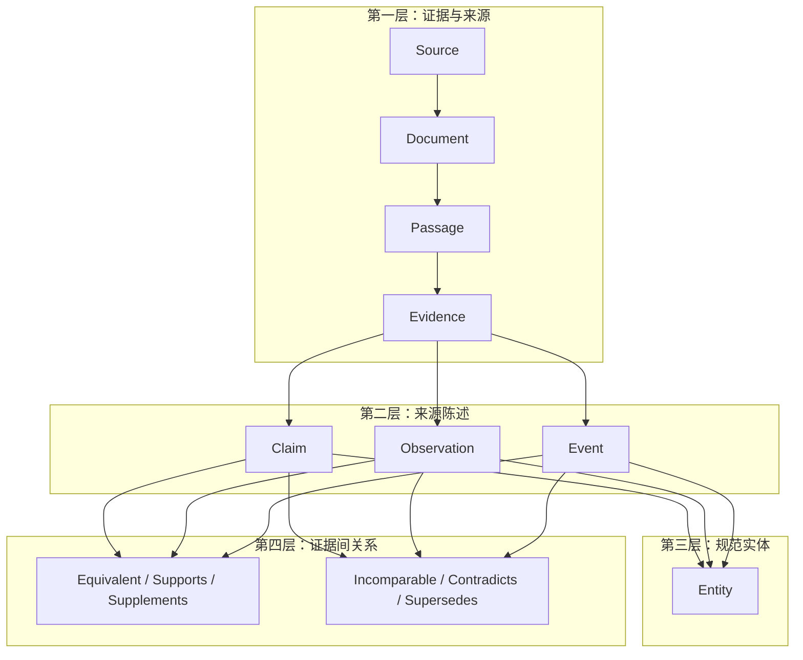
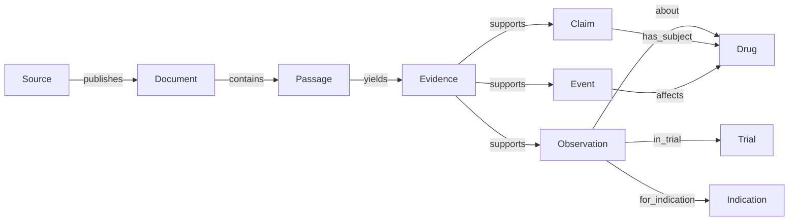
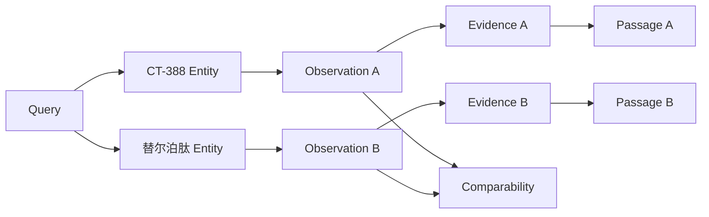

# Pharsight 医药投研核心图架构设计

> **历史文档提示（2026-10-12）：** 本文保留 V2.1 设计演进，不再作为当前运行时规范。
> 当前三层无 `Source` 节点架构请从 [GraphRAG V1 文档导航](./README.md) 阅读。

> 版本：V2.1（核心图修订版）  
> 修订日期：2026-10-08  
> 文档状态：待评审设计，不代表已经实现  
> 适用范围：A/H 股医药公司研究与医药行业研究  
> 关联材料：[方法调研](./GRAPH_RAG_RESEARCH_AND_PHARSIGHT_DESIGN_2026-10-07.md)、[meeting_02](./meeting_02.md)、[RAG V1](../../v1/PHARMA_RAG_V1.md)

> 实施决定（2026-10-10，2026-10-17 修订）：GraphRAG V1 按项目负责人要求删除独立 `Source` 节点，
> 将 Document/Passage/Evidence 视为第一层、Claim/Observation/Event 为第二层、
> Entity 为第三层；七类证据关系作为边实现而非第四层节点。首版使用
> SQLite + NetworkX；当前 v1.2 在 ingest 时只抽取原子记录，在收到 query 后高召回相关记录，
> 再对阻塞候选构造临时关系子图。详见 [现行文档导航](./README.md)。下文保留原始 V2.1
> 设计作为决策背景，其 Source/第四层表述不代表当前运行时 Schema。

## 1. 设计结论先行

Pharsight 不应把医药研报压缩成传统的“实体—关系—实体”知识图，也不应把所有文本块简单连成一张大图。推荐的核心结构是一个**以来源陈述为中心、以原文证据为底座、以实体作为跨文档连接点、以比较与冲突关系作为分析层的证据图**。

其主线是：

```text
Source / Document
        ↓
Passage ── Evidence
        ↓
Claim / Observation / Event
        ↓
Entity
        ↓
Comparison / Conflict / Update relations
```

更准确地说，这不是严格的树，而是四层多对多图：

1. **证据层**保存“原文在哪里”；
2. **来源陈述层**保存“原文具体说了什么”；
3. **实体层**保存“不同来源说的是不是同一个对象”；
4. **分析关系层**保存“这些来源陈述之间能否比较、是否一致、是否发生更新”。

这四层分别解决四个不同问题，不能合并：

| 问题 | 负责层 | 为什么不能由其他层替代 |
| --- | --- | --- |
| 结论能否回到原文 | 证据层 | 实体关系和摘要不能证明原文真的表达过该结论 |
| 数值、条件和不确定性如何绑定 | 来源陈述层 | Passage 太粗，实体三元组又会丢掉条件 |
| 跨文档如何识别同一药物、公司或试验 | 实体层 | 每条来源陈述各自独立，单靠文本相似度容易误连 |
| 两个结果能否比较、冲突还是更新 | 分析关系层 | 数值不同不一定矛盾，日期较晚也不一定覆盖旧值 |

图的最终目的不是替代原文，而是让系统能在有限上下文中找到**正确的原文组合**。因此，图检索的终点必须是 Evidence/Passage，而不是孤立三元组、社区摘要或模型生成的关系说明。

## 2. 为什么医药投研需要这种图

### 2.1 普通 Chunk RAG 的边界

普通 Chunk RAG 对“某年营业收入是多少”“公告第几页写了某产品”之类的单点问题很有效，但医药投研经常要求同时满足多个条件：

- 同一个药物在不同适应症、地区和阶段的状态；
- 同一个试验中不同剂量、时间点和 estimand 的结果；
- 公司公告、试验登记、监管记录和论文之间的差异；
- 一个投资判断背后的多份交易、临床和商业证据；
- 新公告是否真正更新了旧状态，而不是重复披露。

这些问题不是“找一个最相似段落”，而是“找一组具有明确关系的证据”。图的价值在于保存这种关系，并使检索可以沿着关系扩展。

不过，图并非天然更可靠。若构图时把条件压缩掉，图只会更高效地传播错误。因此，Pharsight 的设计顺序必须是：

```text
先保证表示忠实
  -> 再用图提高关联召回
  -> 最后才讨论复杂推理
```

### 2.2 传统实体知识图为什么不够

传统图可能把一段临床材料抽成：

```text
CT-388 --has_efficacy--> 22.5%
CT-388 --better_than--> 替尔泊肽
```

这种表达看起来简洁，但它删除了最重要的信息：

- 22.5% 是治疗 48 周结果；
- 它使用疗效估计目标；
- 它经过安慰剂校正；
- “优于”来自非头对头比较；
- 替尔泊肽的 18% 可能是推测值，而不是原始试验直接报告值。

一旦这些条件消失，后续即使使用更好的 PageRank、GNN 或 Agent，也无法恢复它们。问题发生在表示层，而不是检索层。

因此，实体三元组只能作为导航索引，不能承载全部事实。真正的事实单元必须是带来源和条件的 Claim、Observation 或 Event。

### 2.3 为什么不能只保存原文

反过来，如果只保存 Passage，则跨文档关系完全依赖每次查询时让 LLM重新阅读和判断：

- “替尔泊肽”“tirzepatide”和商品名是否同一对象；
- 两段文字中的 SURMOUNT-1 是否同一试验；
- 两个百分比是否对应同一时间点和统计口径；
- 新旧公告是冲突、补充还是状态更新。

这样虽然忠实，但检索和比较成本高、结果不稳定，也无法积累经过审核的实体身份与可比性判断。

所以本设计既不选择“只要原文”，也不选择“只要知识图”，而是保留二者之间的可追溯映射。

## 3. 核心图的四层结构



### 3.1 第一层：Source、Document、Passage、Evidence

#### 3.1.1 Source：回答“是谁发布的”

Source 代表发布主体，而不是一条网页 URL。例如上交所、港交所、上市公司、ClinicalTrials.gov、CDE、期刊出版社和券商是不同 Source。

引入 Source 的理由有三个：

1. **来源优先级需要稳定身份。** 同一发布者有大量文档，不能在每个 Document 中重复猜测其性质。
2. **需要识别转引。** 多个网页可能转载同一公告，不能被当作多个独立来源。
3. **需要区分“谁说的”和“说了什么”。** 公司对未来获批时间的判断，与监管机构的审批记录不是同一证据性质。

优点：

- 能按监管、交易所、发行人、试验登记、论文、二手网页区分来源；
- 能做来源多样性和独立性控制；
- 便于识别同源转载和引用链。

缺点：

- 发布者身份本身也可能难以验证，例如投资者关系托管域名；
- 来源等级容易被误用为“该来源永远正确”；
- 维护来源登记表需要人工治理。

设计取舍：Source 只提供来源身份和优先级信号，不给 Claim 自动赋予真值。权威来源仍可能包含历史值、预测值或口径差异。

#### 3.1.2 Document：回答“哪一份材料”

Document 代表逻辑文档，例如某份年报、公告、试验登记记录或论文。对会持续更新的网页，同一 Document 可以有多个不可变版本。

保留 Document 的理由是：投资研究经常需要回答“在当时能看到什么”。如果网页更新后覆盖旧内容，而系统只保存当前页面，就无法复现历史截止日的结论。

优点：

- 支持快照和历史回测；
- 保存标题、发布日期、报告期和文档类型；
- 可区分同一材料的版本更新。

缺点：

- 需要保存文档哈希和版本，存储量增加；
- 某些网页没有清晰发布日期，版本语义难判断；
- 同一公告在交易所与公司官网的两个副本可能需要归并。

设计取舍：Document 不直接承载事实，只承担来源组织和版本边界。事实来自其 Passage/Evidence。

#### 3.1.3 Passage：回答“原文在哪一段”

Passage 是页面内的原文块。当前项目已实现不跨页的页级分块，这是核心图可以直接复用的稳定基础。

将 Passage 设为图节点，而不是只把它当作图外附件，主要借鉴 HippoRAG 2 的经验：概念节点适合连接，原文节点适合保留上下文；两者共同参与图检索，能避免图方法在简单事实题上退化。

优点：

- 图检索结果可以直接回到可引用原文；
- 向量检索与图检索共享同一落点；
- 即使结构化抽取漏掉某字段，原文仍可供生成器和研究者核对。

缺点：

- Passage 节点数量远多于实体和 Claim，图规模增大；
- chunk 边界可能切断句间条件；
- 重叠 chunk 会造成重复传播和重复返回。

设计取舍：Passage 必须不跨页并保留章节和字符位置；重叠 chunk 属于同一 span family，在图传播和结果组装时去重。表格、图注和脚注通过布局链接与 Passage 连接，而不是盲目拼成超长 chunk。

#### 3.1.4 Evidence：回答“哪一小段原文支持哪个字段”

Evidence 是 Passage 中被具体记录引用的证据范围。它可以是一句话，也可以是一个表格单元格加表头和脚注的组合。

为什么 Passage 之外还需要 Evidence：

- 一个 Passage 可能包含多个不同主张；
- 一条 Claim 可能只由其中一句支持；
- 一个临床数值的数值、单位和脚注可能分布在不同位置；
- 语义校验需要知道究竟是哪段文字支持了哪个字段。

优点：

- 支持 Claim 级精确引用；
- 可将表格正文、表头和脚注组合成联合证据；
- 便于检查“引用存在但不支持相邻结论”的问题。

缺点：

- Evidence 数量会很多；
- 自动 span 对齐可能出错；
- 若把 Evidence 全做成图库节点，图会变得繁杂。

设计取舍：Evidence 在逻辑模型中是一等对象，但物理图中可有两种实现：小规模实验把它建成节点；大规模实现只在 Claim/Observation/Event 上保存 evidence ID。无论物理表示如何，语义上都必须可独立定位。

### 3.2 第二层：Claim、Observation、Event

这一层是设计的核心。它不试图描述“世界真实是什么”，而是忠实描述“某来源在某时点表达了什么”。

#### 3.2.1 为什么不能只有 Claim

`meeting_02.md` 已提出 Claim–Evidence 层，这是正确方向，但如果 Claim 同时包含以下所有内容，会产生新的问题：

- 临床测量结果；
- 财务数值；
- 监管状态变化；
- 对未来的预测；
- 券商或管理层的评价；
- 实体之间的关系。

这些内容在检索和校验上的行为不同。例如：

- 数值结果需要单位、时间点和统计口径；
- 状态变化需要事件时间和前后状态；
- 预测必须保留“预计”而不能作为已经发生的事实；
- 评价通常不能用确定性规则比较。

因此，本设计将来源陈述拆为 Claim、Observation 和 Event。三者共享来源与证据，但承担不同语义。

这种拆分的优点是结构清晰、便于查询和比较；缺点是抽取器更复杂，且某些句子会同时生成多个对象。我们接受这一复杂度，因为医药投研中“一个句子包含结果、比较和预测”非常常见，强行压成一条 Claim 会让后续分析更困难。

#### 3.2.2 Claim：命题、预测与判断

Claim 保存可独立核对的来源陈述，例如：

- “公司预计该产品于年底获批”；
- “报告认为头部 MNC 的布局重点转向平台”；
- “该研究未达到非劣效终点”；
- “公司与另一方达成授权交易”。

Claim 必须保存命题性质：来源事实陈述、预测、估计、观点、假设或不确定表达。其目的不是做哲学意义上的真值判断，而是防止模型把“预计”“可能”“推测”“我们认为”擦掉。

优点：

- 可以保留自然语言中难以完全结构化的判断；
- 适合检索管理层观点、券商判断和监管描述；
- 能直接连接支持它的原文。

缺点：

- 文本命题仍存在表述差异；
- 自动原子化可能拆得过细或过粗；
- 两条相似 Claim 未必语义等价。

设计取舍：一条 Claim 表达一个可独立核对的核心命题。它不把数值结果的全部条件塞进自由文本；数值部分由 Observation 表达。原文一句话可以同时生成一条 Observation 和一条比较/评价 Claim。

#### 3.2.3 Observation：带完整条件的观察值

Observation 用于临床、财务和市场数据。它不是简单的 `entity --has_value--> number`，而是“某对象在一组明确条件下的测量结果”。

临床 Observation 的逻辑结构是：

```text
对象：药物 / 试验 / 适应症
条件：人群 / 剂量 / 方案 / 对照 / 时间点
指标：终点 / estimand / 分析集 / 是否校正
结果：数值 / 单位 / 统计量 / 不确定区间
性质：直接报告 / 估算 / 推测
证据：原文与来源
```

例如，“替尔泊肽 SURMOUNT-1 研究 15 mg 组，同口径下 48 周推测值约 18%”应是一条 Observation，其中“15 mg”“48 周”“约”“推测值”都是结果不可分割的组成部分。

为什么 Observation 是独立节点，而不是 Claim 的几个字段：

1. 同一 Observation 可能被多个 Claim 引用，例如“结果为 22.5%”和“非头对头下高于另一药物”；
2. Observation 之间需要做可比性判断；
3. 数值可能进入确定性计算；
4. 同一试验不同剂量、时间点和指标应是独立记录。

优点：

- 最大限度减少数值错挂；
- 可按剂量、时间点、终点和口径精确检索；
- 能确定性判断哪些记录可以比较；
- 临床、财务和市场数据可使用共同抽象。

缺点：

- 字段多、抽取难度高；
- 原文经常缺少部分条件；
- 不同领域的 qualifier 不完全相同。

设计取舍：缺失字段保持未知，不从相邻 Observation 或外部常识补写。不同领域共享“对象—条件—指标—值—证据”的抽象，但采用不同 Profile 约束具体 qualifier。

#### 3.2.4 Event：带时间方向的状态变化

Event 表示“发生了什么变化”，例如：

- 试验启动、完成或终止；
- 申报受理、获批或被拒；
- 医保纳入或集采中标；
- 授权交易签署；
- 公司上调或下调指引。

为什么不把“III 期”直接作为 Drug 或 Program 的静态属性：同一项目在不同适应症、地区和时间可能处于不同阶段。若写成 `Drug.phase = 3`，历史状态和限定条件都会丢失。

Event 因此保存：事件主体、事件类型、事件发生时间、公告时间、地区、适应症和前后状态。

优点：

- 天然支持时间线查询；
- 能区分事件发生时间与披露时间；
- 可以明确建立 `SUPERSEDES` 或状态更新关系；
- 避免把项目状态静态化。

缺点：

- 许多材料只说“近期”“今年底”，时间精度不完整；
- 公告日期不一定是事件日期；
- 同一事件可能由多个来源在不同时间披露。

设计取舍：Event 保存时间精度，不能把“2026 年”伪装成具体日期；同一事件可连接多个 Evidence，但不同来源的表述仍保留各自 Claim。

### 3.3 第三层：Entity

Entity 是跨文档共享的对象身份。它的主要价值不是丰富本体，而是帮助系统判断“不同来源说的是不是同一个东西”。

核心实体包括：

- Company 与 Security；
- Drug、Program 与 Brand；
- Target 与 Modality；
- Indication 与 Trial；
- Regulator、Policy、Payer；
- MarketSegment、TechnologyPlatform、Transaction。

#### 3.3.1 为什么 Company 和 Security 分开

上市公司可以发行多个证券，证券价格、估值和交易所属性属于 Security；研发管线和财务主体属于 Company。若合并，A/H 两地上市、母子公司和存托凭证关系会混乱。

优点：支持证券市场数据与经营主体数据分别建模。缺点：查询时常需要多走一跳。这个额外跳数是必要的，因为它避免将股票属性错误写到公司实体上。

#### 3.3.2 为什么 Drug、Program、Brand 分开

同一活性成分可能有多个商品名、多个研发代号和多个地区权益；一个 Program 也可能指联合疗法或特定适应症开发计划。把所有名字合并成一个 Drug 节点虽然检索方便，但容易把授权、申办、获批和适应症关系混在一起。

推荐结构：

```text
Drug（成分或分子身份）
  ↑
Program（公司/适应症/地区下的研发项目）
  ↓
Brand（获批后的商品名）
```

优点：关系语义准确。缺点：实体解析更复杂。首版允许只对高价值对象做这种细分，未确认时保留临时 Program，不强制合并。

#### 3.3.3 为什么 Trial 必须是独立实体

试验是临床 Observation 的上下文核心。同一个药物在多个试验中的结果不能互相替代；同一试验不同组别和时间点也不能混合。

Trial 应优先使用登记号识别。没有登记号时使用临时实体，并明确 `unresolved`。不能仅凭试验简称相似就合并。

优点：能把结果、申办方、阶段、适应症和登记记录组织在一起。缺点：试验简称、子研究和扩展队列可能产生实体粒度争议，需要领域规则。

#### 3.3.4 实体链接为何宁缺毋滥

错误合并比暂时不合并更危险。未合并最多导致召回下降；错误合并会把其他药物或适应症的证据引入答案。

因此实体链接流程为：

```text
精确规范名
 -> 精确别名
 -> 类型过滤
 -> 外部 ID
 -> 上下文消歧
 -> 无法确认则临时 ID
```

Embedding 相似度只能生成候选，不能单独完成高风险实体合并。

### 3.4 第四层：来源陈述之间的关系

图真正支持研究分析的地方，不只是实体连接，而是记录之间的关系。但这些关系必须建立在可比性判断之后。

#### 3.4.1 为什么 Support / Contradiction 二分不够

ArbGraph 的 Support/Contradiction 图适合通用长文证据仲裁，但医药投研中两个记录常见的关系还有：

- 内容相同但来自不同转引；
- 内容互补，一个给数值、一个给脚注；
- 口径不同，不能比较；
- 新材料更新旧状态；
- 同一事实的不同语言表达。

如果只分支持和矛盾，系统会把“48 周”和“72 周”的不同结果误判为矛盾，也可能把公司公告和转载新闻当成两份独立支持。

因此设计七类关系：

| 关系 | 含义 | 典型用途 |
| --- | --- | --- |
| `EQUIVALENT_TO` | 同一事实的等价表达 | 去重、多语言对齐 |
| `SUPPORTS` | 独立来源在同一口径下相互支持 | 多源佐证 |
| `SUPPLEMENTS` | 提供互补信息 | 正文 + 脚注、公告 + 登记详情 |
| `INCOMPARABLE_WITH` | 关键条件不同 | 阻止错误排名和聚合 |
| `CONTRADICTS` | 可比口径下结论不一致 | 冲突披露与复核 |
| `SUPERSEDES` | 新版本或状态明确取代旧记录 | 时间线和当前状态 |
| `SAME_ORIGIN_AS` | 不同材料来自同一原始来源 | 防止转载形成虚假多数 |

优点：更贴近投研证据关系。缺点：关系判断成本增加，自动抽取容易错。解决办法是只对检索相关的记录按查询临时判断，而不是预先对全库两两连边。

#### 3.4.2 可比性为什么必须先于冲突

比较两个临床结果前，至少要检查：

```text
药物 / 试验 / 适应症 / 人群 / 剂量 / 方案 / 对照 /
终点 / 时间点 / estimand / 分析集 / 是否校正 / 单位
```

比较财务数据则要检查：

```text
公司 / 指标 / 报告期 / 合并范围 / 会计准则 /
币种 / 单位 / 是否重述 / 持续经营口径
```

只有条件一致或能通过确定性转换对齐时，才允许自动建立 `SUPPORTS` 或 `CONTRADICTS`。条件不足时应建立 `INCOMPARABLE_WITH` 或保持未知。

这种设计的优点是显著降低“不同口径强行比较”；缺点是会降低系统给出简洁结论的比例。对投资研究而言，这种保守是合理的：宁可明确“不足以比较”，也不要制造虚假的优劣结论。

#### 3.4.3 SUPERSEDES 与 CONTRADICTS 的区别

旧登记显示“尚未招募”，新登记显示“正在招募”，通常是状态更新，不是两个来源互相矛盾。只有在同一有效时点、同一口径下仍不一致，才更接近冲突。

判断 `SUPERSEDES` 至少需要：

- 同一对象和状态维度；
- 明确的新旧时间；
- 新记录确实更新旧状态，而非描述另一地区或适应症。

优点：保留历史并给出当前状态。缺点：时间语义错误时会误删有效差异，所以 superseded 记录仍保留在图中，只在“当前状态”查询中降低优先级。

## 4. 图的逻辑结构

### 4.1 证据主链



主链强调两个方向：

- 从来源向下，可追踪一条结构化记录来自哪里；
- 从实体向上，可找到关于该实体的所有来源陈述与原文。

### 4.2 实体事实投影

为了快速检索，可从 approved Claim/Event 派生实体关系：

```text
Company --DEVELOPS--> Program
Program --BASED_ON--> Drug
Program --TARGETS--> Target
Trial --EVALUATES--> Program
Security --ISSUED_BY--> Company
```

这些边不是新的权威事实，而是“由哪些来源陈述支持”的投影。每条边必须能回到 supporting Claim/Event。

为什么需要投影：若每次查询“公司有哪些靶点管线”都从所有 Claim 重新计算，效率低；投影能直接导航。

为什么不能把投影当主存：一条关系可能有地区、适应症、授权范围和有效时间，简单边无法表达全部条件；Schema 变化时也需要重建。

优点：检索快、路径清晰。缺点：存在重复存储和同步成本。设计上让权威记录位于 Claim/Event，实体边可删除重建。

### 4.3 物理图与逻辑图分离

逻辑模型规定语义，物理实现可以按规模变化：

- 小规模实验：JSON/NetworkX，所有逻辑对象都可作为节点；
- 中等规模：SQLite/PostgreSQL 保存权威记录，内存图保存 ID 和关系；
- 大规模：关系库为主存，Neo4j/其他图引擎为投影，向量库为索引。

这种分离的理由是避免早期被某个图数据库锁定。图数据库解决遍历，不解决证据治理、版本和语义正确性。

优点：后端可替换、测试简单、快照可复现。缺点：需要维护投影一致性。项目当前规模较小，先使用版本化 JSON/SQLite + 内存图更合适，等性能成为问题再引入图数据库。

## 5. 图如何构建

### 5.1 构图不是一次 LLM 调用

推荐流水线：

```text
Passage
 -> Mention detection
 -> Entity resolution
 -> Claim / Observation / Event extraction
 -> Evidence span alignment
 -> Structural checks
 -> Semantic review
 -> Approved records
 -> Graph projection
```

每一步单独保存结果和错误。这样做的理由是：如果最终出现错误，可以判断是解析漏文、实体误连、条件漏抽、证据错挂还是图投影错误。

把全部步骤交给一次 LLM 直接输出大图虽然开发快，但错误难定位、重跑不稳定，也无法只修复其中一层。

### 5.2 Schema 约束与开放发现如何平衡

完全开放的 OpenIE 覆盖面广，但会产生大量噪声和不稳定关系；完全固定的 Schema 稳定，却可能漏掉新技术、新交易形式和新政策关系。

推荐两条通道：

1. **受控通道**：只抽取当前 Schema 支持的 Entity、Claim、Observation、Event，允许进入正式图；
2. **发现通道**：记录未覆盖的新类型或关系候选，进入人工评审，不直接修改 Schema。

这吸收了 Youtu 的 Schema-bounded extraction 思路，但不允许查询期间自动扩展正式 Schema。

优点：稳定图不会被新概念污染，同时保留领域演化能力。缺点：新概念进入正式图会有延迟，需要周期性 Schema 评审。

### 5.3 Claim 粒度

一条 Claim 应只表达一个可独立核对的命题，但“原子”不等于越短越好。

错误拆法：

```text
CT-388 -> 22.5%
CT-388 -> 48周
CT-388 -> 安慰剂校正
```

这会再次把数值和条件拆散。

正确做法：生成一个完整 Observation；若原文还有比较判断，再生成一条引用该 Observation 的 Claim。

```text
OBS-1: CT-388 / 48周 / 22.5% / 安慰剂校正 / 疗效估计目标
CLM-1: 非头对头比较下，报告认为 OBS-1 高于另一项结果
```

优点：条件绑定稳定。缺点：一段原文会生成更多记录，但这些记录的职责更清楚。

### 5.4 审核状态如何进入图

候选记录可以参与“发现更多材料”，但不能直接支撑肯定性结论。

图中建议区分：

- `candidate`：自动抽取，可作为扩展线索；
- `approved`：经过规则或人工确认，可进入最终证据包；
- `rejected`：保留错误样例，不参与检索；
- `superseded`：历史有效但已被明确更新。

这样做的优点是构图可以自动化，同时生成仍保持严格。缺点是需要审核工作流。第一阶段可只人工审核少量金标准和重大事实，不要求全图人工审核。

## 6. 图如何检索

### 6.1 不采用单一图检索器

不同问题适合不同路径：

| 问题 | 最合适的起点 | 图的作用 |
| --- | --- | --- |
| “收入是多少” | Passage/Observation 精确检索 | 几乎不需要扩展 |
| “某公司有哪些减重管线” | Company Entity | 沿 DEVELOPS、适应症和 Evidence 扩展 |
| “两个试验结果能否比较” | 两组 Observation | 查实体身份和可比性关系 |
| “状态如何变化” | Program/Trial Entity | 按 Event 时间线扩展 |
| “哪些证据支持行业判断” | 主题/实体种子 | 找多源 Claim 与底层 Passage |
| “来源为何冲突” | Claim/Observation 集合 | 构建查询局部证据关系图 |

如果所有问题都从实体图做多跳搜索，简单题会增加噪声；如果所有问题都只做向量检索，关系题会漏证据。因此需要按问题类型路由。

### 6.2 种子节点

种子优先级：

1. 精确外部 ID 和规范实体；
2. 结构化条件完全匹配的 Observation/Event；
3. query-to-triple 或 query-to-record 语义命中；
4. Passage BM25/向量命中；
5. 未消歧实体候选。

为什么同时使用实体和 Passage 种子：实体种子擅长关联，Passage 种子保留查询上下文。HippoRAG 2 的核心启示正是把稀疏概念和原始 Passage 一起放入传播过程。

优点：兼顾简单事实和多跳关联。缺点：需要调整不同种子的权重。第一阶段不应凭直觉固定权重，而应在冻结问题上比较。

### 6.3 首选有限类型扩展，而不是立即使用 GNN

第一版推荐 1–2 跳类型扩展：

```text
Entity
 -> Claim / Observation / Event
 -> Evidence / Passage
 -> related Entity（仅当问题需要）
```

例如查询“某公司某药物的关键临床结果”：

```text
Company -> Program -> Trial -> Observation -> Evidence -> Passage
```

扩展时只允许 QueryPlan 指定的关系，避免沿所有边扩散。

优点：

- 完全可解释；
- 不需要训练数据；
- 易于限制噪声和跳数；
- 便于比较图是否真的增加召回。

缺点：

- 规则需要维护；
- 面对未知关系的泛化较弱；
- 路径很多时手工权重难调。

与 G-reasoner 式 GFM 相比，有限扩展能力较弱，但更符合项目当前数据量和 Python 3.11 环境。只有积累了足够节点级相关性标注，且规则/PPR 成为明确瓶颈后，才值得训练或接入 GFM。

### 6.4 PPR 的使用边界

PPR 适合“从多个部分线索激活关联邻域”，可用于：

- 跨文档多跳；
- 药物—靶点—公司—试验关联；
- 行业主题下的多源证据发现。

但 PPR 不理解以下内容：

- 哪个来源更权威；
- 两个临床结果是否可比；
- 某条边是否由推测产生；
- 新旧状态是否构成更新。

因此 PPR 只提供相关性候选，不输出事实置信度。传播结果必须回聚到 Evidence/Passage，并经过关系类型、时间和审核状态过滤。

优点：在线成本低、单步多跳、无需训练。缺点：热门高连接节点可能获得不合理优势，关系方向和语义利用有限。缓解方式包括类型化边权、限制传播子图、混合 Passage restart seed 和对 hub 节点降权。

### 6.5 为什么检索终点必须是 Evidence/Passage

生成器若只收到：

```text
Company A --DEVELOPS--> Drug B
```

它无法知道关系来自哪份材料、哪个地区、什么时间，也无法引用。正确结果应同时返回：

```text
路径：Company A -> Program B -> Claim C -> Evidence E
原文：……
来源：公告标题、发布日期、第几页
限制：仅适用于适应症 X / 地区 Y
```

图路径说明“为什么找到它”，原文说明“为什么可以相信系统没有编造它”。二者缺一不可。

## 7. 查询局部冲突图

### 7.1 为什么不预先构建全库冲突边

若图中有 N 条 Claim/Observation，两两比较成本接近 N²；更重要的是，是否冲突依赖查询关注的口径。两条记录可能在“当前阶段”问题中冲突，在“历史变化”问题中却是正常更新。

所以冲突关系应主要在查询时，对已召回且主题相近的记录构建局部图：

```text
召回候选
 -> 按实体和指标分组
 -> 检查来源是否独立
 -> 判断可比性
 -> 建立七类关系
 -> 形成证据簇
```

优点：成本可控、关系更贴合当前问题。缺点：同一对记录在不同查询中可能得到不同关系。设计上保存判定依据和 QueryPlan，使结果可解释；经过人工确认的稳定关系可以回写全局图。

### 7.2 证据簇而不是“多数投票”

一个局部图可能包含：

- 1 条监管原始记录；
- 1 条公司公告；
- 5 条转载新闻。

不能用 6:1 认为公司侧“占多数”。应先用 `SAME_ORIGIN_AS` 把转载折叠为一个来源簇，再比较独立来源。

图中的支持强度来自独立来源、证据直接性和口径一致性，不来自节点数量本身。

优点：避免信息生态中的重复放大。缺点：原始来源识别可能不完整，需要保守标注“独立性未知”。

### 7.3 自动仲裁的边界

可以自动处理：

- 确定性单位换算；
- 同一官方记录的版本更新；
- 截止时间过滤；
- 明确的同源转载；
- 结构完全一致的重复记录。

不应自动决定：

- 两个独立一手来源的重大差异；
- 临床 estimand 或统计方法争议；
- 管理层判断与监管证据的解释冲突；
- 对商业前景或疗效优劣的重大判断。

这些情况图应输出差异和来源，而不是选择唯一赢家。这比照搬 ArbGraph 的 winner/loser 更新更适合投研场景。

## 8. 社区和层次图是否需要

### 8.1 社区层的用途

Youtu-GraphRAG 的社区和关键词层适合：

- 大型行业语料的全局主题导航；
- “主要技术路线是什么”之类的综述问题；
- 在大量实体中先缩小搜索范围。

但 `meeting_02.md` 的实验显示，社区与关键词组织边可能占图的大部分，同时社区摘要可能新增无依据语义。

因此社区层是可选索引，不是核心事实层。

### 8.2 推荐设计

```text
Community
  -> member entities / claims / documents
  -> generated label and summary
  -> navigation_only = true
```

社区摘要只能用于选择下一步检索范围。若摘要说“某公司布局了某平台”，系统必须继续找到支持该陈述的 Claim 与 Evidence，不能直接引用社区摘要。

优点：提高大语料全局问题效率。缺点：构建和摘要有额外成本，也可能产生错误主题。第一阶段语料规模较小时不启用；等单纯实体/Claim 图在行业全景问题上出现明显检索压力后再加入。

## 9. 关键设计选择的优劣对照

### 9.1 Passage 是节点，还是仅作为外部文本

| 方案 | 优点 | 缺点 | 结论 |
| --- | --- | --- | --- |
| 图外 Passage | 图小、遍历快 | 图搜索与原文脱节，简单事实召回易退化 | 不采用 |
| Passage 节点 | 原文直接参与检索，路径可回溯 | 节点多、需去重 | 采用 |

### 9.2 Evidence 是节点，还是 Claim 属性

| 方案 | 优点 | 缺点 | 结论 |
| --- | --- | --- | --- |
| Evidence 节点 | 联合证据、多 Claim 复用、关系清楚 | 图更大 | 逻辑模型采用；物理实现可优化 |
| Evidence 属性 | 实现简单、图小 | 多段证据重复，生命周期难管理 | 仅可作为物理优化 |

### 9.3 单一 Claim，还是 Claim + Observation + Event

| 方案 | 优点 | 缺点 | 结论 |
| --- | --- | --- | --- |
| 单一 Claim | Schema 简单 | 数值和事件语义混杂，比较困难 | 不采用 |
| 三类记录 | 职责清楚、可比较、可做时间线 | 抽取复杂、记录数增加 | 采用 |

### 9.4 全局冲突图，还是查询局部冲突图

| 方案 | 优点 | 缺点 | 结论 |
| --- | --- | --- | --- |
| 全局预计算 | 查询快 | 成本高、关系脱离问题语境 | 只保存稳定审核关系 |
| 查询局部构图 | 成本可控、贴合当前口径 | 每次需重新判断 | 默认采用 |

### 9.5 固定类型扩展、PPR 与 GFM

| 方法 | 优点 | 缺点 | 适用阶段 |
| --- | --- | --- | --- |
| 1–2 跳类型扩展 | 可解释、无训练、易调试 | 泛化有限 | V1 默认 |
| Weighted PPR | 单步多跳、成本低 | hub 偏置、关系语义弱 | V1.5 实验 |
| GFM/GNN | 可学习复杂结构与查询相关性 | 需要标注、GPU、环境和 MLOps | 数据成熟后的 V2+ |

### 9.6 图是主存，还是可重建投影

| 方案 | 优点 | 缺点 | 结论 |
| --- | --- | --- | --- |
| 图数据库为唯一主存 | 遍历直接 | 版本、证据和 Schema 迁移困难 | 不采用 |
| 权威记录 + 图投影 | 可审计、可重建、后端可换 | 需要维护投影 | 采用 |

## 10. 两种研究模式如何共享核心图

### 10.1 共同核心

公司研究和行业研究都使用 Source、Document、Passage、Evidence、Claim、Observation、Event、Entity 和 EvidenceRelation。差异主要在实体类型和 Observation 条件，而不是另建两套图。

### 10.2 公司模式

主要路径：

```text
Company -> Security
Company -> Program -> Drug / Target / Indication
Program -> Trial -> Observation
Company -> Financial Observation
Program -> Regulatory Event / Commercial Event
```

核心问题是产品、试验、财务和监管信息如何在同一公司研究中保持来源和时间一致。

优点：公司级证据能通过共享实体汇集。风险：公司宣传材料连接度很高，可能压过独立来源，因此检索时需要来源多样性，而不能只按图中心性排序。

### 10.3 行业模式

主要路径：

```text
MarketSegment -> Company / Drug / TechnologyPlatform
Policy -> Payer / Procurement -> MarketSegment
Transaction -> Company / Program / Platform
Clinical Observation -> Drug / Indication / Modality
```

行业模式更需要主题聚合和社区导航，但也更容易出现市场定义不一致。因此 Market Observation 必须绑定地区、时间、市场边界和方法，不能把不同报告的市场规模直接放在同一序列中。

优点：能够从技术、政策、公司和交易多个角度组织行业。风险：图规模和关系类型迅速增加。解决方式是共同核心 + 模式 Profile，而不是无限扩展一套全局 Schema。

## 11. 图检索的端到端例子

### 11.1 问题

> 根据当前材料，能否认为 CT-388 的减重疗效优于替尔泊肽？

### 11.2 初始种子

实体解析得到：

```text
Drug: CT-388
Drug: 替尔泊肽
Indication: 肥胖
Metric: 体重变化百分比
```

### 11.3 图扩展



Observation A：

```text
48 周、22.5%、安慰剂校正、疗效估计目标
```

Observation B：

```text
15 mg、48 周、约 18%、同口径推测值
```

比较 Claim：

```text
原文称“非头对头比较下”CT-388 数据更高
```

### 11.4 可比性判断

相同：适应症方向、指标、48 周。  
不同或未知：试验、人群、直接报告与推测值、比较设计。  
原文明确：非头对头。

因此关系不是“已证实优效”，而是：

```text
Observation A --PARTIALLY_COMPARABLE--> Observation B
Claim comparison --SUPPORTED_BY--> 两侧 Evidence
Claim comparison --QUALIFIED_AS--> non_head_to_head
```

### 11.5 最终图输出

图应返回：

1. 两条完整 Observation；
2. 比较 Claim 及“非头对头”限定；
3. 两侧原文 Evidence 和 Passage；
4. 可比性结果与不同条件；
5. 不允许生成的结论：“临床已证明 CT-388 优效”。

这个案例说明图的价值不是替模型做结论，而是把结论需要的两侧证据、条件和限制一起找齐。

## 12. 与当前 Pharsight 的最小衔接

### 12.1 可直接保留的部分

- 当前完整 PDF 分页分块；
- 稳定 source ID、document hash、page/chunk ID；
- BM25 页级检索；
- 精确 `[Source:...]` 引用；
- `DataCollector -> DataAnalyzer -> ReportGenerator` 主干。

### 12.2 图层新增边界

建议新增一个独立 EvidenceBackend：

```text
现有文档索引
  -> Evidence records
  -> Claim / Observation / Event store
  -> Entity resolution
  -> Graph projection
  -> graph/hybrid search
  -> 返回统一 Evidence Pack
```

生成器不读取 Neo4j、NetworkX 或 PPR 对象，只读取包含结构化记录、原文和来源 ID 的 Evidence Pack。

这样做的优点是 Chunk、Graph 和 Hybrid 可以使用相同生成器比较；缺点是需要一个适配层。但这个适配层正是防止图数据库和算法渗透整个系统的关键。

### 12.3 为什么不使用现有 Memory 作为图检索器

当前 Memory 以完整 ToolResult 为 embedding 单元，适合任务结果选择，不适合页级、Claim 级和 Observation 级检索。将整份文档结果嵌入后再排序，会重新产生粒度过粗的问题。

因此 Memory 继续负责跨 Agent 共享和 checkpoint；核心图检索在 EvidenceBackend 内完成。检索完成后把 Evidence Pack 放入 Memory，而不是让 Memory 重新检索原始文档。

## 13. 核心图的分阶段实现

### 13.1 Stage A：表示正确性

实现：

- Source / Document / Passage / Evidence；
- Entity；
- Claim / Observation / Event；
- 来源主链和实体绑定边。

暂不实现：社区、PPR、GNN、自动冲突仲裁。

原因：如果条件抽取和证据绑定不稳定，增加高级检索没有意义。

验收重点：数值—条件绑定、Evidence 定位、无依据关系率和实体误合并率。

### 13.2 Stage B：可解释图扩展

实现：

- 1–2 跳类型扩展；
- 实体事实投影；
- Graph 结果回到 Evidence/Passage；
- 与 BM25/dense 的 Hybrid 合并。

原因：这是检验图是否增加关联召回的最小实现，不需要训练。

优点：结果路径清楚。缺点：关系规则较人工。若没有实际收益，不进入更复杂阶段。

### 13.3 Stage C：可比性和查询局部冲突图

实现：

- 临床、财务和市场 Comparability Profile；
- 七类 EvidenceRelation；
- 同源折叠；
- 查询局部证据图。

原因：医药投研真正的差异化不只是多跳，而是保留口径、识别不可比和冲突。

### 13.4 Stage D：PPR 与社区导航

只有在以下情况出现时加入：

- 1–2 跳扩展漏掉必要的跨文档路径；
- 行业全景问题的候选规模过大；
- 同一查询需要从多个弱线索激活关联证据。

PPR 与社区仍只负责候选发现，不提升事实可信度。

### 13.5 Stage E：学习式图检索

前提：

- 有足够 query—relevant node 标注；
- 图 Schema 和快照稳定；
- 规则/PPR 的失败模式已量化；
- 收益足以覆盖 GPU、依赖和维护成本。

在此前提下再评估 G-reasoner 式 GFM。否则训练模型只会掩盖表示和标注问题。

## 14. 如何评价核心图是否成功

这里只评价图本身和图检索，不展开报告发布校验。

### 14.1 表示层

- 应有 Claim/Observation/Event 的覆盖率；
- 数值、单位、剂量、时间点和 estimand 的绑定准确率；
- 否定、预测、推测性质保留率；
- 无依据实体关系率；
- Evidence 能否定位并支持记录；
- 实体误合并和漏合并。

### 14.2 检索层

- 必要 Evidence Recall@k；
- 前 k 条中真正相关 Evidence 的比例；
- 跨文档必要来源覆盖；
- 图路径是否都能回到 Evidence；
- 相同 token 预算下与 BM25+dense 的差异；
- graph only、passage only、graph + passage 消融。

### 14.3 比较与冲突层

- 不可比记录被错误排序的比例；
- 真冲突识别率；
- 正常状态更新被误判为冲突的比例；
- 同源转载被错误计为独立支持的比例；
- 冲突关系的人工复核一致性。

### 14.4 成功标准

图不是因为“节点和边构建成功”而成功。它必须至少在预注册的跨文档、比较或冲突任务上，比强 Chunk Hybrid 找到更多必要证据，同时不提高无依据关系和条件丢失。

若图没有产生这种收益，正确结论是保留 Chunk Hybrid，而不是继续增加图复杂度。

## 15. 推荐的最终核心方案

综合研究和项目现状，推荐以下组合：

```text
权威记录：Source / Document / Passage / Evidence

结构化陈述：Claim / Observation / Event

跨文档身份：Entity + conservative entity resolution

实体导航：由 approved records 派生的可重建关系投影

默认图检索：精确种子 + 1–2 跳类型扩展

复杂关联检索：Passage + record 混合种子的 weighted PPR

冲突处理：查询局部图 + comparability first + 七类关系

社区：仅在大规模行业综述中作为 navigation-only 可选层

生成输入：必须回到 Evidence/Passage 的 Evidence Pack
```

这一方案有意不追求“一张图解决所有问题”。它把表示、身份、检索和证据关系拆开，使每种错误都有明确位置：

| 错误 | 首要检查位置 |
| --- | --- |
| PDF 中有，Passage 中没有 | 解析与分块 |
| Passage 中有，Observation 漏条件 | 抽取与 Evidence 对齐 |
| 两个来源没有连到同一对象 | 实体解析 |
| 图扩展没找到必要证据 | 种子、边类型和遍历 |
| 数值不同被误判为冲突 | Comparability Profile |
| 图找到了但答案仍丢条件 | Evidence Pack 与生成 |

它的最大优点是忠实、可解释、可分阶段验证，并与现有页级检索主干兼容。主要代价是数据模型和审核流程比普通 GraphRAG 更复杂，短期内不会像开放三元组图那样快速覆盖所有关系。

这个代价是值得的：医药投研的核心风险不是“图不够大”，而是“数值和条件被错误连接后仍以专业报告形式输出”。核心图首先应防止这种错误，其次才是提高召回和推理能力。

## 16. 当前待评审的核心决策

1. 是否确认 Claim / Observation / Event 三分，而不是单一 Claim；
2. Evidence 在第一版物理图中做节点，还是逻辑对象 + edge property；
3. 公司模式首批必须细分 Drug / Program / Brand 到什么程度；
4. 首批临床 Observation 哪些 qualifier 必填；
5. 第一版采用内存图还是 SQLite + NetworkX 投影；
6. Graph 默认只做 1–2 跳，还是同期加入 weighted PPR；
7. 哪些稳定 EvidenceRelation 允许回写全局图；
8. 行业模式何时达到需要社区导航的规模；
9. Stage A/B 的冻结语料、问题和人工金标准由谁负责；
10. 核心图评测达到什么门槛后才能成为默认检索路径。

## 17. 声明

本设计是面向投资研究辅助的证据组织与检索方案，不构成投资建议或医疗建议。图中的关系、分数、社区和模型判断都不能替代原始监管记录、临床专业解释和人工领域复核。任何系统结论都必须保留来源、时间、条件和不确定性。
