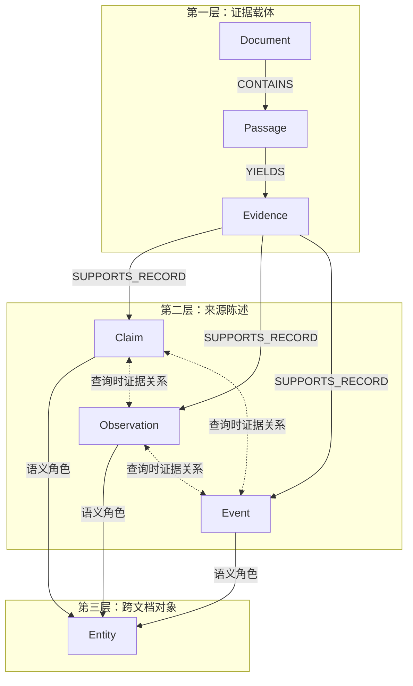
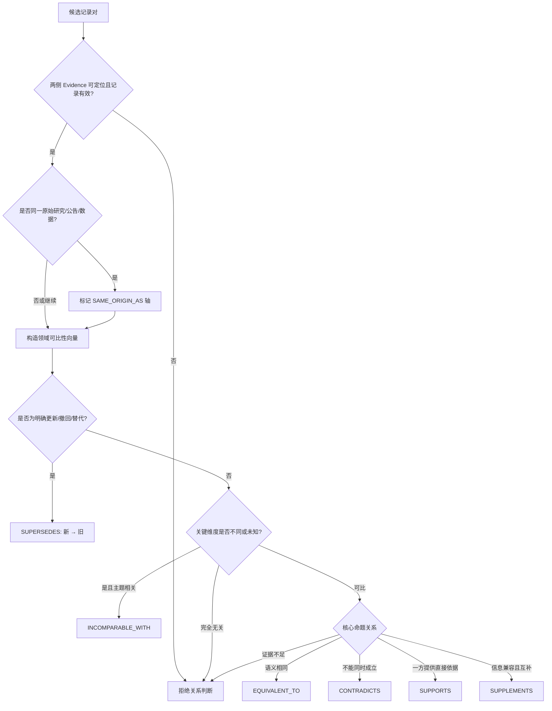

# Pharsight GraphRAG V1.2 理论架构

> 文档性质：当前架构的纯理论说明
> 状态：已实现架构的概念基线
> 适用范围：A/H 股上市医药公司研究与医药行业研究
> 不包含：代码路径、数据库表、配置默认值、运行命令和实验跑分
> 修订日期：2026-10-17

## 1. 要解决的问题

医药投研不是从文档中寻找一段“看起来相关”的文字，而是要在来源、时间、对象、口径和
不确定性均受约束的情况下回答问题。相同药物名称可能指成分、研发项目或商品；相同指标
可能来自不同人群、剂量、终点、报告期或币种；新公告可能更新旧状态，也可能只是补充
信息。传统 Chunk RAG 能找到词语相似的段落，却不能稳定表达这些差异。

Pharsight GraphRAG 的目标是把文档中的可引用原文与可比较的语义记录连接起来，形成一张
“可追溯、可约束、可导航”的证据图。图负责帮助找到证据、理解证据之间的关系，但不
替代原文，也不把模型抽取结果自动升级为事实。

## 2. 核心设计原则

### 2.1 Evidence-first

任何进入报告的材料都必须回到可定位的原文片段。结构化记录和图关系只是检索导航、比较
和解释的中间层，不能脱离原文成为独立引用。

### 2.2 来源身份不是图的语义层

图中不创建独立 `Source` 节点。发布者、URL、来源编号、发布日期、获取时间和可靠性属于
Document 的来源元数据。这样既保留溯源，又避免发布主体成为高连接度枢纽，把大量语义
无关记录错误地拉近。

### 2.3 保留条件，不把文本压扁成三元组

数值、单位、剂量、人群、时间点、估计目标、报告期、币种、预测性质、否定和未知字段
共同决定一条陈述的含义。它们应保留在语义记录中，而不是只留下“实体—关系—实体”。

### 2.4 图用于召回和组织，不用于制造真值

共享实体或图上邻近只表示可能相关。关系分类、实体消歧和模型判断都必须保留审核状态、
证据和理由。自动记录默认是候选项。

### 2.5 失败关闭

无法定位原文、Schema 不合法、关键条件被补写、来源超出批准范围或抽取失败超过阈值时，
系统拒绝对应记录或本次构建，而不是留下看似成功但不可复核的图。

### 2.6 原子记录先行，关系按问题构造

离线 ingest 只负责从每份材料中抽取可独立核验的原子 Claim、Observation、Event，保存其
条件、材料性和证据路径，并连接实体。记录之间的七类证据关系不再全库永久预计算；收到
问题后，系统先高召回检索相关记录，再只在该候选集合内阻塞、判断并构造查询子图。这样
可以让“是否相关”和“关系是什么”都受当前问题约束，避免共同公司等泛实体制造大量静态
错误边。查询边是可审计的临时投影，不改变底层记录和原文。

## 3. 三层语义图

这三层不是严格的树。一个 Passage 可以产生多条记录，一条记录可以涉及多个实体，同一
实体可以连接不同文档中的记录，记录之间还可以存在经判定的证据关系。

### 3.1 第一层：Document、Passage、Evidence

第一层不是普通文件目录，而是整个语义图的证据坐标系。Document 回答“材料从哪里来”，
Passage 回答“去哪里复核”，Evidence 回答“哪句话支持这条记录”。

#### 3.1.1 Document 的逻辑属性

| 属性组 | 子属性 | 必需性 | 含义与约束 |
| --- | --- | --- | --- |
| 身份 | `id` | 必需 | 图内稳定身份，由内容身份派生，不随文件名变化 |
| 身份 | `document_hash` | 必需 | 解析内容或原始文档的稳定哈希，用于去重、幂等和重建 |
| 身份 | `title` | 必需 | 来源文档标题；未知时只能使用可追溯占位，不得模型编造 |
| 来源 | `source_id` | 条件必需 | Pharsight 证据编号，贯穿采集、Memory、报告和引用 |
| 来源 | `publisher` | 可选 | 发布主体名称；它是元数据，不是独立 Source 节点 |
| 来源 | `source_url` | 可选 | 原始 URL、稳定记录页或受控本地文档标识 |
| 时间 | `published_at` | 可选 | 文档公开日期；不得用获取日期代替 |
| 时间 | `retrieved_at` | 可选 | 系统取得材料的时间 |
| 时间 | `reporting_period` | 可选 | 材料覆盖的财务期、数据期或报告期 |
| 时间 | `as_of` | 可选 | 本次研究允许使用信息的截止时点 |
| 处理 | `parser` | 可选元数据 | pdfplumber、OCR 或其他确定性解析器标识 |
| 处理 | `page_count` | 可选元数据 | 解析页数，用于完整性检查 |
| 质量 | `source_type` | 可选元数据 | 公告、定期报告、监管记录、论文、试验注册等来源类别 |
| 质量 | `reliability_tier` | 可选元数据 | 来源优先级，不自动等于内容真实度 |
| 质量 | `limitations` | 可选元数据 | OCR、转载、日期缺失、许可限制等已知限制 |

`source_id` 表示现有研究流程中的来源编号，不表示图内存在 Source 节点。一个 Document
只对应一个内容身份；同一发布者的不同公告是不同 Document，同一文档的多个本地文件名
不应产生不同身份。

#### 3.1.2 Passage 的逻辑属性

| 属性组 | 子属性 | 必需性 | 含义与约束 |
| --- | --- | --- | --- |
| 身份 | `id` | 必需 | 由 Document 身份和 chunk 身份稳定派生 |
| 归属 | `document_id` | 必需 | 唯一父 Document |
| 定位 | `chunk_id` | 必需 | 文档内稳定块编号 |
| 定位 | `page_start` / `page_end` | 条件必需 | PDF 来源必须保留真实页码；不得虚构页码 |
| 定位 | `section_title` | 可选 | 从页面或目录确定的章节名称 |
| 内容 | `text` | 必需 | 解析得到的原始块文本，是后续 quote 定位的母文本 |
| 内容 | `content_hash` | 必需 | 检测块内容变化和重复 |

PDF Passage 原则上不跨页，以避免页码引用歧义。长页面可以形成多个 Passage，相邻 Passage
可有确定性重叠，但重叠不能制造两份独立证据。

#### 3.1.3 Evidence 的逻辑属性

| 属性组 | 子属性 | 必需性 | 含义与约束 |
| --- | --- | --- | --- |
| 身份 | `id` | 必需 | 由 Passage、字符位置和 quote 稳定派生 |
| 归属 | `passage_id` | 必需 | Evidence 必须属于一个可定位 Passage |
| 原文 | `quote` | 必需 | 支持记录的连续原文，不是摘要或改写 |
| 定位 | `start_char` / `end_char` | 必需 | quote 在 Passage.text 中的字符范围 |
| 字段支持 | `field_paths` | 可选 | 指明 quote 支持记录的正文或哪些 attributes |

Evidence 的最低准入条件是 quote 可以映射回 Passage。仅有“模型认为这段支持”的判断，
但没有可定位 quote，不得创建 Evidence，也不得创建依赖它的记录。

#### 3.1.4 第一层基数

| 关系 | 逻辑基数 | 说明 |
| --- | --- | --- |
| Document → Passage | 1:N | Passage 只能属于一个 Document |
| Passage → Evidence | 1:0..N | 没有抽取记录的 Passage 可以没有 Evidence |
| Evidence → Record | 1:1..N | 一段原文可以支持多条记录；每条记录必须至少有一段 Evidence |

### 3.2 第二层：Claim、Observation、Event

三种记录分别表达不同的认识论对象：

| 类型 | 表达内容 | 典型例子 |
| --- | --- | --- |
| Claim | 判断、解释、预测、机制或关系陈述 | “该机制可能改善耐药问题” |
| Observation | 带口径和条件的观测值 | “2026H1 营收为 X 亿元” |
| Event | 在时间轴上发生或披露的状态变化 | “某适应证于某日获批” |

Observation 不能只保存数值，至少要能区分指标、数值性质和对象；Event 必须保留事件类型
及发生时间或披露时间；Claim 必须保留判断的条件、预测性质和限定语。否定、不确定、估算、
预测和未知均是语义的一部分。

#### 3.2.1 三类记录的公共属性

| 属性组 | 子属性 | 必需性 | 含义与约束 |
| --- | --- | --- | --- |
| 身份 | `id` | 必需 | 由类型、文本、结构化属性和 Evidence 身份共同确定 |
| 类型 | `record_type` | 必需 | Claim、Observation、Event 三选一 |
| 原义 | `text` | 必需 | 忠实保留来源陈述，不把模型推论伪装成原文事实 |
| 领域 | `domain` | 必需 | clinical、financial、market、regulatory、commercial、mechanism、other |
| 认识论 | `epistemic_status` | 必需 | asserted、reported、estimated、forecast、opinion、hypothesis、unknown |
| 倾向 | `polarity` | 必需 | positive、negative、uncertain、neutral；不等于投资评级 |
| 条件 | `attributes` | 必需容器 | 保存类型专属字段、比较口径和限制条件 |
| 材料性 | `materiality` | 必需 | 决策影响、证据强度、新颖性、时间敏感性、范围和理由；分数由四维确定性计算 |
| 证据 | `evidence_ids` | 必需 | 至少能回到一段 Evidence |
| 审核 | `review_status` | 必需 | candidate、approved、rejected、superseded |
| 版本 | `extractor_version` | 必需 | 产生该记录的抽取器版本 |
| 版本 | `model_name` | 必需 | 实际调用的模型标识 |

字段缺失表示来源没有给出或抽取器无法可靠确定，不等于“否”“零”或“不适用”。模型不得
根据常识补全剂量、时间、单位、试验编号或监管状态。

材料性分数用于同等相关候选之间的轻量排序，不是事实概率，也不能覆盖查询相关性。四维
分别回答：是否改变投资判断、原文支持是否直接、是否提供新增信息、是否具有催化/失效
时效。范围用于区分公司、产品、试验、市场、政策、会计和其他层面。低材料性记录仍必须
进入足够宽的候选池，以免把问题明确需要的背景或反证提前裁掉。

#### 3.2.2 Claim.attributes

Claim 用于无法还原为单一观测值或时间事件的来源陈述。其逻辑子属性包括：

| 子属性 | 含义 | 规则 |
| --- | --- | --- |
| `subject` | 判断主体 | 应与实体角色边一致；原文未明确时留空 |
| `predicate` | 判断或关系谓词 | 保留原文含义，不扩展为无条件实体事实 |
| `object` | 判断客体 | 可以是实体、概念或文本范围 |
| `qualifiers` | “可能”“显著”“初步”等限定语 | 不能在摘要时删除 |
| `conditions` | 判断成立的前提 | 包括人群、剂量、地区、时间或情景假设 |
| `scope` | 陈述覆盖范围 | 公司、产品、适应证、市场或特定研究 |
| `forecast_target` | 预测对象 | 仅预测类 Claim 使用 |
| `forecast_time` | 预测目标时间 | 与文档发布日期区分 |
| `basis` | 来源明示的判断依据 | 不允许模型自行补充外部理由 |
| `uncertainty` | 区间、概率或定性不确定性 | 未披露时留空，不伪造概率 |

Claim 的最小有效结构是“可核对的陈述文本 + 认识论状态 + Evidence”。subject/predicate 等
字段用于比较和检索，但当前并非所有 Claim 都必须具备完整主谓宾。

#### 3.2.3 Observation.attributes

Observation 表示一个带测量口径的结果。`metric`、`value`、`value_nature` 是当前硬性核心；
其他子属性在原文出现时必须保留：

| 子属性 | 含义 | 典型内容 |
| --- | --- | --- |
| `object` | 被测对象 | 公司、药物、试验组、适应证、市场分部 |
| `metric` | 指标 | 营收、ORR、PFS、市场规模、费用率 |
| `value` | 原始值或结构化值 | 12.3、18%、未达到、区间等 |
| `value_nature` | 数值性质 | actual、reported、estimated、forecast、approximate |
| `unit` | 单位 | 元、亿元、%、月、例、mg |
| `currency` | 币种 | CNY、USD、HKD；不得只靠符号猜测 |
| `population` | 观察人群 | 纳入标准、疾病阶段、样本范围 |
| `intervention` | 干预 | 药物、剂量、频率、途径、联合方案 |
| `comparator` | 对照 | 安慰剂、标准治疗、历史对照或未说明 |
| `timepoint` | 测量时间点 | 第 24 周、数据截止日、报告期末 |
| `reporting_period` | 统计覆盖期 | 2026H1、2025FY、滚动 12 个月 |
| `estimand` | 估计目标 | ITT、治疗策略、假设策略等 |
| `analysis_set` | 分析集 | ITT、PP、安全性集 |
| `geography` | 地理范围 | 中国、美国、全球或特定地区 |
| `segment` | 业务/市场分部 | 创新药、制剂、某治疗领域 |
| `method` | 计算或统计口径 | 同比、经调整、安慰剂校正、名义价格 |
| `uncertainty` | 不确定性 | 置信区间、误差、约数、模型区间 |
| `conditions` | 其他必要条件 | 会计口径、税项、渠道、汇率等 |

Observation 的比较单位不是单独的 `value`，而是“对象 + 指标 + 条件 + 时间 + 数值”。
其中任一关键维度不同，都可能使两条 Observation 不可直接比较。

#### 3.2.4 Event.attributes

Event 表示状态变化或发生事项。`event_type` 以及 `event_time`/`disclosure_time` 至少一个是
当前硬性核心：

| 子属性 | 含义 | 规则 |
| --- | --- | --- |
| `subject` | 事件主体 | 公司、产品、试验、政策或交易 |
| `event_type` | 事件类别 | approval、submission、readout、launch、transaction 等 |
| `event_time` | 事件实际发生时间 | 与披露时间分开保存 |
| `disclosure_time` | 来源披露时间 | 不能自动当成事件发生时间 |
| `time_precision` | 时间精度 | 日、月、季度、年份、区间或未知 |
| `jurisdiction` | 法域/地区 | 中国、美国、欧盟等 |
| `regulator` | 监管主体 | NMPA、FDA、EMA 等；必须来自原文 |
| `indication` | 相关适应证 | 不从同一药物的其他事件迁移 |
| `prior_status` | 事件前状态 | 例如审评中、II 期、未商业化 |
| `new_status` | 事件后状态 | 例如获批、终止、进入 III 期 |
| `effective_time` | 生效时间 | 政策发布日与生效日可能不同 |
| `conditions` | 附带条件 | 地区、剂型、人群、交易交割条件等 |

“计划提交”“预计获批”和“已经获批”不能归并为同一事件状态。前两者的认识论状态应保留
预测性质，只有来源明确确认完成时才能记录为已发生状态。

#### 3.2.5 时间的双轴表达

图同时区分：

- **有效时间**：事实、观测或状态在现实中适用的时间；
- **记录时间**：来源发布、披露或被系统取得的时间。

例如一份 8 月公告披露 6 月完成的事件，`event_time` 是 6 月，`disclosure_time` 是 8 月。
关系判断和报告截止日都需要这两个时间轴，不能只保留一个日期。

### 3.3 第三层：Entity

Entity 提供跨记录、跨文档的身份锚点。当前概念范围包括：

- 公司与证券：Company、Security；
- 产品与研发：Drug、Program、Brand、Target、Modality、TechnologyPlatform；
- 临床与监管：Indication、Trial、Regulator、Policy；
- 商业与市场：Payer、MarketSegment、Transaction。

不同类型不能仅因名称相似而合并。例如 Company 不等于 Security，Drug 不等于 Program，
成分名不必然等于 Brand。身份不确定时保留临时实体或待审核状态，不强行跨文档合并。

#### 3.3.1 Entity 的逻辑属性

| 属性组 | 子属性 | 必需性 | 含义与约束 |
| --- | --- | --- | --- |
| 身份 | `id` | 必需 | 跨文档稳定身份；正式外部 ID 优先于名称 |
| 类型 | `entity_type` | 必需 | 16 类实体之一，类型不同默认不可合并 |
| 名称 | `canonical_name` | 必需 | 当前规范名，不要求与每次原文提及一致 |
| 名称 | `aliases` | 可选 | 缩写、英文名、曾用名等，只用于候选召回 |
| 外部身份 | `external_ids` | 可选 | 股票代码、NCT、监管受理号等 namespace/value |
| 消歧 | `resolution_status` | 必需 | resolved、temporary、needs_review |

别名相同只产生候选，不构成身份相同的充分条件。消歧至少考虑实体类型、外部编号、上下文
角色、所属公司、适应证/试验和时间。没有足够证据时创建 temporary 实体，宁可暂时分开，
也不能错误合并后污染所有跨文档路径。

#### 3.3.2 实体类型的身份边界

| 类型 | 身份粒度 | 不应自动合并为 |
| --- | --- | --- |
| Company | 法人或明确经营主体 | Security、集团内其他法人 |
| Security | 具体交易所证券 | Company、另一市场上市证券 |
| Drug | 活性成分或明确候选药物 | Brand、组合方案、Program |
| Program | 研发项目或资产计划 | Drug、Trial |
| Brand | 商品名及其商业范围 | Drug 成分本身 |
| Target | 靶点概念 | 药物、通路中其他蛋白 |
| Modality | 技术模态 | 具体药物或平台 |
| Indication | 疾病/适应证范围 | Trial、患者人群全文 |
| Trial | 一项可识别研究 | Program、同系列其他试验 |
| Regulator | 监管机构 | 政策或审批事件 |
| Policy | 一项政策或规则 | Regulator、Document |
| Payer | 支付方或支付体系 | Policy、市场分部 |
| MarketSegment | 明确定义的市场范围 | Company、Indication |
| TechnologyPlatform | 可复用技术平台 | 单一 Program 或 Modality |
| Transaction | 一项交易 | 交易参与公司或交易公告 |

#### 3.3.3 类型专属身份子属性

Entity 的运行时公共结构保持统一。下表列出的信息用于组成 `external_ids`、规范名、别名或
消歧上下文，不意味着为每一类 Entity 增加另一套节点 Schema：

| Entity 类型 | 优先身份键 | 辅助消歧属性 | 常见误合并风险 |
| --- | --- | --- | --- |
| Company | 法人登记号、LEI、统一社会信用代码 | 法定名称、注册地、母子公司关系 | 集团、上市主体和运营子公司混为一体 |
| Security | ticker + exchange + share class | ISIN、币种、上市地 | A 股/H 股/ADR 与公司法人混合 |
| Drug | INN/通用名、权威药物编号 | 盐型、活性成分、开发代号 | 成分、复方、剂型、品牌和项目代号混合 |
| Program | sponsor + program code | 所属药物、适应证、开发阶段 | 同一药物的不同研发项目合并 |
| Brand | 商标名 + 地区/持有人 | 对应成分、剂型、规格 | 不同地区品牌或品牌与通用名合并 |
| Target | HGNC/UniProt 等权威编号 | 基因、蛋白、受体家族和物种 | 基因、蛋白、配体及家族概念合并 |
| Modality | 标准模态名称 | 分子形式、递送方式 | 模态类别与具体平台/药物合并 |
| Indication | ICD/MeSH 等疾病标识 | 分期、治疗线、标志物、人群 | 宽疾病与细分适应证无条件合并 |
| Trial | 注册号，如 NCT/CTR | phase、sponsor、方案标题 | 同项目的多项试验或扩展队列合并 |
| Regulator | 官方机构标识 + jurisdiction | 机构全名、层级、历史名称 | 不同国家机构或机构与审评中心合并 |
| Policy | 官方文号 + jurisdiction | 发布机构、生效时间、版本 | 同名政策、征求意见稿和正式稿合并 |
| Payer | 机构/体系标识 + jurisdiction | payer type、覆盖人群 | 支付机构、保险计划和支付政策合并 |
| MarketSegment | 定义 + geography + time scope | 疾病、治疗线、渠道、产品范围 | 不同市场定义只因名称相近而合并 |
| TechnologyPlatform | owner + platform name/version | modality、核心组件、适用范围 | 企业宣传名、技术模态和单一项目合并 |
| Transaction | 官方交易 ID 或 parties + signed date | 标的、类型、币种、交割状态 | 公告、协议、交割和后续付款事件合并 |

外部编号只能在其 namespace 内解释。例如 `600276.SH` 是 Security 身份线索，不是 Company
法人编号；NCT 编号只标识 Trial，不标识 Drug 或 Program。辅助属性不足时保持 temporary
或 needs_review，不把模型相似度当作身份键。

#### 3.3.4 跨层基数

| 关系 | 逻辑基数 | 说明 |
| --- | --- | --- |
| Record ↔ Evidence | N:M | 一条记录可由多段证据共同支持，一段证据也可支持多条记录 |
| Record → Entity | N:M | 每条边必须带语义角色，不能只记录共现 |
| Record ↔ Record | N:M | 只保存有判定依据的七类证据关系 |
| Entity ↔ Document | 不直接连接 | 必须经由 Record 和 Evidence，避免“文档提到即事实” |

## 4. 图中的边

### 4.1 确定性组织边

Document、Passage、Evidence 和来源陈述之间的包含、产生、支持关系由数据处理流程确定，
不交给模型猜测。这类边保证任一语义记录都能反向走到原文和文档。

| 关系 | 端点 | 判定方法 | 审核语义 |
| --- | --- | --- | --- |
| `CONTAINS` | Document → Passage | 由分块索引确定 | 表示归属，不表示语义支持 |
| `YIELDS` | Passage → Evidence | 由 quote 字符位置确定 | 表示 Evidence 来自该 Passage |
| `SUPPORTS_RECORD` | Evidence → Record | quote gate 通过后生成 | 表示来源表达该记录，不保证现实世界为真 |

组织边默认可以批准，因为它们来自确定性身份与位置检查；如果页码或 quote 定位错误，应
删除依赖记录，而不是让模型用低置信度边继续连接。

### 4.2 实体角色边

来源陈述通过带角色的边连接 Entity，例如主体、客体、药物、试验、适应证或影响对象。
角色来自原文语义，必须携带支持它的 Evidence。它表达“这条来源陈述如何涉及该实体”，
而不是宣称实体关系在所有时间和条件下永远成立。

角色边使用开放但规范化的谓词，以容纳财务、临床、监管和商业语义。常见角色包括：

| 角色族 | 示例 | 适用记录 |
| --- | --- | --- |
| 主客体 | `ABOUT`、`HAS_SUBJECT`、`HAS_OBJECT` | 三类记录 |
| 临床 | `HAS_DRUG`、`IN_TRIAL`、`FOR_INDICATION`、`HAS_TARGET` | Claim、Observation、Event |
| 公司/证券 | `INVOLVES_COMPANY`、`HAS_SECURITY`、`REPORTED_BY` | 财务观察、公告事件 |
| 监管 | `REGULATED_BY`、`AFFECTS`、`IN_JURISDICTION` | 监管 Claim/Event |
| 商业/交易 | `IN_MARKET_SEGMENT`、`INVOLVES_PAYER`、`INVOLVES_TRANSACTION` | 商业观察与事件 |

角色名称本身不是事实真值。每条角色边还应携带：支持它的 Evidence、来源记录、模型/抽取器
版本、审核状态、置信信息以及适用时间。没有 Evidence 的实体共现不得变成角色边。

### 4.3 边的公共属性

| 属性 | 适用边 | 含义 |
| --- | --- | --- |
| `id` | 全部 | 稳定边身份 |
| `source_id` / `target_id` | 全部 | 有方向端点；逻辑对称关系的方向不表示因果 |
| `relation` | 全部 | 组织关系、语义角色或七类证据关系 |
| `origin` | 全部 | structural、extracted、derived、reviewed |
| `evidence_ids` | 角色/关系边 | 支持该边的原文范围 |
| `supporting_record_ids` | 角色/派生边 | 该边所依赖的来源记录 |
| `extractor_version` / `model_name` | 模型相关边 | 可复现模型与抽取版本 |
| `review_status` | 模型相关边 | candidate、approved、rejected、superseded |
| `valid_from` / `valid_to` | 时间性边 | 关系在现实中的有效区间 |
| `as_of` | 时间性边 | 判定所使用的信息截止时点 |
| `attributes` | 全部 | 置信度、理由、比较口径等扩展信息 |

### 4.4 七类证据关系

证据关系是第二层记录之间的边，不是第四层节点：

| 关系 | 逻辑方向 | 成立条件 | 主要排除条件 |
| --- | --- | --- | --- |
| `EQUIVALENT_TO` | 对称 | 核心命题、对象、口径、时间和限定一致，允许表述差异 | 仅数值接近、关键条件未知、同源但摘录范围不同 |
| `SUPPORTS` | 有向：支持者 → 被支持者 | 左记录为右记录提供直接数据、依据或一致的独立证据 | 只有主题相同、循环支持、来源只是转引且未披露依赖 |
| `SUPPLEMENTS` | 通常对称 | 两条记录不冲突，各自增加不同但兼容的信息 | 一条明确替代另一条、条件冲突、内容完全等价 |
| `INCOMPARABLE_WITH` | 对称 | 主题相关，但至少一个关键比较维度不同或未知 | 完全无关；差异已做可靠换算并达到可比 |
| `CONTRADICTS` | 对称 | 比较框架一致，命题不能同时成立 | 时间状态演进、口径不同、误差范围重叠、仅语气不同 |
| `SUPERSEDES` | 有向：新 → 旧 | 新记录明确更新、撤回、更正或替代旧状态 | 仅发布时间更晚、不同口径的新观察、并存补充材料 |
| `SAME_ORIGIN_AS` | 对称 | 两条记录追溯到同一研究、公告、数据集或原始披露 | 只研究同一主题、同一发布者的独立材料 |

逻辑对称表示查询时可以双向理解，不要求物理存储两条反向边。`SAME_ORIGIN_AS` 描述证据
独立性，理论上可以与 `EQUIVALENT_TO` 或 `SUPPLEMENTS` 并存；其他关系通常应选择能解释
主要语义差异的一条主关系，避免为同一对记录制造相互冲突的标签。

### 4.5 关系候选如何产生

系统先阻塞候选，再调用语义分类。只有满足以下条件的记录对才值得进入判断：

1. 两条记录均有可回溯 Evidence，且没有被 rejected；
2. 共享至少一个已解析实体；
3. 共享实体是 Drug、Program、Brand、Target、Indication、Trial、Policy、MarketSegment、
   TechnologyPlatform、Transaction 等高信号对象；或者两条记录处于同一 domain，且具有
   相同 metric、object 或 event_type；
4. 该记录对在当前模型和抽取版本下尚未评审；
5. 候选数量不超过受控批次上限。

Company、Regulator 等泛实体单独共享时通常不足以产生候选，因为它们会连接大量无关记录。
候选阻塞只代表“值得比较”，不代表两条记录一定存在七类关系。

### 4.6 可比性向量

在判断等价、支持或冲突前，必须构造比较框架。不同领域使用不同的关键维度：

| 领域 | 必查维度 |
| --- | --- |
| 临床 | 药物/方案、试验、人群、适应证、剂量、对照、终点、时间点、estimand、分析集 |
| 财务 | 公司/证券、合并范围、指标、会计口径、币种、单位、报告期、同比/环比、是否调整 |
| 监管 | 产品、适应证、剂型、法域、监管机构、程序、状态、事件时间、披露时间 |
| 商业 | 产品、地区、渠道、市场分部、价格/销量口径、币种、时间窗口、数据来源 |
| 市场 | 市场定义、疾病范围、治疗线别、地区、预测/历史、测算方法、基准年 |
| 机制 | Drug/Target/Modality、模型体系、人群、因果或相关、假设或已验证 |
| 交易 | 标的、参与方、交易类型、金额口径、币种、签署/交割时间、附带条件 |

每个维度的比较结果应归为：`same`、`aligned`、`different`、`unknown` 或 `not_applicable`。
`aligned` 表示经过原文明确换算或确定性标准化后可比较；模型不能自行进行没有依据的币种、
单位、剂量或统计口径换算。关键维度为 `different` 时通常进入 `INCOMPARABLE_WITH`；关键
维度为 `unknown` 时不能判定 `EQUIVALENT_TO` 或 `CONTRADICTS`。

### 4.7 七类关系的详细判断流程

具体判断顺序如下：

1. **证据资格检查**：两边都必须能回到原文；比较使用记录的完整属性，而不是只比较摘要。
2. **身份检查**：主体、客体和共享实体必须已经达到足够的消歧程度；疑似同名不同物时停止。
3. **同源检查**：识别转载、摘要、同一研究的多次披露和同一数据集，避免把转引当独立支持。
4. **可比性检查**：逐维度比较对象、时间、单位、范围和方法，保存差异而不是只给总分。
5. **时间检查**：判断差异来自真实冲突，还是状态随时间变化；明确更新优先 `SUPERSEDES`。
6. **命题检查**：在可比框架内判断相同、蕴含、互补或逻辑排斥。
7. **方向检查**：为 `SUPPORTS` 和 `SUPERSEDES` 确认方向；其余逻辑对称关系不附会因果。
8. **证据充分性检查**：输出理由、可比性明细和置信度；依据不足则返回无关系。
9. **审核状态检查**：自动判断默认为 candidate，不因模型高置信度自动变为 approved。

### 4.8 各关系的判定细则

#### EQUIVALENT_TO

两条记录必须表达同一命题，且核心条件相同或经过确定性对齐。例如同一报告中的“研发投入
为 45 亿元”和另一处“研发费用及资本化投入合计 45 亿元”只有在口径明确一致时才能等价。
文字相似、数值四舍五入接近或共享实体都不够。

#### SUPPORTS

需要存在明确的证据方向。例如 Observation 可以支持总结性 Claim，监管批准 Event 可以
支持“已进入商业化阶段”的限定性 Claim。左侧必须增加右侧成立的证据强度；同一原始数据
的转述不能被计为独立交叉验证，必须同时暴露 `SAME_ORIGIN_AS`。

#### SUPPLEMENTS

两条记录描述同一主题的不同侧面，并能同时成立。例如一条 Event 记录获批日期，另一条
Observation 记录获批适应证覆盖人群。它们不是同一命题，也不存在替代或冲突，但组合后
提高信息完整度。

#### INCOMPARABLE_WITH

用于阻止错误比较，而不是表示“毫无关系”。典型情况包括不同试验、不同剂量、不同终点、
不同报告期、不同币种、不同市场定义、实际值与预测值混用。必须在 comparability 中指出
具体不一致维度；如果两条记录完全无关，应不建边，而不是滥用 INCOMPARABLE。

#### CONTRADICTS

必须先证明比较框架一致，再证明命题无法同时成立。数值差异落在同一置信区间、一个来源
写“尚未披露”而另一个来源后来披露、或新旧状态不同，都不自动构成冲突。真正的冲突应
保留两侧来源，不删除其中一条。

#### SUPERSEDES

新记录指向旧记录。至少需要更正、更新、撤回、状态推进或同一报告口径的新版本等明确
替代信号。仅仅发布日期更晚不能构成 supersedes；2026H1 营收也不替代 2025FY 营收，
因为二者报告期不同且可以同时成立。

#### SAME_ORIGIN_AS

用于识别证据依赖性。判断依据可以是相同试验编号、相同公告、相同数据截止、明确转引或
相同原始统计表。相同发布者、相同公司或相同主题不代表同源。报告合并证据时，同源记录
不能被计作多份独立验证。

### 4.9 关系判定输出

每次被接受的关系至少要保留：

- 左右记录 ID 和关系类型；
- 逻辑方向；
- 模型置信度；
- 可供人审核的自然语言理由；
- comparability 中逐维度的一致、差异和未知信息；
- 模型与抽取器版本、判定时间和审核状态；
- 两侧记录各自的 Evidence 路径。

置信度不是事实概率，只表示分类器对本次标签的把握。低于阈值、关系不在白名单、端点不在
候选集合、缺少关键比较信息或理由无法被两侧原文支持时，都应记录为无关系或拒绝，而不是
勉强选取最接近的标签。

## 5. 从文档到图

概念流程如下：

1. 使用确定性的 PDF/OCR 解析器取得分页文本；模型不直接阅读 PDF 文件。
2. 将分页文本切分成不跨页、可定位的 Passage，并固定文档与块身份。
3. 从 Passage 中抽取 Claim、Observation、Event 及其 Evidence quote。
4. 识别记录涉及的实体和语义角色，对可能的同一实体进行保守消歧。
5. 生成确定性组织边和有证据的实体角色边。
6. 保存可重建、可审核的证据—记录—实体基础图，不在 ingest 阶段生成七类记录关系。

构图是增量的：相同文档内容和相同抽取版本应复用已有结果；模型、Schema 或抽取器变化
则构成新的构建条件。任何关系都不能破坏底层原文的独立保存。

## 6. 从问题到证据

GraphRAG 查询不是把自然语言直接翻译成任意图查询，而是先形成受约束且偏向召回的
QueryPlan：识别实体及别名、缩写、中英文写法、表头术语、记录类型、领域、关键词、需要
的证据关系和最大跳数。随后执行：

1. 对所有未拒绝原子记录做宽候选检索，覆盖记录正文、attributes、Evidence quote、章节和
   实体名称；类型、领域和材料性只作软加权，不作过早硬过滤；
2. 并行执行原有 Passage BM25 和证据—记录—实体基础图的 0～2 跳扩展；基础图遍历忽略
   历史持久化的七类语义边，防止旧错误关系污染召回；
3. 合并候选后，按共享实体、指标/对象/谓词/事件类型或同一 Evidence 阻塞记录对；
4. 由主模型只在阻塞后的、与问题有关的记录对上判定七类关系，并经过确定性 hard gate；
5. 生成带方向、置信度、理由、可比性、模型、审核状态和查询相关度的临时查询边；
6. 将命中的记录和查询边回聚到 Evidence、Passage 和 Document。

纯图检索适合实体串联、状态演进、跨文档比较和冲突定位。Chunk 检索适合直接措辞、
表格附近文本和图尚未覆盖的内容。Hybrid 将两者合并，按 Passage 去重，并保留检索通道、
图路径、关系理由和原文。

图为空、查询计划失败或图召回不足时，系统可以回退到受同一来源范围约束的 Chunk 检索。
回退不能越过当前研究任务批准的来源边界。

高召回候选池和最终 Evidence Pack 是两个不同预算：前者应足够宽以降低漏检，后者才按
相关性、双通道命中、审核状态、材料性、路径距离与来源多样性截断。单来源问题不再固定
最多返回三条；多来源问题使用自适应来源上限，避免某一文档完全垄断结果。

## 7. 从证据到报告

GraphRAG 的输出是 Evidence Pack，而不是报告结论。Evidence Pack 同时包含：

- 可引用的原文、页码、块编号和来源编号；
- 与原文相连的结构化记录；
- 命中的图路径和关系判定理由；
- 本次问题产生的查询边及其置信度、可比性和 hard-gate 后的理由；
- 来源限制、审核状态和警告。

报告生成器只消费 Evidence Pack，不直接读取数据库或内存图。自动抽取的候选记录可以帮助
解释“为什么找到这段”，但最终陈述必须以返回的 Passage/Evidence 为依据，并继续遵守
截止时间、精确引用、投资风险和非医疗建议要求。

## 8. 审核与真值边界

系统区分四种状态：candidate、approved、rejected、superseded。

- candidate：自动抽取结果，可用于导航，尚未人工确认；
- approved：已通过项目审核规则；
- rejected：不应参与事实支持；
- superseded：保留历史，但已被后续记录替代。

“来源忠实”与“现实世界为真”不是同一件事。一条记录可以准确复述来源，但来源本身可能
过时、预测性强或与其他来源冲突。因此审核既要检查原文蕴含，也要检查时间、口径、来源
独立性和相互关系。

## 9. 公司模式与行业模式

两种研究模式共用同一三层图和同一 Evidence Pack，不建立两套互不兼容的 Schema。

- 公司模式更重视发行人、证券、管线、财务观察、监管事件和报告期；
- 行业模式更重视跨公司、跨产品、政策、市场分层、技术平台和交易关系。

差异通过查询、实体组合和记录条件表达。共同核心使公司研究中的局部证据能够进入行业
比较，同时避免为每种报告类型复制图结构。

## 10. 明确不做的事情

当前架构不把以下能力作为 V1 的必要组成：

- 不建立 `Source` 节点；
- 不进行全库无条件两两关系判断；
- 不用向量相似度自动合并实体；
- 不让模型或 VLM 直接读取 PDF 后跳过文本索引；
- 不把图路径长度或模型置信度解释为事实可信度；
- 不使用图神经网络、PPR 或社区摘要替代证据回溯；
- 不让报告生成器绕过 Evidence Pack 直接访问图存储。

未来无论增加向量召回、社区导航或图算法，都必须保持原文可回溯、关系可解释、范围可控
和审核状态可见这四条不变量。
