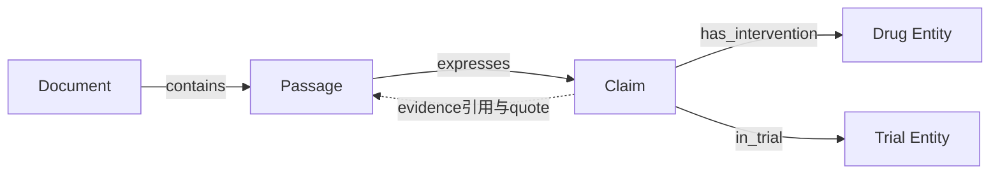
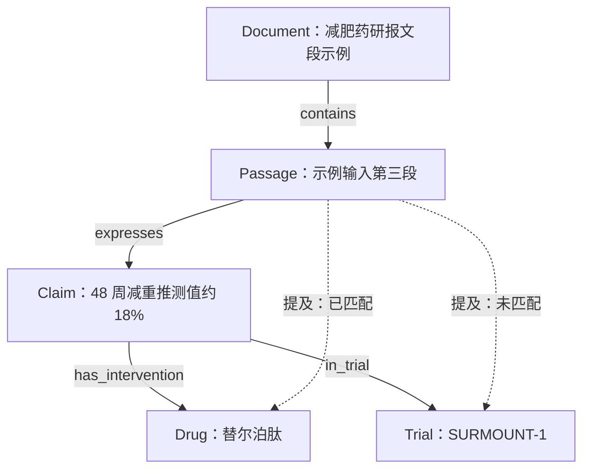

# 大创组会汇报｜Graph Construction & Research Design

## 0. 本周推进概览
- 本地部署并跑通 Youtu-GraphRAG
- 使用真实医药研报进行测试
- 分析 Youtu construction / retrieval 的实际行为
- 完成医药投研 graph schema v1
- 初步形成下一阶段实验方案

---

## 1. Youtu-GraphRAG Demo

本阶段已完成 Youtu 官方 Demo 的本地部署，并在医药研报上进行了构图与问答案例测试。当前工作定位为领域适用性测试，尚未复现论文基准结果，也尚未完成与其他方法的系统比较。

### 1.1 输入数据：从单段诊断到整篇研报

两轮实验承担不同任务：小文本便于逐条核对抽取结果，整篇研报用于观察跨段落、正文与表格结合后的检索和回答。

| 实验 | 实际输入 | 本轮要检查的问题 |
| --- | --- | --- |
| Pilot 1：第9页正文片段 | `obesity_p9_baseline_v01.txt`，约546字符，包含换行 | 数值、剂量、时间点、推测性质、比较设计和实体归属是否被保留 |
| Pilot 2：整篇研究内容 | `orient_obesity_full_youtu_v1.txt`，东方证券《MNC管线完善，重点转向开发平台——减重专题报告》，发布日期2026-04-05 | 能否跨正文、表格与图注整理平台布局、支持研报判断，并保留限定语 |

Pilot 1 的文本很短，但同时含有临床结果、跨试验比较、未来预期和投资判断。例如，“48周推测值约18%”包含时间点、数值、约数和推测性质，适合检查压缩表示是否丢失条件。

> [!example] 实体标注示例｜双靶点减重药物
> **2）II 级肥胖**（**BMI 35–40**）：**CT-388** 数据惊艳，**替尔泊肽**地位稳固。
>
> 近期，双靶点管线有 2 项关键临床数据读出：
>
> **2026 年 1 月 27 日**，**罗氏**发布 **CT-388** 治疗**肥胖患者**的 **II 期临床试验**顶线结果，治疗 **48 周**后减重幅度为 **22.5%**（**疗效估计目标**，**安慰剂校正后**）。非头对头比较下，此数据优于**替尔泊肽** **SURMOUNT-1** 研究 **15 mg 组**的表现（同口径下 **48 周推测值约 18%**），与**瑞他鲁肽**处于同一水平（**II 期研究**中同口径下 **48 周为 22.1%**）。
>
> **2026 年 2 月 23 日**，**诺和诺德**发布公告，**CagriSema** 在**肥胖人群**中与**替尔泊肽**头对头的 **REDEFINE-4** 研究未达到**非劣效终点**。治疗 **84 周**后，**CagriSema** 治疗患者减重幅度为 **23.0%**，**替尔泊肽**治疗患者为 **25.5%**（**疗效估计目标**）。
>
> **CagriSema** 预计今年底获批，预计不会对**替尔泊肽**产生显著冲击。其他管线方面，**CT-388** 和 **Amycretin** 等 II 期数据较好的管线今年启动 **III 期临床**，长期表现有待验证；**AZD9550** 及 **MET-097i** 联用 **MET-233i** 预计今年读出 **II 期数据**。我们认为双靶点中**替尔泊肽**的地位依然稳固。

Pilot 2 覆盖第1页摘要、第4–15页研究正文、表1–6，以及图1–17的标题、注释和可可靠转录的信息；去掉目录、重复页眉页脚等，保留原PDF页码、图表编号和 `BLOCK` 来源标记。未估读没有明确标签的曲线或柱形数值。因此，“整篇”指整篇研究内容的文本化输入，并不意味着全部图形信息均已无损解析。

### 1.2 Demo：图、原文证据与最终回答

| 案例              | 已运行的问题                                        | 展示重点                                    |
| --------------- | --------------------------------------------- | --------------------------------------- |
| Pilot 1 / Q5    | CT-388 的22.5%是否经过安慰剂校正？使用什么估计目标？              | 回答保留了原文的统计限定                            |
| Pilot 1 / Q6    | 根据这段材料，能否判断 SURMOUNT-1 和 REDEFINE-4 是罗氏开展的试验？ | 社区描述具有归属暗示；回答拒绝直接等同，却又增加了当前片段未明确提供的归属信息 |
| Pilot 2 / N1、N2 | 头部MNC布局重点如何变化？礼来、诺和诺德布局哪些平台？                  | 整篇研报中的证据整合表现与返回原文范围，详见 Observation 3    |

**Q5 的实际回答：**“是。CT-388 治疗48周减重22.5%是经过安慰剂校正后的数据，使用的是疗效估计目标。”该表述与输入片段一致。

**Q6 的实际表现：**回答指出主题聚类不代表申办方归属，没有直接接受“两个试验都属于罗氏”的推断。但它又写出“SURMOUNT-1 是礼来的试验”等信息，当前片段没有明确提供这一归属。公告发布者也不能自动等同于申办方。因此，要逐条检查回答中的主张，不能只按开头的“不能判断”将整题判为完全正确。

### 1.3 一个重要观察：答案表现、表示质量与证据充分性需要分开评价

当前案例中，Youtu 能回答部分涉及统计限定的问题，也能在整篇研报中整理观点与事实依据。已有表现值得保留为基线结果。

同时，三个评价对象需要分开：

| 评价对象 | 核心检查 |
| --- | --- |
| 图表示 | 是否保留原文条件，有没有增加原文不支持的语义？ |
| 检索证据 | 是否找全必要出处，范围是否过大，是否混入误导信息？ |
| 最终答案 | 是否准确完整，每条结论是否由本次材料支持？ |

合理的最终答案不能单独证明图表示忠实；图中出现局部问题，也不意味着最终答案必然错误。后续研究需要定位错误发生在哪一环节，并验证表示改动能否带来实际收益。

---

## 2. 从 Demo 得到的 Observations

### Observation 1 — 图结构中组织性关系占比较高，需要区分语义信息与索引开销

Pilot 1 输入约 546 字符，图导出包含 125 条边记录。Pilot 2 使用完整研报输入，约 2.84 万字符，图导出包含 2,161 条边记录。两次实验均按“节点标签＋名称”去重：

| 节点标签 | Pilot 1 | Pilot 2 |
| --- | ---: | ---: |
| entity | 17 | 317 |
| attribute | 20 | 374 |
| community | 4 | 43 |
| keyword | 17 | 187 |
| **合计** | **58** | **921** |

| 边类型 | Pilot 1 | Pilot 2 |
| --- | ---: | ---: |
| has_attribute | 33 | 867 |
| member_of | 17 | 307 |
| keyword_of | 17 | 187 |
| kw_filter_by | 17 | 187 |
| represented_by | 17 | 187 |
| participates_in | 9 | 58 |
| related_to | 9 | 152 |
| comparable_to | 3 | 28 |
| created_by | 3 | 69 |
| belongs_to | — | 52 |
| is_a | — | 37 |
| part_of | — | 22 |
| influences | — | 6 |
| precedes | — | 2 |
| **合计** | **125** | **2,161** |

在 Pilot 1 中，`has_attribute` 与四类关键词、社区组织边合计 101 条，占全部边记录的 80.8%；Pilot 2 中对应的组织边合计 1,735 条，占 80.3%。这说明两次导出中，相当一部分边用于保存属性和组织检索结构。它们可能有检索价值，不能仅凭数量认定为冗余。

Pilot 2 的边数约为 Pilot 1 的 17.3 倍，但两次输入的长度、内容和覆盖范围都不同，目前不能据此判断图结构随文本长度增长的规律。下一步应在相同构图配置下增加不同规模的输入，同时记录构图成本、关系质量和下游检索收益。

**对新设计的启发**：优先把临床条件作为结构化字段保存，用共享实体连接相关 Claim；谨慎添加仅由共现推断的关系，以及同一药物下 Claim 之间的两两连边。更简洁的图能否提高准确率、证据追溯能力或效率，仍需与 Youtu 进行对照实验。

### Observation 2 — Entity/triple abstraction 会压缩原始 context，也可能引入额外语义

将 Pilot 1 原文与 Q5 返回的三元组并排比较：

| 原文信息 | 当前返回的三元组表达 | 需要检查的问题 |
| --- | --- | --- |
| 48周减重22.5%，疗效估计目标，安慰剂校正后 | `CT-388 → has_attribute → efficacy: 48周减重22.5%` | 该属性中没有完整呈现统计限定 |
| 非头对头比较下，优于替尔泊肽，与瑞他鲁肽处于同一水平 | `CT-388 → has_attribute → comparison: 优于替尔泊肽，与瑞他鲁肽相当` | “非头对头”没有随比较结论出现 |
| SURMOUNT-1研究15mg组，同口径下48周推测值约18% | `替尔泊肽 → has_attribute → efficacy: SURMOUNT-1研究15mg组48周减重约18%` | “推测值”性质被弱化 |

这里的直接证据是：**这些返回三元组没有完整表达原文条件**。是否在图的其他位置仍保存了相关信息，需要继续追踪。

另一类问题是新增语义。返回的 `CT-388-GLP1-Combination` 社区描述写成“以CT-388为核心，联合替尔泊肽、瑞他鲁肽、CagriSema等GLP-1类减重疗法”。输入中的这些药物主要处于比较语境，并未表达这样的联合方案。社区描述也需要检查来源支持，不能仅把它当作无害标签。

**设计需求**: 把数值、适用条件、比较设计和主张性质绑定保存；对新增的关系或社区摘要同样检查来源支持。错误分析分别记录“丢失条件”和“增加无依据语义”。

### Observation 3 — 整篇研报实验中，Passage / chunk 仍承担大量证据内容

本节使用 Pilot 2 的两份原始返回结果。来源为已取回的 N1、N2 文件，见文末材料索引。统计对象是顶层 `retrieved_triples` 和 `retrieved_chunks`。

#### 案例 N1：研报观点与交易依据

**问题**: 报告认为，头部MNC的减重布局重点发生了什么变化？哪些交易或平台布局支持这一判断？请分别列出报告观点和事实依据。

回答概括了“单一产品转向平台和产品组合”，并按平台交易、产品组合与平台类交易、平台布局格局组织依据。它还列出诺和诺德与 VIVTEX 等交易的日期、标的和金额，说明系统具备一定的长文本整理能力；完整交易清单尚未逐项外部核验。

但返回的两类材料提供的信息不同：

| 返回内容 | 本次实际结果 | 能说明什么 |
| --- | --- | --- |
| 顶层三元组 | 20条：12条 `member_of`、8条 `keyword_of` | 主要是社区归属与关键词关联，未直接展示完整交易事实关系 |
| 原文块 | 5块；各块约5095–6444字符，原始字符串合计30,061字符 | 回答同时获得了大量可供阅读的原文记录 |
| 来源标记 | 5块合起来含 `BLOCK=001` 至 `BLOCK=130`，去重130个 | 覆盖了整篇文本版本的全部130个来源块标记 |

例如，三元组 `头部MNC → keyword_of → 创新药风险与商业化生态` 提供主题关联；VIVTEX 交易的日期、标的和金额可在返回原文的 `PAGE=4–5 / BLOCK=007 / 表1第1行` 定位。两者承担的信息粒度明显不同。

#### 案例 N2：平台类别与布局空缺

**问题**: 根据报告，礼来和诺和诺德布局了哪些类型的平台？其他MNC主要还存在哪些空缺？请结合正文和表格回答。

这次顶层20条三元组中，出现了更直接相关的属性和关系，例如：

- `诺和诺德 → has_attribute → 布局: 药物发现平台、制剂平台（口服、超长效）`
- `诺和诺德 → participates_in → 表观基因组控制器发现平台`
- `超长效制剂 → part_of → 制剂平台`

同时仍返回4个长原文块，原始字符串合计24,966字符，含105个去重来源块标记，占130个来源标记的80.8%。这一比例表示标记覆盖范围，不代表文本字数覆盖率或证据召回率。

回答能够整理两类平台及不同公司的布局，但原文中已经返回的限定语在答案中仍有弱化：

| 返回原文中的表述 | 最终答案中的表述 | 观察 |
| --- | --- | --- |
| `Nimbus→Non-GPCRs（推测）→口服小分子` | `Nimbus（Non-GPCRs→口服小分子）` | 列举时丢掉“推测” |
| 图15：`自有平台？→口服制剂`；正文：“或自建” | 前文写“或自建”，后续清单写“制剂平台包括自有平台” | 同一答案中不确定性保留不一致 |

对应位置：`PAGE=11 / BLOCK=061` 的平台正文与 `BLOCK=062` 的图15转录。这些限定已经出现在返回 chunk 中，因此不能直接将其在答案中的丢失归因于构图；还需要检查最终 prompt、截断情况和生成过程。

#### 这两题共同支持的结论

**Youtu 同时返回图三元组和原文块。整篇研报实验中，返回原文范围很大，chunk 承载了交易细节、平台列表和不确定性等大量内容**。 当前结果尚未分离图结构对答案的独立贡献。

### Observation 4 — 当前问答成功尚未显示图检索的额外收益

Pilot 1 中，一个 chunk 已覆盖短输入；Pilot 2 中，N1 的返回记录覆盖全部来源块标记，N2 也覆盖其中大部分。增加文档长度，并没有自动形成足够的证据筛选压力。

因此，目前可以报告已有问答表现，但尚不能据此判定 GraphRAG 优于普通 RAG，或图结构没有价值。评价要同时看答案质量、必要证据是否找齐、上下文规模与成本。

后续问题按任务划分，并在测试前固定判分要点：

| 任务 | 问题方向 | 检查重点 |
| --- | --- | --- |
| 条件保留 | 汇总同一药物不同试验的剂量、时间、结果和统计口径 | 是否遗漏或错配条件 |
| 正文与图注整合 | 图11中哪些结果未经安慰剂校正？ | 是否找齐脚注，是否错误推广局部说明 |
| 表格属性绑定 | 表4中哪些管线在美国和中国的开发阶段不同？ | 行列归属是否正确，“/”是否保留为未提供信息 |
| 文档内部不一致 | 不同位置如何描述ASC36半衰期？ | 是否保留不同记录及其限定，不擅自统一 |
| 证据边界 | 能否仅凭半衰期认定疗效或商业前景最好？ | 是否限制无依据推断 |

以上是待完成的后续测试，不计入已运行结果。跨文档比较和冲突识别需再加入独立来源；同一研报中的不同表述先称“文档内部不一致”。

### Observation 5 — 投研任务需要实体关系之外的条件与证据组织

| 需求 | 实际任务 | 对表示的要求 |
| --- | --- | --- |
| Provenance | 每条数值、判断从何而来？ | 返回原文引用及文档、页码、表格/图注位置 |
| Time | 发布日期、事件日期、治疗时长分别是什么？ | 分开保存时间含义，保留原始时间表达 |
| Numerical evidence | 18%和22.5%分别是什么结果？ | 绑定人群、剂量、时间点、统计口径与推测性质 |
| Cross-document comparison | 两份材料是否描述同一条件下的结果？ | 共享实体身份，保留独立来源级Claim |
| Conflicting evidence | 数值差异是否构成冲突？ | 先检查可比性，再审核冲突关系 |

前三项已有当前案例支持；后两项是接下来需要新增数据验证的需求。

**Research Question：**相较于当前 Youtu 表示，显式保留主张、条件和来源的图表示，能否减少医药研报中的条件丢失、无依据关系和回答证据不足，并在有限上下文预算下提供足够证据？

---

## 3. Proposed Graph Design

设计依据：[[graph_schema_v1]]。以下展示 v1 的核心组织原则与现有示例，完整字段清单留在规范中。

### 3.1 Node Schema

| 节点类型 | 作用 | 当前示例 |
| --- | --- | --- |
| Document | 保存来源身份和元数据 | 减重研报片段来源 |
| Passage | 保留原貌并提供定位 | 包含SURMOUNT-1描述的原文段落 |
| Claim | 保存一条可独立核对、带条件的来源陈述 | 替尔泊肽SURMOUNT-1研究15mg组，同口径下48周减重推测值约18% |
| Entity | 提供跨主张共享的对象身份 | 替尔泊肽、SURMOUNT-1 |

Entity 子类型为 Drug、Company、Trial、Target、Indication。属性作为字段保存，Alias、Mention、Evidence 在 v1 中使用记录或字段，不单独增加节点。

Claim 使用 `domain` 与 `claim_type` 两个维度。领域包括临床、研发监管、商业投研和机制；主张类型包括结果、比较、事件、预测、评价和关系陈述。当前原文中的“结果数值”“非头对头比较”“预计获批”“地位稳固”应分别保留其性质。

粒度规则：一条 Claim 保留一个可独立核对的主张和完整条件。不同试验、组别、时间点的结果分别记录；“结果A＋结果B＋比较结论”通常形成三条 Claim。不能为了凑类型，拆出原文没有明确给出的数值结果。

### 3.2 Relation Schema

主展示按用途解释关系，完整18个边名见规范。

| 关系组                    | 代表关系                                                         | 约束与动机                             |
| ---------------------- | ------------------------------------------------------------ | --------------------------------- |
| document&passage&claim | Document `contains` Passage；Passage `expresses` Claim        | 原文表达某主张，不等于该主张在现实中必然为真            |
| claim&entity           | `has_intervention`、`has_comparator`、`in_trial`、`has_subject` | 区分干预、对照、试验和陈述主体；跨试验比较对象不能误连为本试验对照 |
| claim&claim            | `compares_result`、`uses_as_basis`                            | 保留比较所引用的结果，以及结论依赖的依据；同主题不自动构成依据   |
| 经审核的关系                 | `contradicts`、`supersedes`                                   | 先审核可比性与更新含义，数值不同或发布时间较新均不足以自动连边   |
| 可选实体派生索引               | `targets`、`developed_by`、`sponsored_by`等                     | 从合格来源主张派生，并可回溯支持它的Claim           |

Pilot 1 / Q6 说明：`announced_by` 表示发布行为，`sponsored_by` 表示试验申办关系，两者不能互换。社区共现也不产生任何一种归属关系。

### 3.3 Hierarchical Structure

组织主线为 Document → Passage → Claim → Entity，实际结构允许多对多连接。

一个 Passage 可以表达多个 Claim，一条 Claim 可以引用多个证据文段，同一 Entity 可以被多个 Claim 共享。Claim 之间还可以比较或引用依据。

Evidence 是 Claim 中的引用记录，指向 Passage 并保存 quote；它不构成当前 v1 的独立节点层。

### 3.4 为什么增加 Claim–Evidence layer

以 [[graph_example_v1.json]] 中的单条claim为例，展示“原文—主张—条件—证据—实体”的绑定。

> 替尔泊肽 SURMOUNT-1 研究15 mg组，同口径下48周减重推测值约18%。

按当前 Markdown 规范中的 PICO＋result 组织展示：

| 字段 | 本例保留的内容 |
| --- | --- |
| population | 未说明，保持未知 |
| intervention | 替尔泊肽；15 mg；其他未说明方案不补写 |
| comparator | 未明确说明；不把另一试验药物直接当成本试验对照 |
| outcome | 减重幅度 |
| result | 48周、约18%、推测值、“同口径下”；未明确的统计口径保持未知 |

Claim 公共信息另含来源引文、实体链接和审核状态。替尔泊肽使用登记ID `DRUG_002`；SURMOUNT-1 在现有示例中保留临时 Trial ID。

这套设计要检验的作用是：数值与条件一起进入检索结果；推测性质不被压成无条件事实；每条主张可以回到原文；相邻主张的统计限定不被直接复制过来。

**当前实现状态**： 已有graph_schema、JSON Schema及单条格式示例，尚未实现通用抽取器、实体消歧器、语义 verifier 和完整运行时校验器。示例含1个Document、1个Passage、1个Claim、2个Entity、4条边和2条提及链接，审核状态仍为 `not_checked`。

审核分为两层：结构检查确认字段、类型与引用等是否合法；语义检查确认原文是否支持主体、数值、条件、否定、推测性质及连边。结构通过不能自动将状态改为 `passed`，通过语义检查也仅说明忠实于来源。

### 3.5 Provenance / temporal information

**来源**：Document 保存标题、来源、链接与发布日期，Passage 保存页码、章节或块标记。Claim.evidence 至少记录 `passage_id + quote`，引文应能在对应原文定位；表格和脚注分布在不同位置时，允许增加证据引用。

**时间**：区分文档发布日期、事件发生日期、治疗或随访时长，以及预测目标时间。Pilot 1 单段中“今年底”缺少明确文档日期时保留原词；Pilot 2 的文档元数据可提供日期上下文，但规范化仍须与具体主张核对。

**跨来源**：同一对象在不同来源中的 Claim 分别保留。先对齐试验、人群、组别、剂量、终点、时间点和统计口径，再判断可比性与冲突。转引同一研究不自动计为多份独立研究证据；新来源也不自动覆盖旧记录。

### 3.6 实体标准化：接入成员 E 的别名库

成员 E 的现有交付与 schema 记录包含63条别名、14个实体，覆盖 Drug、Company、Target、Indication，尚无 Trial 登记。

连接流程：识别原始mention → 查询标准名/别名 → 检查类型与上下文 → 复用统一ID → 保存原始mention及链接依据。未命中或有歧义的实体保留临时ID，不强行合并。

同药物的不同名称可以共享身份，但不同试验和结果继续独立。商品名不能在所有语境下无条件视为成分级同义词；别名库也不能补写研报没有表达的公司、药物或试验关系。当前对接是接口规则和示例，实际命中率与错误合并率尚待运行测试。

---

## 4. 从 Graph 到 Research Workspace（Tentative）

当前核心：Graph 承担知识表示与证据检索。一个后续系统设想是，将检索出的 Claim、原文和结构化数值送入可编程工作区，再完成比较、聚合、数值分析和报告生成。

例如，任务为“整理某药物各项研究结果及可比性”：先检索相关 Claim，输出包含来源、试验、剂量、时间点、指标、数值、单位、限定语和审核状态的证据表；再检查哪些记录可比较，执行有依据的计算，生成保留引用的报告。

所有计算结果继续记录输入证据和操作，避免把统计口径不同的结果直接聚合。现有临床模板可以作为起点；交易和平台分析所需结构还需后续扩展与验证。

这一方向与此前讨论的 FinSight 启发相联系，但本次只陈述我们自己的系统设想。具体文献模块及实现对照待补，当前实验仍聚焦 graph representation。

---

## 5. 下一阶段实验与组会讨论事项

### 5.1 先固定数据、问题与评分依据

保留 Pilot 1 与 Pilot 2 两套数据。先统一 schema 的文字和机器版本，对同一批片段建立人工核对表：应抽取哪些主张、必须保留哪些条件、来源在哪里、哪些结论不能推出。

沿用已设计的整篇研报任务，补做统计口径、表格行列绑定、正文与脚注整合、文档内部不一致等测试。保存成功与失败结果，不因模型答对而事后更换问题或判分标准。跨来源测试另加真实独立材料。

### 5.2 第一阶段：检查表示是否忠实

在相同输入片段上比较 Youtu 与新 schema 的自动抽取，优先记录：

| 指标 | 核对方式 |
| --- | --- |
| 主张覆盖 | 人工标注的应有主张中，抽取出多少条 |
| 条件保留 | 应保留的时间、剂量、比较设计、统计口径、推测性质有多少被正确绑定 |
| 数值归属 | 数值是否连接到正确药物、试验、组别、指标与时间点 |
| 无依据语义 | 抽取关系、主张或摘要是否超出来源支持 |
| 引用质量 | 引文能否定位，是否真正支持所附主张 |
| 身份解析 | 已知同一实体是否正确合并，不同实体是否被误合并 |
| 成本 | 节点/边数量、构图时长、调用量及token开销 |

以实际自动输出评分；手工示例用于解释格式，不参与自动抽取性能比较。

### 5.3 第二阶段：检查检索和回答收益

先补“全文直接问答”诊断基线，再完成正式检索对照：

| 对照 | 给模型的材料 | 用途 |
| --- | --- | --- |
| 全文直接问答 | 同一份清洗文本 | 判断已有问题在材料充分时是否本来就容易回答；属于诊断基线 |
| 普通Chunk RAG | 从同一语料检索的文本块 | 比较普通文本检索表现 |
| Youtu | 当前系统返回的图信息与文本证据 | 保留现有系统作为基线 |
| Claim–Evidence方案 | 主张、条件与可追溯原文 | 检验新表示能否减少错配并提高证据效率 |

正式检索比较固定问题、生成模型、回答要求、尽可能一致的解析输入与上下文token预算，记录配置差异。全文直接问答单独报告，其预算可能不同，不冒充同预算检索比较。

此外，对同一问题做“仅图信息 / 仅返回的文本证据 / 两者结合”的诊断，观察信息来源的贡献。先保存实际最终 prompt，核对截断、重排和去重；不能直接用 `retrieved_chunks` 长度代替模型实际输入量。

回答评价分别记录正确性、完整性、限定语保留、引用支持、证据不足时是否适当保留判断，以及实际token和时延。证据效率需结合人工标注的必要证据评价，不能只用返回文本越短越好。

### 5.4 按错误环节决定下一步

| 观察到的情况 | 优先检查 |
| --- | --- |
| PDF有，输入文本没有 | 解析、表格与图注转录 |
| 输入有，图中漏掉或错挂 | 构图与实体链接 |
| 图或原文中有，检索未返回 | 检索策略与证据选择 |
| 返回有，最终prompt没有 | 上下文组装或截断 |
| 最终prompt有，答案仍丢失条件 | 生成与答案核查 |

组会希望讨论：
- 当前的图表示是否合理，哪部分需要简化，哪部分需要扩充？
- 下一步应该如何设计实验和benchmark，才能检验这套流程比youtu和普通RAG更适合医药投研问题？

---

## 材料索引

- 设计说明：[[graph_schema_v1]]；机器格式：[[graph_schema_v1.json]]；当前格式示例：[[graph_example_v1.json]]。
- Pilot 1 输入：[原文片段](file:///D:/学习/大创/实验/2026-09-19_pilot1/obesity_p9_baseline_v01.txt)；[图导出](file:///D:/学习/大创/实验/2026-09-19_pilot1/obesity_p9_baseline_v01_new.json)；[Q5结果](file:///D:/学习/大创/实验/2026-09-19_pilot1/Q5返回值.txt)；[Q6结果](file:///D:/学习/大创/实验/2026-09-19_pilot1/Q6返回值.txt)。
- Pilot 2 原始返回：[[组会/meeting_02_assets/N1_full_report_result.txt|N1：研报观点与交易依据]]；[[组会/meeting_02_assets/N2_full_report_result.txt|N2：平台布局与空缺]]。
- 成员 E：[组会汇报](file:///D:/学习/大创/组会/组会2/组会汇报_成员E.md)；别名库：[[副本combined_resources.xlsx]]。

原始返回保留完整字段，便于复核顶层三元组、原文块、子问题和中间步骤。统计与结论均按各自记录范围陈述，不将来源标记覆盖率当作证据召回率。
