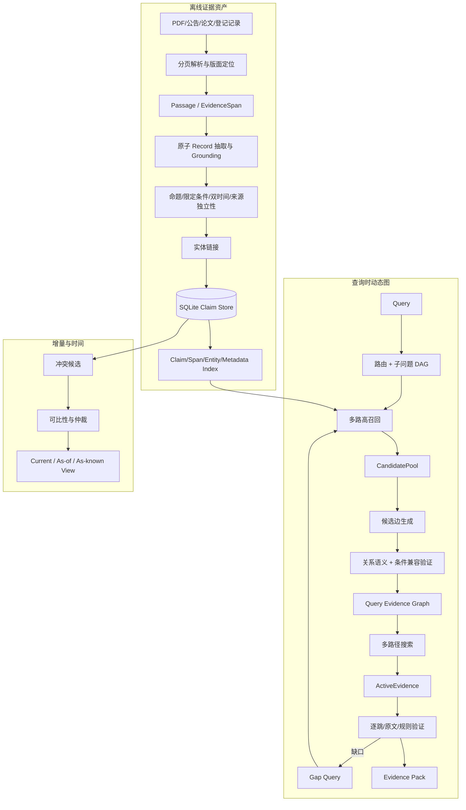

# Pharsight Claim 驱动动态 GraphRAG V2 架构设计

> 文档性质：下一版完整理论与工程架构基线  
> 版本：V2.0  
> 日期：2026-10-19  
> 适用模式：`pharma_company`、`pharma_industry`  
> 当前运行时落地基线：`pharsight-graph-v1.2` / `graphrag-v1.3`  
> 设计输入：《面向医药投研的 Claim 驱动动态 GraphRAG：技术设计与实验方案》及现有 V1.2 实现  
> 状态：核心数据契约和单轮查询子图已实现；迭代桥接、路径验证、时间仲裁和 Dense 通道按本文分阶段实施

## 1. 设计结论

V2 不建设全库 Claim—Claim 语义关系网，而采用五个彼此解耦的能力面：

1. **Claim Store**：离线保存可回原文的来源断言，并区分来源断言、规范命题和独立研究；
2. **Hybrid Index**：用 Claim、原文、实体、条件、元数据和后续 Dense 索引保证初始召回；
3. **Query-scoped Evidence Graph**：收到问题后才对相关 Claim 发现和验证关系；
4. **Verified Multi-hop Reasoner**：维护候选池与有效证据池，搜索多条路径并逐跳验证；
5. **Temporal Arbitration**：以追加事件和双时间视图处理状态更新、科学分歧及历史回测。

持久化基础仍是无 `Source` 节点的三层图：

- 第一层：`Document / Passage / EvidenceSpan`；
- 第二层：`Claim / Observation / Event`，统称 Record；
- 第三层：`Entity`。

“Source Layer”只表示来源元数据和证据坐标系，不恢复独立 `Source` 图节点。查询子图、路径、
子问题、缺口和仲裁记录是运行时控制对象或附属审计记录，不是第四层知识节点。

## 2. 要解决的问题与非目标

### 2.1 核心问题

在批准的证据范围、报告截止时间和查询预算内，从全文材料中找到一组充分且可比较的来源
断言，判断它们之间是支持、限定、矛盾、更新、同源还是仅相关，最后返回可以逐句核验的
Evidence Pack。

系统优化目标是：

\[
\max (Recall_{claim}, Recall_{evidence\ set}, EdgeF1, PathValidity, Faithfulness)
\]

并约束：

\[
Latency \le B_l,\quad ModelCost \le B_c,\quad ContextTokens \le B_t
\]

完整证据链的损失可能依次发生在解析、抽取、召回、连边、路径选择和推理验证。最终答案
正确不能反向证明这些中间步骤正确，因此必须分层记录和评测。

### 2.2 非目标

- 不让模型直接阅读 PDF 代替确定性解析/OCR；
- 不把每个实体共现都写成持久语义边；
- 不用边置信度或来源等级冒充命题为真的概率；
- 不用 Claim 条数代替试验数、产品数或市场统计；
- 不在没有对照实验时声称 GraphRAG 必然优于 Chunk RAG；
- 不在当前阶段引入 Neo4j、GNN、社区摘要或未经评测的医学本体自动合并；
- 不让候选关系、模型摘要或推理路径替代原文引用。

## 3. 总体架构



### 3.1 强制不变式

| 不变式 | 要求 |
| --- | --- |
| Evidence-first | 每条可用 Record 至少连接一个可定位 EvidenceSpan |
| 来源断言不等于真值 | Record 表示来源说了什么；审核、仲裁和报告结论另行处理 |
| 相关不等于支持 | `RELATED` 只能用于探索，不能进入证明路径 |
| 关系语义与查询效用分离 | relation/classifier score 描述边本身；utility 描述它对当前问题的价值 |
| CandidatePool 与 ActiveEvidence 分离 | 宽召回候选不会自动进入推理上下文 |
| 条件先于比较 | 人群、剂量、终点、时间、币种等未对齐时不得直接判矛盾或优劣 |
| 双时间 | 现实有效期与系统获知时间分别保存 |
| 历史不覆盖 | 新状态追加并形成视图；原来源断言原则上不物理改写 |
| 失败显式化 | 缺口、验证未运行、预算耗尽和回退必须进入 trace/warning |

## 4. 持久化三层图

## 4.1 第一层：Document

Document 是一次可审计的内容版本，不是发布者节点。

| 属性组 | 子属性 | 规则 |
| --- | --- | --- |
| 身份 | `id` | 由内容哈希派生的稳定 ID |
| 身份 | `document_hash` | 原始文件或规范解析内容哈希；用于幂等和缓存失效 |
| 版本 | `document_version` | 同一逻辑材料的递增版本；V2 目标字段 |
| 来源 | `source_id` | 贯穿 ToolResult、Memory 和报告的批准来源编号 |
| 来源 | `title`、`publisher`、`source_url` | 原材料标题、发布主体和稳定地址 |
| 时间 | `published_at` | 公开时间，不能由获取时间替代 |
| 时间 | `retrieved_at` / `recorded_at` | 系统取得/登记该版本的时间 |
| 时间 | `reporting_period` | 财务或数据覆盖期 |
| 截止 | `as_of` | 研究允许使用信息的截止时点 |
| 处理 | `parser`、`page_count`、`content_type` | 解析器、完整页数和载体类型 |
| 质量 | `source_type`、`reliability_tier` | 来源类别和优先级；不等于内容必真 |
| 限制 | `limitations`、`license` | OCR、转载、许可、缺页等限制 |

## 4.2 Passage

| 属性组 | 子属性 | 规则 |
| --- | --- | --- |
| 身份 | `id`、`document_id`、`chunk_id` | 块身份在同一文档版本内稳定 |
| 定位 | `page_start/page_end` | PDF 必须真实；原则上块不跨页 |
| 定位 | `section_title` | 章节、表名或图名；未知不补写 |
| 版面 | `block_type` | paragraph/table/footnote/caption/header 等，V2 目标字段 |
| 表格 | `table_id`、`row_labels`、`column_labels` | 数值表格必须保留行列语境，V2 目标字段 |
| 内容 | `text`、`content_hash` | 解析原文和内容哈希 |
| 邻接 | `previous_chunk_id/next_chunk_id` | 只表达阅读顺序，不代表语义支持 |

Passage 是漏抽兜底通道。即使某页没有 Record，也必须可被 Chunk/BM25 或后续 Dense 通道
找回；关键临床、监管、财务主表零 Record 应进入构建质量告警。

## 4.3 EvidenceSpan

| 属性 | 说明 |
| --- | --- |
| `id` | Passage + 字符范围 + quote 的稳定身份 |
| `passage_id` | 唯一父 Passage |
| `quote` | 连续原文，不允许模型改写 |
| `start_char/end_char` | quote 在 Passage 内的字符坐标 |
| `field_paths` | 该 span 支持 Record 的哪些字段 |
| `locator` | 页、表、行列、脚注、图注等扩展位置，V2 目标字段 |
| `grounding_status` | exact / whitespace_normalized / rejected，V2 目标字段 |

EvidenceSpan 只证明“Record 是否忠实复述该处来源”，不能证明来源内容在现实世界为真。

## 4.4 第二层：Record 总模型

Record 是来源断言，分 Claim、Observation、Event。三类共享以下属性：

| 属性组 | 子属性 | 语义 |
| --- | --- | --- |
| 来源身份 | `id` | `canonical_proposition_id + evidence_id`；不同来源断言不合并 |
| 命题身份 | `canonical_proposition_id` | 对规范命题与限定条件的稳定哈希，用于聚类而非覆盖 |
| 独立性 | `origin_study_id` | 底层试验/研究/统计表身份，防止转载被重复计票 |
| 类型 | `record_type` | Claim / Observation / Event |
| 陈述 | `text` | 忠实的来源陈述 |
| 命题 | `proposition` | subject/predicate/object 或 metric/value/event 核心 |
| 限定 | `qualifiers` | 人群、剂量、臂、终点、报告期、地区、币种等适用条件 |
| 原字段 | `attributes` | 类型专属完整字段；兼容既有实现 |
| 断言种类 | `assertion_kind` | 研究观察、监管状态、财务披露、指引、预测、观点、假设等 |
| 认识论 | `epistemic_status` | asserted/reported/estimated/forecast/opinion/hypothesis/unknown |
| 极性 | `polarity` | positive/negative/uncertain/neutral，不是投资评级 |
| 材料性 | `materiality` | 与 query 无关的投研重要性四维及确定性汇总分 |
| 有效时间 | `valid_from/valid_to` | 现实状态或结论适用区间 |
| 获知时间 | `recorded_at` | 系统何时可见该断言；历史回测以此防信息泄露 |
| 证据 | `evidence_ids` | 至少一条可定位 EvidenceSpan |
| 审核 | `review_status` | candidate/approved/rejected/superseded |
| 版本 | `extractor_version/model_name` | 抽取器和实际模型标识 |

### 4.4.1 命题与来源断言的区别

两篇材料都引用同一试验 ORR=48% 时：

- 有两个 Record ID，因为原文和传播来源不同；
- 可以共享一个 `canonical_proposition_id`；
- 应共享 `origin_study_id`；
- 证据综合按独立研究计数，不能把两个来源当两项独立支持。

同一 quote 中的 ORR、PFS 和不良事件应拆为三条 Observation；共同条件进入 qualifiers，
共同试验进入 origin_study_id。

### 4.4.2 Claim 属性

| 子属性 | 说明 |
| --- | --- |
| `subject/predicate/object` | 判断核心；缺失时保持缺失 |
| `basis` | 来源明示依据，不由模型外推 |
| `conditions` | 情景、人群、地区、产品范围等 |
| `qualifiers` | may/initial/exploratory/significant 等限定语 |
| `forecast_target/forecast_time` | 预测对象与目标时间 |
| `uncertainty` | 概率、区间或定性不确定性 |

### 4.4.3 Observation 属性

| 子属性 | 说明 |
| --- | --- |
| `object/metric/value/value_nature` | 对象、指标、原始值和数值性质 |
| `numerator/denominator/sample_size` | 比率和样本量信息 |
| `unit/currency` | 单位和币种 |
| `ci_lower/ci_upper/p_value/hr` | 统计不确定性和效果量 |
| `population/line_of_therapy` | 人群和治疗线数 |
| `intervention/dose/route/frequency` | 干预条件 |
| `comparator/arm/design/phase/trial_id` | 试验设计条件 |
| `endpoint/endpoint_definition/estimand/analysis_set` | 终点与分析口径 |
| `timepoint/data_cutoff/reporting_period` | 测量和数据时间 |
| `geography/segment/method/conditions` | 地区、分部、计算方法和其他条件 |

### 4.4.4 Event 属性

| 子属性 | 说明 |
| --- | --- |
| `subject/event_type` | 事件主体和类别 |
| `event_time/disclosure_time` | 发生时间与披露时间分开 |
| `prior_status/new_status` | 状态变迁 |
| `jurisdiction/indication/trial_id` | 适用范围 |
| `effective_from/effective_to` | 状态生效区间 |
| `counterparty/transaction_terms` | 交易事件可选字段 |

## 4.5 第三层：Entity

当前保留 16 类实体，并在 V2 目标中增加机制和试验细粒度对象：

`Company, Security, Drug, Program, Brand, Target, Modality, Indication, Trial, Regulator,
Policy, Payer, MarketSegment, TechnologyPlatform, Transaction`；目标扩展为 `TrialArm,
Population, Endpoint, Outcome, AdverseEvent, Mechanism, Patent, LicenseDeal`。

| 属性 | 规则 |
| --- | --- |
| `id` | 优先使用受审外部 ID；否则类型 + 规范名稳定哈希 |
| `entity_type` | 禁止跨类型合并，例如 Drug ≠ Program ≠ Brand |
| `canonical_name` | 当前规范名 |
| `aliases` | 中英文、研发代号、旧名；保留来源和审核状态是 V2 目标 |
| `external_ids` | 注册号、证券代码、词表 ID 等 |
| `resolution_status` | resolved/temporary/needs_review |

实体链接顺序：强 ID → 受审别名 → 类型约束名称候选 → 上下文 rerank → 保留多候选/待审。
不确定时不得强制合并。

## 5. 边体系与生命周期

## 5.1 持久结构边

| 边 | 生成方式 | 语义 |
| --- | --- | --- |
| Document `CONTAINS` Passage | 确定性 | 文档包含文本块 |
| Passage `YIELDS` Evidence | 确定性 | 文本块产生可定位 span |
| Evidence `SUPPORTS_RECORD` Record | Evidence gate | 原文支持来源断言的抽取 |
| Record → Entity 角色边 | 模型抽取 + 实体链接 | ABOUT、SUBJECT、OBJECT、IN_TRIAL、FOR_INDICATION 等 |

结构边可重建、可持久化；它们不表示跨 Claim 推理关系。

## 5.2 查询时语义边

V2 关系集合分为四个用途组：

| 组 | 关系 | 是否可进入证明路径 |
| --- | --- | --- |
| 证明 | `ENTAILS`、`SUPPORTS`、`CONTRADICTS` | 必须经逐跳验证后才可 |
| 比较 | `EQUIVALENT_TO`、`COMPARES`、`INCOMPARABLE_WITH` | 等价/可比通过条件门后可；不可比用于阻断 |
| 时间 | `TEMPORAL_PRECEDES`、`SUPERSEDES` | 只表达时间/状态更新，不自动表达因果 |
| 探索 | `QUALIFIES`、`ELABORATES`、`SUPPLEMENTS`、`RELATED`、`SAME_ORIGIN_AS`、`PREREQUISITE` | 默认只导航；PREREQUISITE 经规则验证后可进入路径 |

`QueryGraphEdge` 至少包含：

| 字段 | 说明 |
| --- | --- |
| `source_id/target_id` | Record 端点 |
| `relation` | 稳定语义标签 |
| `confidence` | 分类器把握，不是事实概率 |
| `query_relevance` | 对当前问题的效用，0～1 |
| `context_compatible` | 已知限定条件是否兼容 |
| `verified` | 是否通过独立路径/规则验证；模型分类后仍默认为 false |
| `edge_role` | proof/exploration/comparison/temporal |
| `comparability` | 各条件的 equal/different/unknown |
| `reason` | 可审核理由 |
| `edge_evidence_ids` | 两端原文 span |
| `cache_key` | 命题版本对 + 关系 + 模型/本体版本的哈希 |
| `model_name/review_status/origin` | 判定模型、审核状态、query_time 来源 |

关系语义可以按命题版本缓存，但 query utility 不缓存为全局常量。Claim、实体、本体、模型或
限定条件变化时基础关系缓存失效。

## 5.3 关系逐类判定

### ENTAILS

只有在右侧结论可由左侧来源断言和明示规则推出、且所有关键 qualifiers 不冲突时成立。
“体外抑制靶点”不能蕴含“临床有效”；亚组结果不能蕴含总体人群结果。当前运行时只把它
作为候选 proof 边，`verified=false`，需后续 verifier 才能用于最终结论。

### SUPPORTS

左侧为右侧提供证据方向，但不构成逻辑必然。至少共享受控实体，且人群、终点、时间等
差异必须写入 comparability。两个 Event 的时间先后不等于支持。

### CONTRADICTS

先证明可比，再判断在相同对象、指标/状态、口径、时间窗口下结果互斥。不同试验阶段、
人群、终点、治疗线数或估计目标通常是不可比或 context-dependent，不直接判矛盾。

### EQUIVALENT_TO

对象、指标/事件、数值/状态、单位、条件、时间和极性一致；同 quote 本身不充分。同一规范
命题的不同来源断言仍需检查是否同一底层研究。

### COMPARES / INCOMPARABLE_WITH

只有 comparison query 才生成。COMPARES 表示两侧构成一个合法比较框架，不表示优劣；
INCOMPARABLE_WITH 必须指出阻断维度，且不会被放入确定性排序。

### SUPERSEDES

要求稳定业务/试验/监管主体、明确更新或纠错语义以及可排序有效时间。后发布不等于替代；
科学研究结果通常并存，不因更晚发表而自动覆盖。

### TEMPORAL_PRECEDES

要求同一时间线主体和两个明确可比较时间。只用于时间轴，不能沿边传播因果或支持。

### QUALIFIES / ELABORATES / SUPPLEMENTS

QUALIFIES 增加适用限制；ELABORATES 展开同一命题细节；SUPPLEMENTS 提供互补维度。三者
均须共享命题核心或实体，默认属于探索边。

### SAME_ORIGIN_AS

相同 Evidence 是确定性强条件；相同 `origin_study_id` 是跨来源同研究条件。相同公司、作者
或主题不够。同源记录在证据投票和路径多样性中只计一个独立来源组。

### RELATED

只表示值得继续探索的语义邻近，不允许作为“所以”的依据，也不参与证据充分性计算。

### PREREQUISITE

表示某证据是回答另一子问题或使用另一条边的前提，例如先验证试验可比性，才能执行疗效
比较。它依赖 QueryPlan DAG，不能仅凭两个 Claim 文本相似生成。

## 6. 离线构建流程

1. 验证来源授权、source ID、发布时间和 cutoff；
2. PDF 先经 pdfplumber/OCR 得到分页文本，模型不直接读文件；
3. 固定 Document hash、Passage、页码、块号和版面元数据；
4. 主模型抽取原子 Record、精确 quote、proposition、qualifiers、assertion_kind、origin study、
   时间和实体提及；
5. Pydantic 校验类型，Evidence gate 精确定位 quote；
6. 对数值、单位、日期、剂量、终点和否定执行确定性校验；
7. 计算 canonical proposition ID 和来源 Record ID；
8. 实体强 ID/别名/上下文消歧，不确定时 needs_review；
9. 原子事务写入 Document bundle；失败不留下半成品；
10. 建立 Claim、原文、实体、条件和元数据索引；后续再增加 Dense；
11. 不在 ingest 阶段生成全库 Claim—Claim 语义边。

同一 document hash + schema + extractor + model 成功时复用。Schema/extractor 版本变化触发
重建；原数据库通过增加列迁移，旧静态语义边不参与 V2 在线遍历。

## 7. 在线查询与动态构图

## 7.1 路由

QueryPlan 将问题路由为：

- `simple_fact`：Claim/Chunk 直接检索，不强制动态图；
- `multi_hop`：子问题 DAG、动态图、桥接回检和路径验证；
- `comparison`：强制可比性门控和支持/反对双路径；
- `global_trend`：主题分层、数据库聚合和来源归一，不以局部 top-k 代表总体；
- `temporal_status`：有效时间、获知时间、状态变迁和权威来源；
- `quantitative_analysis`：检索参数后交确定性计算器。

QueryPlan 还保存实体及别名、关键词、记录类型、领域、时间范围、关系需求、子问题 DAG、
required evidence types 和最大跳数。规划失败时回退确定性 n-gram/BM25，但记录 warning。

## 7.2 多路高召回

初始候选为：

\[
C_0=C_{claim}\cup C_{proposition}\cup C_{qualifier}\cup C_{span}\cup C_{entity}
\cup C_{metadata}\cup C_{BM25}\cup C_{dense}
\]

当前运行时已经实现除 Dense 外的可解释通道，并以 Reciprocal Rank Fusion 融合：

\[
RRF(c)=\sum_m \frac{w_m}{k+rank_m(c)} + prior_{type/domain}+prior_{materiality}
\]

其中类型、领域和材料性只给小幅先验，不能覆盖相关性；source/document/cutoff/rejected 是硬
过滤。未来 Dense 通道加入时必须作为独立排名接入 RRF，不直接与词法原始分相加。

候选池默认宽于最终 top-k。评测优先优化 Claim Recall@pool 和完整 Evidence Set Success，
不能只优化 top-k precision。

## 7.3 CandidatePool 与 ActiveEvidence

CandidatePool 保存宽召回 Record ID、各通道排名、原始分数、轮次和来源；低分候选只软降级。
ActiveEvidence 是经过路径选择、来源多样性和预算截断后真正进入分析上下文的少量证据。

Evidence Pack 分别返回 `candidate_record_ids`、`active_record_ids`、`retrieval_rounds`、
`open_gaps`、`verification_status` 和 `trace_id`。当前单轮实现的 verification_status 为
`not_run`，不能被下游解释为已经完成多跳验证。

## 7.4 两阶段边构建

阶段 A 以共享实体、origin study、相同命题维度、时间主体、医学模板和后续语义近邻生成
候选 pair；每次 Query 有 Record 数和 pair 数硬预算。阶段 B 由主模型/NLI 分类，再经过关系
专属 hard gate。低于阈值、端点越界、关系不在计划白名单或条件不满足的边拒绝。

基础关系置信和 Query utility 分开保存。相同 Claim 版本对的基础分类可以缓存；不同 Query
只重算 utility、角色和是否进入路径。

## 7.5 子问题 DAG 与路径搜索

每个子问题包含：`id, question, required_evidence_types, depends_on, keywords,
evidence_found, verification_status, open_gaps`。依赖未满足时，下游定量比较不得启动。

路径评分建议：

\[
S(P,q)=\alpha Rel+\beta Edge+\gamma Coverage+\delta Provenance
-\lambda Redundancy-\eta Incompatibility
\]

Beam Search 同时保留支持路径、反对路径和替代路径；同一 origin study 的多篇来源不获得
虚假的来源多样性奖励。`RELATED` 和纯时间邻接边不能进入 proof path。

## 7.6 逐跳验证

每一步结构化为：

```json
{
  "premise_claim_ids": ["record:a", "record:b"],
  "inference_rule": "comparable_trial_outcomes",
  "conclusion": "...",
  "label": "ENTAILS|SUPPORTS|CONTRADICTS|INSUFFICIENT",
  "source_span_ids": ["evidence:x", "evidence:y"],
  "checks": {"population": "equal", "endpoint": "equal", "time": "unknown"}
}
```

关键结论必须重新读取 EvidenceSpan/Passage。验证器区分：Record 是否被原文支持；多条 Record
能否支持新结论。两者不可用同一分数代替。

## 7.7 缺口回检与停止

若缺少桥接实体、比较条件、原始 span、反证或时间状态，Controller 产生结构化 Gap Query，
重新搜索整个 Claim Store 和原始 Chunk，而非只找当前图邻居。新 Record 进入 CandidatePool，
再局部连边。

停止条件：必需子问题覆盖；高风险结论通过验证；关键矛盾已处理；或达到轮数/token/费用/
时延预算。本轮新 Claim 接近零、相同 gap 重复或路径只重复同源证据时提前停止。证据不足时
输出已证事实、可支持推断、关键未知和拒答原因。

## 8. 时间、冲突与增量知识

## 8.1 双时间

- `valid_from/valid_to`：现实状态生效区间；
- `recorded_at`：系统得知该信息的时间。

`as_of(t)` 查询现实有效状态；`as_known_at(t)` 查询当时系统实际可知的信息。历史回测必须
同时满足 recorded_at 和报告 cutoff，避免未来信息泄露。

## 8.2 状态事实与科学证据分流

状态事实（试验状态、批准、权益转让）可通过权威来源和有效时间形成 current view；旧状态
仍保留。科学证据（疗效、安全性、机制）通常并存，不能简单“新覆盖旧”或多数投票。

## 8.3 仲裁记录

仲裁是附属不可变记录，字段包括：claim group、候选 Record、compatibility、conflict class、
decision、review basis、effective as-of、reviewer、human-review flag。决定可为 coexist、current、
disputed、unresolved、withdrawn。原 Record 不因仲裁被改写。

高风险监管状态、临床有效/无效和投资结论应保留人工复核开关。当前运行时尚未实现持久
仲裁表和 as-known view，这是 V2 下一阶段，不得在报告中假装已经仲裁。

## 9. 全局趋势与数值分析

趋势问题按 Modality、Target、Indication、Company、Time、Stage 分层抽样和聚合，报告 strata
coverage。数量来自 Trial/产品/结构化事实表，不数 Claim 条数。必要时增加主题摘要作为互补
模块，但摘要仍需链接到底层 Evidence。

财务、市场和估值计算由确定性函数执行。Claim 只提供参数、范围、时间和来源；计算结果保存
公式版本、输入 Record、单位换算、情景和日志。自然语言路径不能伪造统计检验或 NPV。

## 10. 存储、投影与接口

SQLite 继续作为 V2 MVP 权威存储，NetworkX 只构造查询时临时投影。核心表：documents、
passages、evidence_spans、records、entities、record_entities、edges、build_runs。records 增加
assertion_kind、proposition_json、qualifiers_json、canonical_proposition_id、origin_study_id、
valid_from、valid_to、recorded_at。后续增加 document_versions、relation_cache、query_runs、
arbitration_events 和 alias_assertions。

索引至少覆盖 canonical proposition、origin study、recorded_at、记录类型/领域、实体规范名、
边端点和 document hash。Dense/ANN 只有在规模和评测证明需要后接入；不得让新索引改变
Evidence Pack 和 source ID 契约。

公共接口保持：

- `GraphBuilder.build_document(...) -> BuildReport`；
- `GraphRetriever.search(...) -> EvidencePack`；
- `GraphEvidenceSearchTool -> ToolResult`。

Evidence Pack V2 必须包含原文命中、QueryPlan、候选/有效 Record、query edges、轮次、缺口、
验证状态和 trace。ReportGenerator 不直接访问 SQLite/NetworkX。

## 11. 失败模式与安全边界

| 失败 | 行为 |
| --- | --- |
| PDF 解析/页码不完整 | 构建失败或显式 limitations，不让 LLM 直接补读 |
| quote 无法定位 | 拒绝该 Record并记录错误 |
| proposition/qualifier 缺关键字段 | 保留缺失或 needs_review，不用常识补写 |
| QueryPlan 失败 | 确定性词法计划 + warning |
| Claim 图无结果 | 同范围 BM25 回退 |
| 关系模型失败 | 保留 CandidatePool，不返回伪关系 |
| verifier 未运行 | `verification_status=not_run` |
| 预算耗尽 | partial/insufficient，列出 open gaps |
| cutoff/source 越界 | 硬拒绝，不允许回退越界 |
| 冲突无法解决 | disputed/unresolved 并列展示 |

任何输出都必须包含投资风险和非医疗建议声明。自动关系、材料性、路径分数和模型判断不能
替代临床专业解释、监管原记录或人工投资判断。

## 12. 可观测性

每次 ingest 记录文档/页/Passage、抽取成功率、零 Record 页、Evidence gate、实体状态、模型、
版本、token、延迟和错误。每次 Query 记录：

- corpus/index/schema/extractor/model 版本；
- source/cutoff 作用域；
- QueryPlan 和子问题 DAG；
- 各通道候选 ID、排名与 RRF 信号；
- 每轮新增 Claim、重复 gap 和停止原因；
- pair 阻塞前后数量、模型边、hard-gate 拒绝；
- 路径、独立 origin study 数、ActiveEvidence；
- 验证结果、open gaps、回退、token、费用和 P50/P95 延迟。

trace 不保存密钥、受限原始数据或患者级信息；运行数据库、日志和报告继续位于忽略目录。

## 13. 评测与消融

### 13.1 分层指标

| 层 | 指标 |
| --- | --- |
| 解析/抽取 | Extraction Recall、Qualifier Accuracy、Numeric Accuracy、Grounding Precision |
| 实体 | Linking Accuracy、误合并率、needs_review 比例 |
| 召回 | Claim Recall@20/50/120、Bridge Recall、Evidence Set Success |
| 边 | 各关系 Precision/Recall/F1、blocking 漏边、hard-gate 错拒 |
| 路径 | Gold Path Recall@K、Path Validity、origin-study diversity |
| 推理 | Gold-evidence-available Accuracy、unsupported conclusion rate、abstention accuracy |
| 时间 | Temporal QA、Conflict F1、future leakage rate |
| 报告 | citation coverage、条件保持率、冲突披露、多来源覆盖、领域评分 |
| 成本 | token、调用数、P50/P95、费用、索引体积 |

### 13.2 消融矩阵

- A0：Chunk BM25；
- A1：Claim-only；
- A2：Claim + Entity/Metadata/RRF；
- A3：A2 + Query-time edges；
- A4：A3 + Gap/Bridge iterative retrieval；
- A5：A4 + Diverse path search；
- A6：A5 + Stepwise verifier；
- A7：A6 + Temporal arbitration。

每组固定语料、query、LLM、source/cutoff、top-k、上下文和费用预算。另做 Gold Evidence
Available Test，把 retrieval loss 与 edge/path/reasoning loss 分开。若复杂模块在质量—成本
Pareto 上无收益，应保留简单路由而不是为了“有图”强制使用。

### 13.3 数据集

目标建立 150～300 个双人标注 Query，覆盖简单事实、2～4 跳、比较陷阱、时间更新、冲突、
趋势、数值和应拒答问题。每题允许多组等价 gold evidence set，保存 source spans、实体、关键
边、条件、cutoff 和 expected abstention。

## 14. 分阶段实现

### 已在本轮落地

- Schema `pharsight-graph-v1.2` / extractor `graphrag-v1.3`；
- Record 的 proposition、qualifiers、assertion_kind、canonical proposition、origin study、
  valid time 和 recorded time；
- SQLite 兼容迁移及相关索引；
- QueryPlan query type、子问题、证据类型、时间范围及 0～4 跳契约；
- Claim/proposition/qualifier/span/entity/metadata 多通道评分与 RRF；
- CandidatePool/ActiveEvidence、retrieval round、open gaps、trace 和显式 verification status；
- 扩展关系 taxonomy；边的 context compatibility、proof/exploration role、edge evidence 和
  versioned cache key；
- ToolResult 完整透传上述审计字段。

### 下一阶段

1. 持久 query_runs/relation_cache 和模型/本体版本失效；
2. 独立 Dense 通道及与 BM25/Entity 的冻结 Recall 消融；
3. 真正的 gap sufficiency judge、最多 N 轮全库桥接回检和停止控制；
4. Beam 多路径、同源研究去重与逐跳 verifier；
5. append-only document version、arbitration_events、current/as-of/as-known 视图；
6. 表格行列和图表数值专用解析；
7. global trend 分层聚合与确定性 quantitative tool 接口；
8. Python 3.11、公司/行业真实语料和领域人工验收。

## 15. 发布门槛

V2 只有在以下条件满足后才能成为默认后端：

- 关键页面 Extraction Recall 和 qualifier/numeric accuracy 达到项目阈值；
- Claim Recall@pool 与 Evidence Set Success 显著不低于 Chunk/Hybrid 基线；
- proof/comparison/temporal 边分别达到精确率门槛，`SUPERSEDES` 与 `CONTRADICTS` 无严重误判；
- verifier 能降低 unsupported conclusions，且拒答准确；
- as-known 历史查询无未来信息泄漏；
- 公司与行业模式在相同预算下完成 A0～A7 消融；
- 报告重大事实引用覆盖 100%，来源/页/块可定位；
- Python 3.11 全量测试、ruff、迁移、失败恢复和真实冻结语料验收通过。

在这些门槛之前，新增边和路径只用于导航及实验，不应被描述为医学真值、投资结论或已证明
的因果关系。
