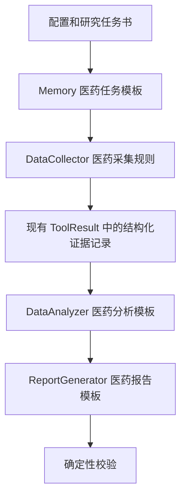

# 医药投研流程与 FinSight 全流程适配方案

## 0. 文档控制

| 项目 | 内容 |
| --- | --- |
| 文档目的 | 调研医药投研的实际工作流，并给出“不改变 FinSight 总体架构、先跑通 Pharsight”的实施方案 |
| 当前决策 | 优先跑通 `DataCollector -> DataAnalyzer -> ReportGenerator` 完整主流程；图检索改造后置 |
| 首个落地模式 | A/H 股上市医药公司研究；行业研究在同一主流程上复用 |
| 输出语言 | 中文 |
| 标准运行时 | Python 3.11 |
| FinSight 基线 | `8fc5bce28ac201c713219a47d30367c6a84342f4` |
| 文档状态 | 调研与实施基线；代码已落地，真实端到端和领域验收未完成 |
| 关联文档 | [V1 文档入口](./README.md)、[医药投研 RAG V1](./PHARMA_RAG_V1.md)、[总体架构](../ARCHITECTURE.md) |

本文所称“医药投研”是面向公开市场证券研究的行业与上市公司研究，不是临床诊疗，不提供医疗建议。文中的研究结论必须区分来源事实、确定性计算、显式假设和模型判断。

---

## 1. 执行摘要

Pharsight 当前最合理的第一步，不是先替换 FinSight 的 RAG 或编排架构，而是把其现有的通用金融报告流水线改写成一条受控、可审计的医药投研流水线：


在代码层面继续沿用 FinSight 的三段式主干：

```text
DataCollector（采集）
    -> Memory（任务与中间结果）
    -> DataAnalyzer（分析）
    -> ReportGenerator（成稿）
```

本轮改造的核心不是新增智能体，而是改写每一段的“输入契约、任务模板、工具集合、输出模板和验收规则”。具体结论如下：

1. **架构保持不变。** 保留现有 Agent、Memory、优先级调度、检查点和报告导出机制；不引入新的编排框架、图数据库或 `EvidenceBackend`。
2. **先支持一个窄场景。** 首次端到端运行应选择“一家公司、一个核心药物、一个适应症、一个主要市场、一个明确截止日”，不要直接做全行业全管线覆盖。
3. **先用受控资料包，再扩展在线工具。** 第一轮通过人工选定的一手文档和现有财务工具完成闭环，避免通用搜索的不确定性掩盖流程问题；随后再接 NMPA/CDE、ClinicalTrials.gov、PubMed、医保和交易所接口。
4. **医药研究的主键必须改变。** 不能只按公司名或药物名组织信息，最低粒度应为“药物/分子 + 适应症 + 地区 + 试验或申报事件 + 时间”。
5. **证据元数据先放入现有 `ToolResult.data`。** 第一版无需修改 `ToolResult` 类即可携带来源编号、发布者、日期、页码/章节、链接和证据类型；这属于数据内容升级，不是架构升级。
6. **提示词和报告模板是最大改造面。** 采集、分析、报告生成和 Memory 均需新增 `pharma_company`、`pharma_industry` 模式；只有少量代码需要处理模式路由、工具白名单、图表开关和硬编码的 `company`。
7. **引用必须设置发布闸门。** FinSight 当前基于语义相似度回填来源，只能作为过渡。首次可运行版本应统一使用稳定来源编号，并在导出前做确定性校验；未通过引用检查的报告不得标记为完成。

因此，建议把“跑通”的定义设为：在 Python 3.11 环境中，使用固定资料包和配置，从采集任务开始，经分析和报告生成，产出一份中文 Markdown 研究报告；报告中的重大事实均能回到具体来源，且明确显示截止时间、假设、风险和非医疗建议声明。

---

## 2. 调研方法与监管边界

### 2.1 调研方法

本方案以官方和一手来源定义流程边界，再结合公开市场投研的一般方法映射到 FinSight：

- 证券研究规范：研究报告的独立客观性、信息来源、底稿、质量控制和发布要求。
- 药品全生命周期：发现、临床前、临床试验、注册审评、上市后安全和适应症变更。
- 市场准入：医保目录、谈判/竞价、支付标准和集中带量采购。
- 上市公司披露：定期报告、临时公告、招股书和交易所披露。
- 医学证据：试验注册、结果披露、同行评审论文以及上市后不良事件。

### 2.2 对系统设计有直接影响的规范

中国证券业协会的研究报告执业规范要求研究机构建立覆盖信息收集、调研、报告制作、质量控制、合规审查和发布等环节的制度；研究依据应当真实、准确、完整，信息来源合法合规，并保留资料、调研纪要和分析模型等工作底稿。行业研究报告同样适用相关要求。[中国证券业协会：《发布证券研究报告执业规范（2025年修订）》](https://www.sac.net.cn/sjb/zlgl/zlgz/202512/t20251231_69839.html)

国家药品监督管理部门规定，药品注册覆盖临床试验申请、上市许可申请、再注册和补充申请，申报资料应真实、准确、完整、可追溯，审评关注安全性、有效性和质量可控性。[国家市场监督管理总局：《药品注册管理办法》](https://www.samr.gov.cn/zw/zfxxgk/fdzdgknr/fgs/art/2023/art_3275cb2a929d4c34ac8c0421b2a9c257.html)

ClinicalTrials.gov 的结构化研究记录把研究标识、申办方、疾病、设计、结局指标、入排标准、日期和结果模块分开；这意味着“注册过一项试验”不能自动被系统解释为“试验已完成”或“结果为阳性”。[ClinicalTrials.gov API：Study Data Structure](https://clinicaltrials.gov/data-api/about-api/study-data-structure)

国家医保目录管理涉及专家评审、药物经济学、独家药品谈判、非独家药品竞价以及支付标准；集中采购又引入报量、以量换价和采购周期。因此，“获批上市”“进入医保”“医院准入”“实际放量”必须作为不同事件处理。[国家医保局：《基本医疗保险用药管理暂行办法》](https://www.nhsa.gov.cn/art/2020/7/31/art_173_10977.html)、[国务院办公厅：国家组织药品集中采购和使用试点方案](https://www.nhsa.gov.cn/art/2019/1/17/art_147_905.html)

openFDA 明确提示，FAERS 不良事件报告不能单独证明药物导致了某个事件，也不应用于直接比较药物安全性。这类数据只能形成安全信号，不能作为因果结论。[openFDA Drug Adverse Event API](https://open.fda.gov/apis/drug/event/)

这些要求决定了 Pharsight 不能只做“搜索后总结”，而必须保留来源、时间、口径、证据类型和推理边界。

---

## 3. 医药投研的统一工作流

行业研究和公司研究虽然最终报告结构不同，但共用一条控制主线。

### 3.1 第一步：形成研究任务书

输入至少包含：

| 字段 | 说明 | 示例 |
| --- | --- | --- |
| `research_mode` | 公司研究或行业研究 | `pharma_company` |
| `as_of` | 信息截止时间，精确到时区 | `2026-09-20T18:00:00+08:00` |
| `target` | 公司、行业或主题 | 某 A 股创新药公司 |
| `security_ids` | 股票代码、交易所、公司全称 | `XXXXXX.SZ` |
| `jurisdictions` | 监管与商业化地区 | 中国内地、美国 |
| `focus_assets` | 核心药物、技术平台或产品 | 药物 A |
| `focus_indications` | 关注适应症 | 适应症 B |
| `questions` | 本次要回答的核心争议 | 临床价值是否支持收入预期 |
| `output_scope` | 报告深度、章节、是否估值 | 简版公司深度报告 |

任务书的价值在于冻结边界。没有截止时间、地区和适应症，系统很容易把不同时间、国家或适应症的状态合并成一个错误结论。

### 3.2 第二步：制定来源计划

来源优先级应固定为：

1. 监管机构、交易所和政府部门。
2. 上市公司法定披露和正式公告。
3. 临床试验注册与结果库、同行评审论文。
4. 官方统计数据和指南。
5. 获授权的可靠数据供应商。
6. 新闻和其他二手材料，仅用于发现线索或补充背景。

每份来源进入系统时登记：

```yaml
source_id: S001
source_type: exchange_filing
publisher: 上市公司或交易所
title: 文档标题
published_at: 2026-01-01
retrieved_at: 2026-09-20T10:00:00+08:00
reporting_period: 2025FY
url: https://example.invalid/document
local_path: null
page_or_section: 第 42 页 / 某章节
language: zh-CN
cutoff_eligible: true
reliability_tier: primary
notes: 单位、币种、是否经审计、许可限制
```

### 3.3 第三步：采集并建立工作底稿

采集不是把网页正文塞入上下文，而是形成可审计的工作底稿：

- 保存文档标识、版本、发布日期、访问时间和哈希。
- 保留原始单位、币种、报告期和口径。
- 对 PDF 记录页码，对网页记录章节或可复现定位。
- 对同一事件区分首次披露、后续更新和最终结果。
- 对冲突来源同时保留，默认优先一手来源，并记录冲突处理。
- 对晚于 `as_of` 的信息标记为不可用于当期结论，而不是静默混入。

### 3.4 第四步：标准化医药实体与事件

最低限度需要识别以下实体：

- 公司、证券和交易所。
- 药物通用名、研发代号、商品名及同义词。
- 靶点、作用机制、药物类型和技术平台。
- 适应症、疾病分期、生物标志物和治疗线次。
- 试验注册号、试验分期、设计、对照组和结局指标。
- 注册申请、受理、审评、批准、补充申请和撤回事件。
- 医保、集采、支付标准、采购周期和医院准入事件。
- 财务科目、产品收入、销量、价格、毛利率和研发费用。

药物研发阶段必须绑定到具体的“药物—适应症—地区—日期”。例如，同一药物可能在中国某适应症已获批，在美国仍处于 III 期，在另一适应症仅处于 I 期。

### 3.5 第五步：解释医学与临床证据

系统需要按固定顺序分析每项关键试验：

1. 研究问题和目标人群。
2. 试验分期、随机/盲法、对照设置和中心数量。
3. 样本量、入排标准、治疗线次和生物标志物。
4. 主要/次要终点及其测量时间。
5. 统计分析集、效应量、置信区间、显著性和敏感性分析。
6. 临床意义，而不只判断 `p < 0.05`。
7. 暴露时间、不良事件、停药和死亡等安全性信息。
8. 结果是否来自注册库、会议摘要、论文、公司新闻稿或监管文件。
9. 与标准治疗的可比性和局限；跨试验比较必须明确为间接比较。

ICH E9(R1) 强调研究问题、试验设计、实施、分析和解释之间应保持一致，并使用估计目标及敏感性分析处理治疗后事件。[ICH E9(R1) 指南](https://database.ich.org/sites/default/files/E9-R1_Step4_Guideline_2019_1203.pdf)

### 3.6 第六步：监管、支付与商业化分析

医药产品的商业价值不能从临床结果直接跳到收入预测，中间至少有四层：

```text
临床证据
  -> 注册可行性与标签范围
  -> 支付与准入
  -> 医生/医院采用和患者可及性
  -> 价格、销量、收入与利润
```

需要分别回答：

- 是否已提交申请、已受理、进入优先审评或已批准？
- 批准适应症、患者范围、治疗线次和标签限制是什么？
- 是否纳入医保、支付标准和协议期限如何？
- 是否进入集采，报量、价格降幅和采购周期如何？
- 商业化由谁负责，生产能力和供应风险如何？
- 医院准入、医生教育、渠道库存和患者支付能力是否支持放量？

### 3.7 第七步：财务建模与估值

财务预测应把业务驱动因素显式化。单品收入可以从患者漏斗或处方驱动拆解：

```text
可治疗患者数
× 诊断率
× 符合标签比例
× 可及率
× 渗透率
× 年治疗费用
× 治疗持续时间/依从性调整
= 产品收入
```

每个变量必须标记为来源事实、计算或假设，并进行情景分析。成本端还要考虑生产成本、销售投入、里程碑付款、销售分成、研发费用、资本开支、税率和营运资本。

估值方法按公司类型选择：

| 公司类型 | 主要方法 | 关键注意点 |
| --- | --- | --- |
| 成熟制药/器械/流通公司 | `PE`、`EV/EBITDA`、DCF、分部估值 | 集采、产品周期、渠道和现金流质量 |
| 高成长商业化生物科技 | DCF、`EV/Sales`、分部估值 | 销售爬坡、适应症扩展和费用率 |
| 临床阶段创新药公司 | 风险调整净现值（rNPV）、管线资产加总、现金价值 | 成功概率、时间轴、峰值销售、专利期、现金消耗和稀释 |

不得把行业惯例成功率伪装成公司事实；成功率、上市时间、价格和份额均应作为显式假设并给出敏感性。

### 3.8 第八步：形成论点、催化剂、风险和证伪条件

研究结论至少包含：

- 市场共识可能忽略或错误定价了什么。
- 哪些来源事实支持核心判断。
- 哪些环节依赖假设，最敏感的变量是什么。
- 未来 3—18 个月有哪些带日期或时间窗的催化剂。
- 什么事件会证伪核心论点，例如试验未达终点、审评延期、价格低于预期、竞争格局突变或融资压力上升。
- 研究结论与估值之间的传导路径。

### 3.9 第九步：报告、复核与发布

发布前至少经过三类检查：

1. **事实检查**：名称、代码、阶段、试验状态、日期、单位和数字是否与来源一致。
2. **证据检查**：每个重大事实是否有有效来源编号；引用是否指向支持该主张的具体页/段。
3. **判断检查**：计算可复算；假设和模型判断已显式标注；风险与反例未被省略。

通过检查后才进入最终报告。所有资料、提取结果、计算表、提示词版本和报告版本共同构成可复现工作底稿。

---

## 4. 上市医药公司研究流程

### 4.1 公司模式的标准步骤

| 步骤 | 核心问题 | 主要输入 | 阶段输出 |
| --- | --- | --- | --- |
| 1. 身份与边界 | 研究的是哪个法律实体和证券？ | 交易所披露、公司官网 | 公司/证券主数据、截止时间 |
| 2. 财务基线 | 收入、利润、现金和研发投入如何？ | 年报、中报、财务数据 | 历史财务表与异常项 |
| 3. 业务拆分 | 收入和利润来自哪些产品/地区？ | 定期报告、产品披露 | 分部与产品矩阵 |
| 4. 管线盘点 | 每个资产处于什么阶段？ | 公司管线、CDE、试验注册 | 药物—适应症—地区矩阵 |
| 5. 临床评价 | 关键试验能否支持标签和采用？ | 注册信息、论文、监管文件 | 试验证据卡与局限 |
| 6. 监管评价 | 申报、受理、审评和批准状态？ | NMPA/CDE、FDA 等 | 监管事件时间线 |
| 7. 竞争格局 | 标准治疗和同类管线是什么？ | 指南、试验、批准标签 | 竞品与差异化矩阵 |
| 8. 市场准入 | 医保、集采、价格和医院准入如何？ | 国家医保局、公司披露 | 支付与价格桥梁 |
| 9. 商业预测 | 患者、份额、价格如何转为收入？ | 疾病数据、市场数据 | 患者漏斗和收入模型 |
| 10. 财务预测 | 产品预测如何进入三张表？ | 历史财务、经营假设 | 利润、现金流和融资需求 |
| 11. 估值 | 当前价格隐含何种预期？ | 预测模型、可比公司 | 基准/乐观/悲观估值 |
| 12. 结论 | 论点、催化剂和证伪条件是什么？ | 全部分析 | 投资研究结论与风险 |

### 4.2 公司模式的关键输出表

首版报告应至少生成以下结构化表格：

1. 公司与证券基本信息表。
2. 近 3—5 年财务摘要表。
3. 商业化产品收入与生命周期表。
4. 核心管线表，包含药物、适应症、地区、阶段、试验号、下一里程碑和来源。
5. 关键临床试验卡片。
6. 监管和商业化时间线。
7. 竞争产品/管线矩阵。
8. 患者漏斗和收入预测假设表。
9. 估值敏感性表。
10. 催化剂、风险和证伪条件表。

### 4.3 首次运行建议场景

首次不要直接覆盖公司全部产品，建议使用：

```text
研究对象：一家 A 股或 H 股医药上市公司
核心资产：一个已进入 II/III 期或已上市的药物
适应症：一个明确适应症
地区：中国内地；必要时补充一个海外地区
历史期：最近 3 个完整财年 + 最新报告期
预测期：3 年
来源规模：5—10 份一手文档
输出：无图表的中文简版公司深度报告
```

这样既能覆盖临床、监管、支付、财务和估值，又能控制首次排错范围。

---

## 5. 医药行业研究流程

行业研究不是把多家公司报告拼在一起，而是从疾病和治疗路径出发：

| 步骤 | 核心内容 | 主要输出 |
| --- | --- | --- |
| 1. 行业边界 | 疾病、治疗环节、技术路线、地区、时间 | 范围说明与排除项 |
| 2. 疾病与诊疗路径 | 患病、诊断、分层、治疗线次和未满足需求 | 患者路径图 |
| 3. 标准治疗 | 当前指南和治疗选择 | 标准治疗矩阵 |
| 4. 技术与靶点 | 作用机制、平台和技术成熟度 | 技术路线图 |
| 5. 已上市产品 | 标签、疗效、安全性、价格和份额 | 产品竞争矩阵 |
| 6. 在研管线 | 资产、公司、试验、阶段和里程碑 | 管线景观与时间线 |
| 7. 政策与支付 | 审评、医保、集采和合规变化 | 政策影响表 |
| 8. 市场测算 | 患者漏斗、价格和渗透率 | 自下而上的市场规模 |
| 9. 产业链与经济性 | 上游、生产、渠道、医院和支付方 | 价值链利润分配 |
| 10. 上市公司映射 | 收入暴露、竞争力和估值 | A/H 公司比较表 |
| 11. 催化剂与风险 | 数据读出、批准、支付和竞争事件 | 行业事件日历 |
| 12. 行业结论 | 景气、结构机会和证伪条件 | 行业研究结论 |

行业市场规模不能只引用一个二手 `TAM` 数字。至少应同时给出：

- 自上而下的权威统计或官方口径。
- 自下而上的患者漏斗、用药率、价格和疗程计算。
- 两种口径差异及原因。
- 基准、乐观和悲观情景。

---

## 6. FinSight 当前流程与医药投研的差距

### 6.1 当前可复用主干

根据 Pharsight 中保留的上游实现，`run_report.py` 已具备：

1. 加载 YAML 配置和自定义任务。
2. 使用 Memory 自动补充采集与分析任务。
3. 按优先级运行 `DataCollector`、`DataAnalyzer` 和 `ReportGenerator`。
4. 在同一优先级内并行执行任务。
5. 保存检查点和中间结果。
6. 通过 ReportGenerator 形成 Markdown，并继续转换为 DOCX/PDF。

这些能力足以支撑第一版医药投研，不需要替换编排架构。

### 6.2 关键差距矩阵

| 环节 | FinSight 当前特点 | 医药投研要求 | 风险等级 |
| --- | --- | --- | --- |
| 研究输入 | 主要是名称、代码、公司/行业类型 | 还需截止日、地区、药物、适应症、研究问题 | 高 |
| 任务生成 | 通用金融问题，允许 LLM 自由扩展 | 固定研究清单、依赖关系和缺失项检查 | 高 |
| 工具选择 | 默认可向 Agent 暴露较多通用工具 | 按模式使用白名单，优先一手来源 | 高 |
| 医药来源 | 缺少监管、试验、文献、医保连接器 | 至少支持受控资料包，后续接官方接口 | 高 |
| 数据结构 | `ToolResult` 较通用，来源粒度粗 | 需要来源编号、日期、页码、证据类型和口径 | 高 |
| 实体粒度 | 公司/行业为主 | 药物—适应症—地区—试验/事件—时间 | 高 |
| 分析提示词 | 通用财务和证券分析 | 临床、监管、支付、管线、rNPV 等专用方法 | 高 |
| Memory 路由 | 非 `financial` 类型可能退回 `general` | `pharma_company` / `pharma_industry` 必须精确路由 | 高 |
| 行业任务提示词 | 文件和键名与通用调用存在不一致风险 | 两个模式均使用统一的必需键 | 中 |
| 分析上下文 | 倾向把全部采集结果放入提示词 | 需要按章节选择来源并控制上下文 | 中 |
| 报告模板 | 通用公司/行业研报 | 需要产品、管线、临床、支付和证伪章节 | 高 |
| 报告类型传递 | 运行入口存在硬编码 `company` 的倾向 | 必须从配置贯穿研究模式 | 高 |
| 引用 | 通过语义相似度寻找来源并回填 | 重大事实必须确定性映射到来源编号 | 极高 |
| 图表/代码 | 默认可能启用 | 首次运行关闭，稳定后再开 | 中 |
| 质量控制 | 主要依赖生成流程 | 需要事实、引用、截止日和合规闸门 | 极高 |

### 6.3 不宜直接照搬的能力

- 通用网页搜索可以发现线索，但不应替代监管、交易所、试验注册和论文原文。
- 自动生成大量任务看似全面，却可能在首次运行中造成工具漂移、上下文膨胀和不可复现。
- 模糊引用回填适合一般摘要，不适合把试验终点、批准状态和财务数字绑定到证据。
- 通用“行业趋势”提示词无法处理适应症、治疗线次、试验设计和支付路径。
- 仅凭公司披露不能确认全部临床与监管状态，必须交叉核对官方来源。

---

## 7. 不改变架构的适配设计

### 7.1 保持不变的部分

本轮明确不做以下改动：

- 不替换 `DataCollector`、`DataAnalyzer`、`ReportGenerator` 和 Memory。
- 不改变现有优先级调度与检查点机制。
- 不引入 LangGraph、Neo4j、向量数据库或新的智能体编排器。
- 不建立新的 RAG 抽象层作为运行前置条件。
- 不要求第一版完成全自动数据抓取、完整图谱或复杂图表。
- 不改变上游许可证、历史和总体目录结构。

### 7.2 需要改变的内容



改造集中在五类内容：

1. **配置**：新增医药研究字段与两种模式。
2. **提示词**：为四个阶段分别提供公司和行业模板。
3. **工具**：第一版增加“受控资料包读取”能力，后续按优先级增加官方数据工具。
4. **模板**：新增医药公司和行业报告大纲。
5. **校验**：在导出前增加来源编号、截止日和声明检查。

### 7.3 模式命名与路由

建议固定使用：

```yaml
target_type: pharma_company   # 或 pharma_industry
```

所有 PromptLoader 均按同一个 `target_type` 找到对应文件：

```text
src/memory/prompts/pharma_company_prompts.yaml
src/memory/prompts/pharma_industry_prompts.yaml
src/agents/data_collector/prompts/pharma_company_prompts.yaml
src/agents/data_collector/prompts/pharma_industry_prompts.yaml
src/agents/data_analyzer/prompts/pharma_company_prompts.yaml
src/agents/data_analyzer/prompts/pharma_industry_prompts.yaml
src/agents/report_generator/prompts/pharma_company_prompts.yaml
src/agents/report_generator/prompts/pharma_industry_prompts.yaml
```

每个文件必须包含对应类会读取的全部键，不能只增加部分模板后依赖静默回退。Memory 对新模式应直接路由，不得把它们映射到 `general`。

### 7.4 建议的配置契约

```yaml
project:
  target_type: pharma_company
  target_name: 示例公司
  ticker: XXXXXX.SZ
  as_of: "2026-09-20T18:00:00+08:00"
  jurisdictions: [CN]
  focus_assets: [示例药物]
  focus_indications: [示例适应症]
  research_questions:
    - 核心临床证据能否支持当前商业预期？
    - 当前估值隐含了怎样的上市时间和峰值销售？
  source_manifest: data/manifests/example_company_v1.yaml
  output_language: zh-CN

workflow:
  auto_generate_tasks: false
  enable_chart: false
  enable_code_execution: false
  live_web_search: false
  strict_cutoff: true
  require_citation_validation: true
```

首次运行关闭自动扩展任务和实时搜索，是为了验证流程，不是长期能力限制。第二次迭代再逐项打开。

### 7.5 采集阶段改造

DataCollector 的提示词应改为“执行给定的证据采集任务”，而不是自由进行通用研究。采集结果至少包含：

```yaml
source_id: S003
claim_scope: 核心试验的主要终点
evidence_type: trial_registry
publisher: ClinicalTrials.gov
published_at: 2025-12-01
updated_at: 2026-08-12
retrieved_at: 2026-09-20T10:30:00+08:00
url: https://clinicaltrials.gov/study/NCT00000000
locator: Protocol Section / Outcome Measures
entity_keys:
  drug: 示例药物
  indication: 示例适应症
  jurisdiction: US
  trial_id: NCT00000000
content: 结构化字段或节选
limitations:
  - 该页面为注册记录，不等于同行评审结果
```

为了保持兼容性，这个字典可先放进现有 `ToolResult.data`，`ToolResult.name` 可使用稳定来源编号加简短标题，例如 `S003 ClinicalTrials.gov NCT00000000`。

工具策略分两层：

- **P0 跑通层**：固定资料清单读取/抓取工具 + 现有财务工具；只处理预先批准的 URL 或本地文档。
- **P1 扩展层**：CDE/NMPA、ClinicalTrials.gov、NCBI、国家医保局、交易所披露等结构化工具，继续实现现有 `Tool`/`ToolResult` 接口。

### 7.6 Memory 与任务生成改造

Memory 中的自动任务应替换为医药研究清单。公司模式至少有：

```text
C01 公司与证券身份
C02 历史财务和分部收入
C03 商业化产品
C04 核心研发管线
C05 关键临床试验
C06 注册与批准事件
C07 医保、集采和价格
C08 竞争产品与标准治疗
C09 患者漏斗和市场规模
C10 收入预测和估值
C11 催化剂、风险和证伪条件
```

行业模式至少有：疾病与治疗路径、标准治疗、技术路线、已上市产品、在研管线、政策支付、市场规模、产业链、公司映射和催化剂风险。

第一轮建议把这些任务写入配置，`auto_generate_tasks: false`。流程稳定后，LLM 只能在固定任务之后补充“缺失项任务”，且每个新增任务必须说明依赖、目标来源和必要性。

### 7.7 分析阶段改造

DataAnalyzer 的每个输出使用统一结构：

```markdown
## 分析结论

### 来源事实
- …… [Source:S003]

### 确定性计算
- 公式、输入和结果…… [Source:S010] [Source:S011]

### 显式假设
- ……

### 模型判断
- ……

### 冲突与缺失数据
- ……

### 对投资论点的影响
- ……
```

提示词必须包含以下禁止项：

- 不把试验注册状态写成结果。
- 不把公司新闻稿写成监管确认。
- 不把申请、受理、审评、批准混为一谈。
- 不进行未经限定的跨试验优劣比较。
- 不从不良事件自发报告推导因果关系。
- 不补造缺失的患者数、价格、成功率、市场份额或财务数字。
- 不在截止时间之后引入信息。

### 7.8 报告生成阶段改造

公司报告建议大纲：

1. 报告范围、截止时间与结论摘要。
2. 公司与证券概览。
3. 历史财务和业务质量。
4. 商业化产品与生命周期。
5. 研发管线和关键临床证据。
6. 监管、医保与集采。
7. 竞争格局和差异化。
8. 患者漏斗、商业预测和财务预测。
9. 估值与敏感性。
10. 催化剂、风险和证伪条件。
11. 来源、方法和免责声明。

行业报告大纲：

1. 范围、口径和核心判断。
2. 疾病负担、患者路径和未满足需求。
3. 标准治疗和技术路线。
4. 已上市产品和在研管线。
5. 监管、医保、集采与政策环境。
6. 市场规模和增长驱动。
7. 产业链与竞争格局。
8. A/H 上市公司映射和估值比较。
9. 催化剂、风险和证伪条件。
10. 来源、方法和免责声明。

第一轮应生成 Markdown 作为主验收产物。DOCX/PDF 转换属于环境兼容性验收，不应阻塞对内容主流程的判断。

### 7.9 引用与发布校验

建议沿用 ReportGenerator 的来源占位形式，但把名称固定为 `[Source:S001]`，避免依赖长标题的语义匹配。导出前执行确定性检查：

- 所有 `[Source:Sxxx]` 均存在于来源清单。
- 无孤立的来源条目或无法定位的重大事实。
- 管线阶段、试验结果、批准状态、价格和财务数字必须有引用。
- 每个来源的发布日期不晚于 `as_of`；若晚于截止日则必须明确作为回溯备注并排除出当期结论。
- 报告包含“投资研究辅助、非医疗建议”声明。
- 报告不得出现系统无法从底稿重建的链接或数字。

当前的模糊来源匹配可以保留作兼容兜底，但不得作为发布通过的依据。

---

## 8. 文件级修改清单

以下是后续实施时的建议变更范围。本文件只定义方案，不实施这些代码修改。

| 文件或目录 | 建议修改 | 类型 | 是否改变架构 |
| --- | --- | --- | --- |
| `my_config.yaml` / 新示例配置 | 增加模式、截止时间、地区、药物、适应症、资料清单和开关 | 配置 | 否 |
| `run_report.py` | 把医药字段传入 `research_query`；传递真实 `target_type` 和图表开关；消除 `company` 硬编码 | 小型兼容修改 | 否 |
| `src/memory/variable_memory.py` | 精确路由两个医药模式；统一提示词键；支持确定性任务清单 | 小型兼容修改 | 否 |
| `src/memory/prompts/` | 新增两套任务生成、选择和总结提示词 | 内容 | 否 |
| `src/agents/data_collector/data_collector.py` | 按模式加载提示词和工具白名单 | 小型兼容修改 | 否 |
| `src/agents/data_collector/prompts/` | 新增公司/行业采集规则 | 内容 | 否 |
| `src/agents/data_analyzer/prompts/` | 新增临床、监管、支付、商业和估值分析模板 | 内容 | 否 |
| `src/agents/report_generator/prompts/` | 新增两套完整报告提示词 | 内容 | 否 |
| 报告大纲目录 | 新增中文医药公司和行业大纲 | 内容 | 否 |
| `src/tools/pharma/` | 增加资料包工具及后续官方数据工具，遵循既有 Tool 接口 | 扩展组件 | 否 |
| `src/utils/report_validation.py` | 新增来源编号、截止时间和声明校验 | 质量闸门 | 否 |
| `tests/` | 增加模式路由、提示词键、来源解析、截止日和端到端测试 | 测试 | 否 |

### 8.1 最小代码改动与内容改动的边界

绝大多数改造应发生在 YAML、提示词、大纲和任务配置中。代码只处理四个无法通过配置解决的问题：

1. 新模式被错误回退到通用提示词。
2. 运行入口没有把医药字段和真实模式贯穿下去。
3. DataCollector 暴露了不受控的工具集合。
4. 报告导出前缺少确定性校验。

如果实现开始要求替换 Memory、重写 Agent 生命周期或建立新检索后端，应暂停并单独进行架构评审；这些不属于“先跑通”的范围。

---

## 9. 分阶段实施计划

### 阶段 0：固定示例与验收基线

目标：选定一个可控案例，冻结输入与预期。

- 选择一家 A/H 医药公司、一个核心资产和一个适应症。
- 确定截止时间和研究问题。
- 准备 5—10 份一手资料及来源清单。
- 固定历史财务报告期和预测期。
- 记录人工判断的关键事实，作为回归基准。

完成标准：资料均可合法访问，来源编号稳定，人工能够回答核心问题。

### 阶段 1：打通模式与提示词

目标：两个医药模式能被全流程正确识别，先完成公司模式。

- 增加配置字段和模式路由。
- 编写固定采集、分析和报告任务。
- 补齐四个阶段所需的全部提示词键。
- 新增公司报告大纲。
- 关闭自动任务、实时搜索、图表和代码执行。

完成标准：干运行不再回退到 `general` 或 `financial`，所有任务能被实例化。

### 阶段 2：接入受控证据包

目标：在不依赖开放式搜索的情况下完成证据采集。

- 增加资料清单读取工具。
- 把文档信息标准化到 `ToolResult.data`。
- 实现截止时间过滤和来源编号。
- 复用现有财务工具，必要时用法定披露校验。

完成标准：每条采集结果都有来源、日期和定位；截止日后的资料不会进入分析。

### 阶段 3：跑通完整主流程

目标：完成一次 Collector—Analyzer—ReportGenerator 运行。

- 执行固定任务清单。
- 检查 Memory 中间结果和上下文规模。
- 生成无图表中文 Markdown 报告。
- 保存配置、提示词版本、来源清单和检查点。

完成标准：完整运行无异常，关键中间产物可重放，报告章节齐全。

### 阶段 4：加入发布质量闸门

目标：让“生成成功”升级为“可审计地生成成功”。

- 校验来源编号和定位。
- 校验数字、单位、日期和管线阶段。
- 校验事实/计算/假设/判断标签。
- 校验风险、证伪条件和免责声明。
- 人工复核临床、监管、财务和估值结论。

完成标准：机器检查全通过，人工抽查无重大错误。

### 阶段 5：扩展在线数据和行业模式

目标：在已稳定主流程上增加自动化，而不是边接工具边重写流程。

建议顺序：

1. 交易所和公司法定披露。
2. CDE/NMPA 注册与临床试验。
3. ClinicalTrials.gov。
4. PubMed/NCBI。
5. 国家医保局和集采。
6. openFDA 等海外补充数据。
7. 行业模式和多公司比较。

每接入一个工具，必须增加超时、错误信息、速率限制、来源元数据和模拟测试。

### 阶段 6：恢复自动化能力

主流程稳定后，依次评估：

- 自动补充任务。
- 受控实时搜索。
- 章节级检索和上下文压缩。
- 图表与代码执行。
- DOCX/PDF 稳定导出。
- 既有 RAG V1 文档中的 Claim–Evidence 图与混合检索。

---

## 10. 验收标准

### 10.1 功能验收

- `pharma_company` 配置能完成 `DataCollector -> DataAnalyzer -> ReportGenerator` 全流程。
- 运行不依赖手工修改中间文件。
- 所有任务使用医药提示词，未静默回退到通用模板。
- 报告至少包含临床、监管/支付、商业预测、财务/估值、催化剂和风险。
- Markdown 必须生成；DOCX/PDF 作为环境相关的次级验收。

### 10.2 证据验收

- 重大事实引用覆盖率为 100%。
- 所有来源编号能解析到来源登记表。
- 临床结论可定位到试验注册、论文或监管文件的具体章节/页码。
- 财务数字包含报告期、单位和币种。
- 预测变量能区分来源事实、计算和假设。
- 截止日后的信息不进入当期结论。

### 10.3 医药语义验收

- 管线阶段绑定药物、适应症、地区和日期。
- 申请、受理、审评、批准和上市状态没有混淆。
- 试验注册信息没有被表述为阳性结果。
- 统计显著性与临床意义没有混为一谈。
- 跨试验比较注明局限。
- FAERS 等自发报告没有被当作因果证据。

### 10.4 投研验收

- 收入预测能回到患者、渗透率、价格和疗程等驱动因素。
- 估值方法与公司阶段相匹配。
- 报告包含基准、乐观和悲观情景或等价敏感性。
- 催化剂带时间窗，风险带传导路径，核心论点有证伪条件。
- 结论不提供个体医疗建议，也不承诺投资收益。

### 10.5 工程验收

- Python 3.11 环境可复现。
- 网络调用默认在测试中被模拟。
- 目标单元测试和回归测试通过，`ruff check` 通过。
- 配置快照不包含密钥。
- 运行输出、缓存、原始受限数据和报告未被提交。
- `FinSight` 上游目录仍为固定提交且工作树干净。

---

## 11. 主要风险与应对

| 风险 | 表现 | 应对 |
| --- | --- | --- |
| 首次范围过大 | 任务数量、来源和提示词同时失控 | 固定单公司、单资产、单适应症 |
| 来源质量不足 | 搜索摘要替代一手证据 | 受控资料包，一手来源白名单 |
| 时间穿越 | 使用截止日后的更新 | 强制 `as_of` 与发布日期校验 |
| 实体合并错误 | 不同适应症或地区阶段被合并 | 使用组合主键和同义词表 |
| 临床误读 | 把注册、摘要或替代终点过度解释 | 固定证据卡和人工复核 |
| 模糊引用错配 | 报告引用到相似但不支持的来源 | 稳定来源编号和确定性检查 |
| 预测不可解释 | LLM 直接给出市场规模或峰值销售 | 患者漏斗、公式、假设表和敏感性 |
| 上下文膨胀 | 全部采集结果进入每个分析任务 | 按章节/任务选择来源，限制上下文 |
| 工具不稳定 | 实时网站结构、限流或网络变化 | P0 资料包、缓存、超时和模拟测试 |
| 过早改架构 | 主流程问题与新 RAG 问题叠加 | 图检索和新后端后置到稳定基线之后 |

---

## 12. 当前决策与后续图改造的关系

[医药投研 RAG V1 研究与实施方案](./PHARMA_RAG_V1.md) 中的证据 ID、Claim–Evidence 图和混合检索仍有长期价值，但不再是本阶段跑通 Pharsight 的前置条件。

为避免未来返工，本轮只保留三个兼容点：

1. 来源使用稳定 `source_id`。
2. 医药实体使用药物、适应症、地区、试验/事件和时间等明确字段。
3. 分析结果分离事实、计算、假设和判断。

未来引入图检索时，可以把现有来源记录和分析主张投影为节点与边，而无需改变报告业务流程。也就是说，当前先验证“研究流程正确”，未来再提升“检索和证据组织效率”。

---

## 13. 官方来源清单

### 13.1 证券研究与披露

- [中国证券业协会：发布证券研究报告执业规范（2025年修订）](https://www.sac.net.cn/sjb/zlgl/zlgz/202512/t20251231_69839.html)
- [中国证监会：发布证券研究报告暂行规定](https://www.csrc.gov.cn/csrc/c101838/c1022037/content.shtml)
- [上海证券交易所：信息披露相关规则](https://www.sse.com.cn/lawandrules/regulations/csrcorder/c/10116625/files/f3d7c690cbdf4822a9b326698d92063d.pdf)
- [HKEXnews 披露易](https://www.hkexnews.hk/homelcicontentsearch.html)

### 13.2 中国药品监管、临床和支付

- [国家药监局政务服务门户](https://www.nmpa.gov.cn/zwfwqjd/index.html)
- [国家市场监督管理总局：药品注册管理办法](https://www.samr.gov.cn/zw/zfxxgk/fdzdgknr/fgs/art/2023/art_3275cb2a929d4c34ac8c0421b2a9c257.html)
- [国家药品监督管理局药品审评中心：药物临床试验登记与信息公示平台](https://www.chinadrugtrials.org.cn/)
- [国家医保局：基本医疗保险用药管理暂行办法](https://www.nhsa.gov.cn/art/2020/7/31/art_173_10977.html)
- [国家医保局：国家组织药品集中采购和使用试点方案](https://www.nhsa.gov.cn/art/2019/1/17/art_147_905.html)

### 13.3 国际临床、文献和安全数据

- [ClinicalTrials.gov Data API](https://clinicaltrials.gov/data-api)
- [ClinicalTrials.gov Study Data Structure](https://clinicaltrials.gov/data-api/about-api/study-data-structure)
- [WHO Trial Registration Data Set](https://www.who.int/tools/clinical-trials-registry-platform/network/who-data-set)
- [NCBI APIs](https://www.ncbi.nlm.nih.gov/home/develop/api/)
- [NCBI E-utilities](https://www.ncbi.nlm.nih.gov/books/NBK25499/)
- [openFDA Drug APIs](https://open.fda.gov/apis/drug/)
- [openFDA Drug Adverse Event API](https://open.fda.gov/apis/drug/event/)
- [FDA Drug Development Process](https://www.fda.gov/patients/learn-about-drug-and-device-approvals/drug-development-process)
- [FDA Clinical Research](https://www.fda.gov/patients/drug-development-process/step-3-clinical-research)
- [ICH E9(R1) Statistical Principles for Clinical Trials](https://database.ich.org/sites/default/files/E9-R1_Step4_Guideline_2019_1203.pdf)

---

## 14. 本阶段明确不宣称的能力

本文仅完成调研和实施设计，不代表 Pharsight 已经具备：

- 自动、完整地获取全部医药监管和临床数据；
- 医学或统计学专业审评能力；
- 可发布级的证券研究质量；
- 准确的药物成功率、市场规模、收入预测或估值；
- 图谱检索、混合 RAG 或自动引用完全可靠；
- 任何诊断、治疗或个体投资建议能力。

这些能力只有在代码实现、测试、人工复核和项目验收完成后，才能更新为已实现状态。
